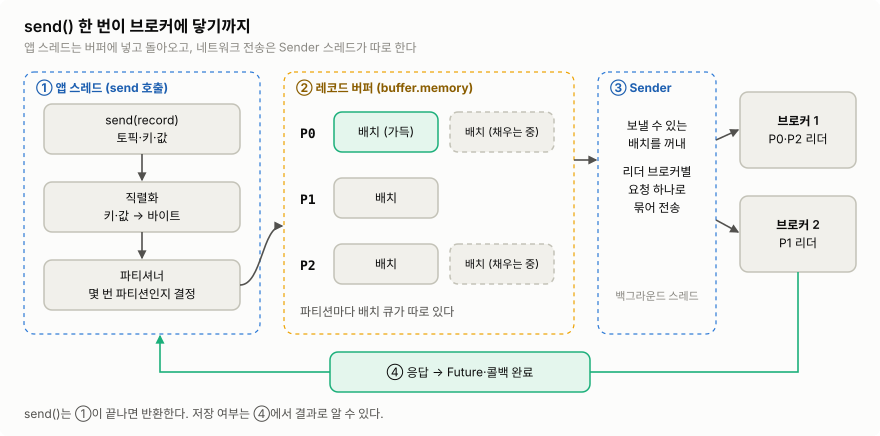
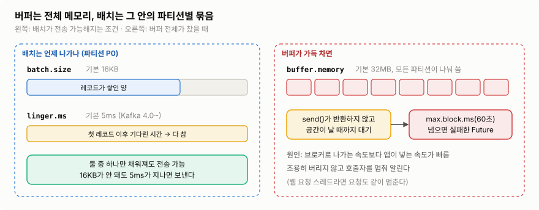
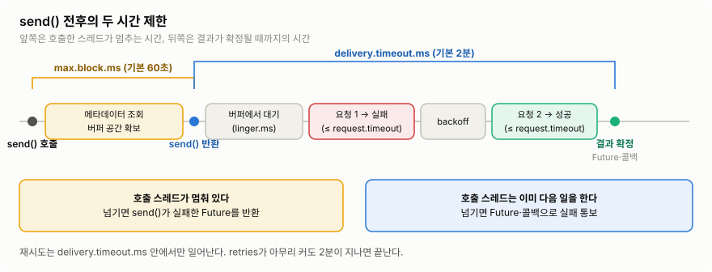
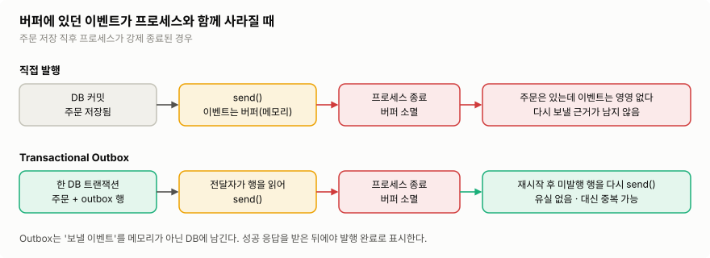

프로듀서는 ==**레코드를 Kafka 토픽에 발행하는 클라이언트**==다. 코드에서는 `send()` 한 줄이지만, 그 뒤에서 버퍼링·배치·재시도·중복 제거가 일어난다. 이 글은 한 가지 질문을 따라간다.

> **`send()`를 호출한 이벤트는 언제, 어떤 경로로, 어떤 보장을 받으며 브로커에 저장되는가?**

## 1. 프로듀서는 어디서 쓰나

Kafka 공식 Java 클라이언트 라이브러리 `kafka-clients`의 `KafkaProducer`가 실제 프로듀서다. Spring에서는 보통 직접 만들지 않는다.

- `spring-kafka`의 `KafkaTemplate`이 `KafkaProducer`를 감싼다. `kafkaTemplate.send(...)`도 결국 `KafkaProducer.send()`를 부른다.
- Spring Boot에 `spring-kafka`를 의존성으로 넣으면 `KafkaTemplate` 빈이 자동 구성된다. 설정은 `application.yml`의 `spring.kafka.*`로 넘긴다.
- 프로듀서가 가장 먼저 알아야 할 설정은 **`bootstrap.servers`**(Boot에서는 `spring.kafka.bootstrap-servers`)다. 프로듀서는 처음에 어느 브로커가 어느 파티션의 리더인지 모른다. 그래서 여기 적힌 주소로 먼저 접속해 ==**토픽·파티션·리더 정보(메타데이터)를 받아오고, 이후에는 각 파티션의 리더 브로커로 직접 보낸다**==. 주소를 여러 개 적어 두면 그중 하나가 죽어도 접속할 수 있다.

```yaml
spring:
  kafka:
    bootstrap-servers: broker1:9092,broker2:9092,broker3:9092
    producer:
      key-serializer: org.apache.kafka.common.serialization.StringSerializer
      value-serializer: org.apache.kafka.common.serialization.StringSerializer
```

```kotlin
@Service
class OrderEventPublisher(
	private val kafkaTemplate: KafkaTemplate<String, String>
) {
    fun publish(orderId: Long, payload: String) {
        kafkaTemplate.send("orders.events", orderId.toString(), payload) // 토픽, 키, 값
    }
}
```

이 코드는 동작하지만 ==**발행 결과를 전혀 확인하지 않는다**==. 왜 문제인지가 이 글의 나머지 내용이다.

## 2. `send()` 안에서 일어나는 일



>**스레드가 두 개**다. 앱 스레드는 ①까지만 하고 돌아온다. 
>네트워크 전송(③)은 백그라운드 Sender 스레드가 한다.  ([KafkaProducer API](https://kafka.apache.org/43/javadoc/org/apache/kafka/clients/producer/KafkaProducer.html) 기준)

1. **직렬화**: 키·값 객체를 바이트로 바꾼다. 컨슈머가 같은 형식으로 해석해야 하므로 JSON·Avro 등 형식과 변경 규칙을 정해 둔다.
2. **파티션 결정**: 파티셔너가 레코드가 갈 파티션을 정한다. 아래 2.1절.
3. **버퍼에 적재**: 레코드를 메모리 버퍼 안의 **해당 파티션 배치**에 넣는다. ==**`send()`는 여기서 반환한다.**== 아직 네트워크로는 아무것도 나가지 않았을 수 있다.
4. **전송**: `KafkaProducer`가 만들 때 함께 띄운 ==**Sender 스레드**==가 보낼 준비가 된 배치를 꺼낸다. ==**같은 리더 브로커로 갈 배치들을 요청 하나로 묶어 보낸다**==.
5. **응답**: 브로커 응답이 오면 Sender 스레드가 `send()`가 돌려준 Future를 완료하고 **콜백을 실행**한다.

왜 이렇게 나눴을까? 레코드를 하나씩 바로 보내면 **레코드마다 네트워크 왕복**이 생긴다. 모아서 보내면 ==**요청 수가 줄고 압축 효율도 오른다**==. 대신 `send()`가 반환된 시점에는 ==**결과를 아직 모른다**==. 결과 확인은 3절에서 다룬다.

### 2.1 키가 파티션을 정한다

- ==**같은 키는 같은 파티션**==으로 간다. 기본 파티셔너가 키를 해시하기 때문이다. 같은 파티션 안에서만 순서가 보장되므로, ==**순서가 중요하면 같은 키**==를 써야 한다.
- **키가 없으면** 기본 파티셔너가 한 파티션에 배치 하나 분량(`batch.size`)을 채운 뒤 다른 파티션으로 넘어간다(sticky). 관련 이벤트를 묶어야 한다면 키를 생략하지 않는다.
- 키가 있어도 **파티션 수가 바뀌면 배정이 달라진다**. 증설 절차는 [[03 토픽·파티션 상세 개념]].
- 이벤트가 한 키에 몰리면 ==**핫 파티션**==이 된다. 키는 순서가 필요한 업무 단위와 트래픽 분포를 함께 보고 고른다.

### 2.2 버퍼와 배치는 다르다

- **버퍼**: 전송을 기다리는 레코드를 담는 ==**프로듀서의 전체 메모리 공간**==. 크기는 `buffer.memory`(기본 32MB).
- **배치**: 버퍼 안에서 **같은 파티션으로 갈 레코드를 묶은 단위**. 파티션마다 배치 큐가 따로 있고, 배치 하나의 최대 크기는 `batch.size`(기본 16KB).
- 즉 ==**버퍼는 그릇, 배치는 그릇 안의 파티션별 묶음**==이다. 전송·압축·재시도·중복 제거는 모두 ==**배치 단위**==로 일어난다.


>같은 파티션으로 갈 레코드끼리 모여 하나의 배치가 된다.
>이미지 출처: [Confluent — Kafka 브로커 동작: Record Batching](https://developer.confluent.io/courses/architecture/broker/)



**배치는 언제 나가나.** 아래 둘 중 ==**먼저 오는 조건**==에서 전송 가능해진다.

- 배치가 `batch.size`만큼 찼다.
- 첫 레코드가 들어온 뒤 `linger.ms`(Kafka 4.0 클라이언트부터 기본 5ms, 이전 0ms)가 지났다.

`linger.ms`를 늘리면 배치가 커져 요청 수가 줄고 압축률이 오르지만, 레코드마다 그만큼 늦게 나간다. `compression.type`(기본 `none`)으로 `lz4`·`zstd` 등을 켜면 배치 단위로 압축해 네트워크·디스크를 아끼는 대신 CPU를 더 쓴다. ex) [Cloudflare](https://blog.cloudflare.com/squeezing-the-firehose/)는 로그 파이프라인에 압축을 켜 유입 대역폭을 크게 줄였다. 처음에는 기본값으로 시작하고, 전송 지연과 처리량을 측정한 뒤 조정한다.

**버퍼가 가득 차면.** 
==**Sender 스레드가 브로커로 보내는 속도보다 앱이 `send()`로 넣는 속도가 빠르면 버퍼가 찬다**==. 브로커 장애나 네트워크 지연이 흔한 원인이다. 이때 프로듀서는 레코드를 버리지 않고, ==**`send()`가 반환하지 않은 채 최대 `max.block.ms`(기본 60초) 동안 공간이 나길 기다린다**==. 그래도 공간이 안 나면 `send()`는 `BufferExhaustedException`으로 실패한 Future를 돌려준다. 결과를 확인하지 않는 코드라면 이 실패도 모르고 지나간다.

- **왜 버리지 않고 막나**: 조용히 버리면 앱은 유실을 알 수 없다. ==**막아서 호출자의 속도를 늦추고(배압), 끝내 안 되면 실패로 알려 판단을 앱에 넘긴다==**.
- **문제가 되는 곳**: 웹 요청 스레드에서 `send()`를 부르면 요청도 최대 60초 멈춘다. **스레드 풀이 금방 바닥**난다.
- **실무 대응**
	- 요청 경로에서 발행한다면 `max.block.ms`를 수 초 이내로 낮춰 **빨리 실패**시키고, 실패를 사용자 응답이나 재시도 대상으로 처리한다.
	- **일시적 폭주라면 `buffer.memory`를 늘린다**. 브로커로 나가는 속도가 계속 느린 상황이라면 버퍼를 늘려도 시간만 늦출 뿐이다. 브로커·네트워크·파티션 수를 본다.
	- **유실이 허용**되는 데이터(ex) 조회 로그)만 실패를 확인해 **명시적으로 버리고 지표를 남긴다**.
	- 중요한 이벤트를 요청 경로에서 떼어 내려면 7절의 Transactional Outbox를 쓴다.
	- 감시 지표: 프로듀서의 `buffer-available-bytes`, `bufferpool-wait-ratio`, `record-error-rate`.

## 3. `send()`의 결과를 확인하는 법

`send()`는 3단계에서 반환하므로 반환값만으로는 저장 여부를 알 수 없다. 대신 ==**나중에 결과가 채워지는 객체**==를 돌려준다.

- `KafkaProducer.send()`: `Future<RecordMetadata>`를 반환하고, 두 번째 인자로 `Callback`을 받는다.
- `KafkaTemplate.send()`(Spring Kafka 3.x): `CompletableFuture<SendResult<K, V>>`를 반환한다. 성공하면 `SendResult.recordMetadata`에 파티션·오프셋이 들어 있다.

결과를 다루는 방법은 세 가지다.

| 방식     | 코드                           | 장점                       | 비용·주의                                        |
| ------ | ---------------------------- | ------------------------ | -------------------------------------------- |
| 확인 안 함 | `send(...)`만 호출              | 가장 빠름                    | ==**실패해도 아무도 모른다**==. 유실 허용 데이터에만            |
| 동기     | `send(...).get(timeout)`     | 결과를 받은 뒤 다음 줄 실행. 흐름이 단순 | 레코드마다 왕복을 기다려 처리량이 떨어지고 호출 스레드가 묶인다          |
| 비동기    | `send(...).whenComplete { }` | 기다리지 않아 처리량이 높다          | 실패 처리 코드가 콜백으로 흩어진다. 콜백은 **Sender 스레드**에서 돈다 |

**비동기로 하고 싶지 않다면** `get()`으로 기다리면 된다. 단건 API처럼 "발행이 확인돼야 응답한다"는 요구가 있을 때 쓴다. ==**대량 발행에서는 비동기 + 콜백이 기본**==이다.

```kotlin
@Service
class OrderEventPublisher(private val kafkaTemplate: KafkaTemplate<String, String>) {
    private val log = LoggerFactory.getLogger(javaClass)

    // 비동기: 기다리지 않고, 결과는 콜백에서 받는다
    fun publish(orderId: Long, payload: String) {
        kafkaTemplate.send("orders.events", orderId.toString(), payload)
            .whenComplete { result, ex ->
                if (ex == null) {
                    val meta = result.recordMetadata
                    log.info("발행 성공 orderId={} partition={} offset={}", orderId, meta.partition(), meta.offset())
                } else {
                    // 재시도는 프로듀서가 이미 했다(5절). 여기 오면 최종 실패다.
                    log.error("발행 실패 orderId={}", orderId, ex)
                }
            }
    }

    // 동기: 결과가 올 때까지 호출 스레드가 기다린다
    fun publishAndWait(orderId: Long, payload: String): RecordMetadata =
        kafkaTemplate.send("orders.events", orderId.toString(), payload)
            .get(10, TimeUnit.SECONDS)
            .recordMetadata
}
```

- **콜백은 짧게**: ==**콜백은 대개 Sender 스레드에서 실행**==된다. 여기서 DB 조회나 외부 API 호출을 하면 그동안 다른 배치 전송도 밀린다. 무거운 후속 작업은 다른 실행기로 넘긴다.
- **`get(10초)`의 타임아웃은 실패가 아니다**: 프로듀서는 내부적으로 최대 `delivery.timeout.ms`(기본 2분)까지 재시도한다. `get()`이 10초 만에 `TimeoutException`을 던져도 레코드는 그 뒤에 저장될 수 있다. 이 상황에서 새로 `send()`하면 중복이 생긴다(6절).
- Spring Kafka의 `ProducerListener`를 템플릿에 등록하면 ==**성공·실패를 한곳에서**== 받을 수도 있다. 기본값 `LoggingProducerListener`는 실패를 로그로만 남긴다.
- **종료**: 앱이 정상 종료될 때 Spring이 프로듀서를 `close()`해 버퍼에 남은 레코드를 보낸다. 직접 쓰는 `KafkaProducer`라면 `close()`를 반드시 호출한다. `flush()`는 종료 없이 지금까지 넣은 레코드의 전송 완료만 기다린다.

## 4. 브로커가 말하는 "성공"의 기준: `acks`

결과를 받는다고 해도 "성공"이 무엇을 뜻하는지는 `acks`가 정한다.

| 설정 | 브로커가 성공 응답을 보내는 시점 | 주의점 |
|---|---|---|
| `acks=0` | 응답을 기다리지 않음 | 저장 여부를 알 수 없다. 재시도도 의미가 없다 |
| `acks=1` | 리더가 자기 로그에 기록한 뒤 | 팔로워에 복제되기 전에 리더가 죽으면 성공 응답을 받은 레코드도 유실될 수 있다 |
| `acks=all` (기본값) | 현재 **ISR** 전원이 기록한 뒤 | 복제를 기다리는 만큼 느리다. 내구성이 가장 높다 |

**ISR**(In-Sync Replicas)은 ==**리더를 제때 따라오는 복제본 집합**==이다. `acks=all`은 ISR 전원을 기다리는데, ISR이 리더 하나로 줄면 복사본 하나로도 성공할 수 있다. 그래서 토픽 설정 `min.insync.replicas`로 ==**성공에 필요한 ISR의 최소 크기**==를 정한다. 프로듀서 설정이 아니라 토픽·브로커 설정이다.

ex) 복제 계수 `3`, `min.insync.replicas=2`, `acks=all`: ISR이 3개면 3개 모두 기록 후 성공, 2개면 2개 기록 후 성공, 1개면 `NotEnoughReplicas` 오류로 쓰기가 거부된다.


>ISR이 `min.insync.replicas`보다 적으면 리더가 쓰기를 거부하고 프로듀서에 오류를 돌려준다.
>이미지 출처: [Confluent — 내구성과 순서 보장](https://developer.confluent.io/courses/architecture/guarantees/) 

중요한 이벤트에는 ==**복제 계수 `3` + `min.insync.replicas=2` + `acks=all`**==이 흔한 출발점이다. 브로커 하나가 멈춰도 쓰기를 이어가고, 복사본이 하나뿐인 상태로는 성공 응답을 주지 않는다. 

>리더 선출·복제 보장의 경계는 추후 별도 포스팅에서 다룬다.

## 5. 실패하면: 프로듀서의 자동 재시도

`acks`로 성공 기준을 정해도 전송은 실패할 수 있다. 리더 브로커가 바뀌는 중이거나, ISR이 잠시 부족하거나, 응답이 늦게 오는 경우다. 이런 일시적 실패는 ==**별도 설정 없이 프로듀서가 알아서 재시도한다**==.

### 동작 원리

- 재시도는 ==**Sender 스레드가 배치 단위==로** 한다. 실패한 배치를 버퍼 큐의 앞쪽에 다시 넣고, 잠시 기다린 뒤 같은 배치를 다시 보낸다. 앱 코드는 관여하지 않는다.
- 리더가 바뀌어 실패했다면 메타데이터를 새로 받아 **새 리더로** 다시 보낸다.
- 재시도 사이 대기는 `retry.backoff.ms`(기본 100ms)에서 시작해 `retry.backoff.max.ms`(기본 1초)까지 지수적으로 늘어난다.
- 앱이 결과를 받는 건 **최종 성공 또는 최종 실패 한 번**뿐이다. 3절의 콜백에 실패가 왔다면 재시도까지 이미 끝난 뒤다.

### 무엇을 재시도하나

| 구분           | ex)                                                                                    | 프로듀서 동작      |
| ------------ | -------------------------------------------------------------------------------------- | ------------ |
| 재시도 가능 (일시적) | 리더 변경 중(`NotLeaderOrFollowerException`), ISR 부족(`NotEnoughReplicasException`), 요청 타임아웃 | 자동 재시도       |
| 재시도 불가 (영구적) | 레코드가 너무 큼(`RecordTooLargeException`), 토픽 권한 없음, 직렬화 실패                                 | 재시도 없이 바로 실패 |

### 언제 멈추나: 두 개의 시간 제한

`retries`의 기본값은 `2147483647`(사실상 무한)이다. 실제로 재시도를 끝내는 건 횟수가 아니라 ==**시간**==이다.



>앞 구간(`max.block.ms`)은 호출 스레드가 멈추는 시간이고, 뒤 구간(`delivery.timeout.ms`)은 재시도를 포함해 결과가 확정될 때까지의 시간이다.
>이미지 출처: 자체 작성 ([Apache Kafka 프로듀서 설정](https://kafka.apache.org/43/generated/producer_config.html) 기준)

| 설정 | 기본값 | 제한하는 구간 | 넘으면 |
|---|---|---|---|
| `max.block.ms` | 60초 | `send()` **호출부터 반환까지**. 메타데이터 조회와 버퍼 공간 확보를 기다리는 시간. 호출 스레드가 멈춰 있다 | `send()`가 실패한 Future를 반환 |
| `delivery.timeout.ms` | 2분 | `send()` **반환부터 결과 확정까지**. 버퍼 대기(`linger.ms`) + 요청 + 재시도 대기 + 재요청을 모두 합친 시간 | Future·콜백으로 실패 통보 |
| `request.timeout.ms` | 30초 | 요청 **한 번**의 응답 대기 | 그 요청을 실패로 보고 재시도 |

두 구간을 나누는 이유는 **누가 기다리느냐**가 다르기 때문이다. `max.block.ms` 동안에는 앱 스레드가 멈춘다. `delivery.timeout.ms` 동안 앱 스레드는 이미 다음 일을 하고, Sender 스레드가 재시도를 이어간다. "발행 실패를 몇 분 안에 알아야 하나"는 `delivery.timeout.ms`로, "요청 스레드를 얼마나 묶어도 되나"는 `max.block.ms`로 정한다. 

>`delivery.timeout.ms`는 `linger.ms + request.timeout.ms` 이상이어야 한다.

### 재시도가 순서를 바꿀 수 있다: `max.in.flight.requests.per.connection`

Sender 스레드는 응답을 기다리지 않고 같은 브로커에 다음 요청을 이어서 보낸다. **`max.in.flight.requests.per.connection`**(기본 5)은 브로커 연결 하나에 ==**응답을 아직 못 받은 요청을 최대 몇 개까지 동시에 둘지**==다. 값이 클수록 처리량이 오른다.

문제는 ==**재시도와 겹칠 때**==다. ex) 같은 파티션의 배치 1과 배치 2를 연달아 보냈다. 배치 1은 실패하고 배치 2는 성공했다. 배치 1을 재시도해 성공하면 로그에는 **2 → 1** 순서로 남는다. 

→ 아래 ==멱등 프로듀서를 켜면 이 역전을 막는다==. 멱등성을 끈다면 순서를 지키기 위해 `max.in.flight.requests.per.connection`을 `1`로 낮춰야 한다.

## 6. 재시도가 만드는 중복: 멱등 프로듀서

재시도에는 함정이 있다. 브로커가 배치를 **저장은 했는데 응답이 유실**되면, ==**프로듀서는 실패로 보고 같은 배치를 다시 보낸다**==. 그러면 로그에 같은 레코드가 두 번 남는다.

**멱등 프로듀서**(`enable.idempotence=true`)가 이를 막는다.

- 프로듀서는 시작할 때 브로커에서 **프로듀서 ID**(PID)를 받는다.
- 배치마다 **파티션별로 1씩 증가하는 시퀀스 번호**를 붙인다.
- 브로커는 파티션마다 PID별 마지막 시퀀스 번호를 기억한다. ==**이미 받은 번호의 배치가 다시 오면 저장하지 않고 성공 응답만 돌려준다.**== 번호가 건너뛰면 순서가 어긋났다고 보고 거부한다. 그래서 5절의 순서 역전도 막힌다.


>응답이 유실돼 같은 배치가 다시 와도 브로커가 시퀀스 번호로 중복임을 알아본다.
>이미지 출처: [Confluent — 내구성과 순서 보장](https://developer.confluent.io/courses/architecture/guarantees/)

**켜는 법**
- Kafka 3.x 이후 클라이언트에서는 ==**기본으로 켜져 있다**==. 
- 조건은 `acks=all`, `retries > 0`, `max.in.flight.requests.per.connection ≤ 5`이고, 모두 기본값이 만족한다.
>**주의**: `enable.idempotence`를 직접 쓰지 않은 채 `acks=1`처럼 조건과 충돌하는 값을 설정하면, 멱등성이 ==**조용히 꺼진다**==. `enable.idempotence=true`를 명시했는데 충돌하면 시작할 때 설정 오류가 난다. 중요한 이벤트라면 명시해 두는 편이 안전하다.

**보장 범위**
- 멱등 프로듀서는 ==**같은 프로듀서 인스턴스가 같은 배치를 내부 재시도할 때**==만 중복을 막는다.
- 앱이 ==**`send()`를 새로 호출하면 새 시퀀스 번호가 붙는다**==. 3절의 `get()` 타임아웃 뒤 다시 보내는 경우가 여기 해당한다.
- 프로세스가 재시작되면 PID가 바뀐다. 재시작 전에 보낸 이벤트를 다시 보내면 중복이다.
- 컨슈머가 같은 레코드를 다시 읽는 중복은 별개 문제다.
- 이런 중복은 ==**업무 이벤트 ID + 소비 측 멱등 처리**==로 막는다.

## 7. 프로듀서가 끝내 못 막는 것: 버퍼 유실과 Transactional Outbox

지금까지의 보장(`acks`, 재시도, 멱등성)은 모두 **레코드가 버퍼에 들어간 뒤, 프로세스가 살아 있는 동안** 성립한다. 두 가지 빈틈이 남는다.

1. **버퍼는 메모리다.** `kill -9`, OOM, 컨테이너 강제 종료가 나면 아직 전송되지 않은 레코드는 그대로 사라진다. 콜백도 실행되지 않는다. `acks=all`은 브로커에 **도착한 뒤**의 보장이라 여기엔 효과가 없다.
2. **DB 저장과 발행은 서로 다른 시스템에 쓰는 작업이다.**  (= ==**Dual-Write 문제**==)
	- 주문을 DB에 커밋한 뒤 `send()`했는데 발행이 실패하면, 주문은 있는데 이벤트는 없다. (이벤트 유실)
	- 순서를 바꿔 발행 후 DB가 롤백되면 존재하지 않는 주문의 이벤트가 나간다. (일관성 깨짐)



>직접 발행은 버퍼에 있던 이벤트가 프로세스와 함께 사라진다. Outbox는 DB에 남은 행을 재시작 후 다시 보내 유실을 막는 대신, 중복이 생길 수 있다.
>이미지 출처: 자체 작성 ([microservices.io — Transactional Outbox](https://microservices.io/patterns/data/transactional-outbox) 기준)

**Transactional Outbox**는 두 빈틈을 함께 메운다. 핵심은 ==**보낼 이벤트를 메모리가 아니라 업무 데이터와 같은 DB 트랜잭션에 기록하는 것**==이다.

1. 주문 서비스는 한 DB 트랜잭션에서 `orders` 변경과 `outbox_event` 행 INSERT를 함께 커밋한다. 둘 다 저장되거나 둘 다 롤백된다.
2. 별도 **전달자**가 미발행 outbox 행을 읽어 `send()`한다.
3. 전달자는 3절의 방식으로 ==**성공 응답을 확인한 뒤에야**== 그 행을 발행 완료로 표시한다.

그래서 전달자가 버퍼에 레코드를 둔 채 죽어도, outbox 행은 미발행 상태로 남아 있다. 재시작한 전달자가 같은 행을 다시 보내므로 **유실되지 않는다**. 대신 "실제로는 저장됐는데 완료 표시 전에 죽은" 경우 같은 이벤트가 두 번 나간다. ==**이건 새 `send()`라서 멱등 프로듀서로 못 막는다**==. outbox 행의 **고정된** `eventId`를 이벤트에 담고 ==**소비 측에서 중복을 거른다**==.

- **Kafka 트랜잭션으로는 안 되나**: Kafka 트랜잭션(`transactional.id`)은 **여러 파티션에 대한 쓰기**나 Kafka 안의 소비→생산 흐름을 원자적으로 묶는다. DB 커밋까지 함께 묶지는 못한다.
- **비용**: 발행이 DB 커밋보다 늦어지고(최종 일관성), ==**outbox 테이블 정리와 전달자 운영이 필요**==하다.
- 전달자를 ==**DB 폴링**==으로 만들지 ==**CDC**(Debezium)==로 만들지는 별도 포스팅에서 다룬다.

**언제 Outbox를 쓰나?**: ==**이벤트가 유실되면 다른 서비스 상태가 어긋나는 경우**==(주문·결제·재고)에 쓴다. 로그·지표처럼 일부 유실을 허용하면 3절의 비동기 발행 + 실패 로그로 충분하다.

## 8. 설정 정리

기본값은 Kafka 4.x 클라이언트 기준이다. 운영 중인 클라이언트 버전의 [설정 문서](https://kafka.apache.org/43/generated/producer_config.html)를 함께 확인한다.

| 설정 | 기본값 | 무엇을 정하나 | 다룬 곳 |
|---|---|---|---|
| `bootstrap.servers` | 없음 | 처음 접속해 메타데이터를 받을 브로커 주소 | 1절 |
| `batch.size` | 16KB | 파티션별 배치 하나의 최대 크기 | 2절 |
| `linger.ms` | 5ms | 배치를 채우려고 기다리는 최대 시간 | 2절 |
| `buffer.memory` | 32MB | 전송 대기 레코드가 쓰는 전체 메모리 | 2절 |
| `compression.type` | `none` | 배치 압축 방식 | 2절 |
| `acks` | `all` | 브로커가 성공 응답을 보내는 시점 | 4절 |
| `retries` | 2147483647 | 일시적 실패 재시도 횟수. 사실상 시간이 한도 | 5절 |
| `retry.backoff.ms` / `retry.backoff.max.ms` | 100ms / 1초 | 재시도 사이 대기 | 5절 |
| `max.block.ms` | 60초 | `send()`가 호출 스레드를 막을 수 있는 최대 시간 | 2·5절 |
| `delivery.timeout.ms` | 2분 | `send()` 반환 후 결과 확정까지의 상한 | 5절 |
| `request.timeout.ms` | 30초 | 요청 한 번의 응답 대기 | 5절 |
| `max.in.flight.requests.per.connection` | 5 | 연결당 응답 대기 중인 요청 수 | 5절 |
| `enable.idempotence` | `true` | 재시도 중복·순서 역전 방지 | 6절 |

주문 이벤트를 요청 경로에서 발행하는 서비스라면 이렇게 시작할 수 있다.

```yaml
spring:
  kafka:
    bootstrap-servers: broker1:9092,broker2:9092,broker3:9092
    producer:
      acks: all
      key-serializer: org.apache.kafka.common.serialization.StringSerializer
      value-serializer: org.apache.kafka.common.serialization.StringSerializer
      properties:
        enable.idempotence: true   # 기본값이지만 조용히 꺼지지 않도록 명시
        max.block.ms: 3000         # 요청 스레드를 60초까지 묶지 않는다
        delivery.timeout.ms: 120000
```

토픽은 복제 계수 `3`, `min.insync.replicas=2`로 만든다.

## 실무 판단

- ==**`send()` 반환을 발행 성공으로 처리하지 않는다.**== 비동기 콜백이나 `get()`으로 결과를 확인한다.
- 콜백에 실패가 왔다면 **재시도는 이미 끝난 상태**다. 무조건 새 `send()`로 재발행하지 말고, 업무 기준으로 재발행할지 정한다. 재발행한다면 같은 `eventId`를 쓴다.
- 요청 경로에서 발행한다면 `max.block.ms`를 낮춘다.
- 유실되면 안 되는 이벤트는 Transactional Outbox로 발행하고, 소비 측은 `eventId`로 중복을 거른다.

참고: [Apache Kafka 프로듀서 설정](https://kafka.apache.org/43/generated/producer_config.html) · [KafkaProducer API](https://kafka.apache.org/43/javadoc/org/apache/kafka/clients/producer/KafkaProducer.html) · [토픽 설정: `min.insync.replicas`](https://kafka.apache.org/43/generated/topic_config.html) · [Spring for Apache Kafka — Sending Messages](https://docs.spring.io/spring-kafka/reference/kafka/sending-messages.html) · [Confluent — Kafka 브로커 동작](https://developer.confluent.io/courses/architecture/broker/) · [Confluent — 내구성과 순서 보장](https://developer.confluent.io/courses/architecture/guarantees/) · [Cloudflare — Squeezing the firehose](https://blog.cloudflare.com/squeezing-the-firehose/) · [microservices.io — Transactional Outbox](https://microservices.io/patterns/data/transactional-outbox) · [프로듀서 중요 개념](https://mxruhxn.tistory.com/entry/Apache-Kafka-%EC%B9%B4%ED%94%84%EC%B9%B4-%EA%B8%B0%EB%B3%B8-%EA%B0%9C%EB%85%90#%ED%94%84%EB%A1%9C%EB%93%80%EC%84%9C%20%EC%A4%91%EC%9A%94%20%EA%B0%9C%EB%85%90-1) · [프로듀서 상세 개념](https://mxruhxn.tistory.com/entry/Apache-Kafka-%EC%B9%B4%ED%94%84%EC%B9%B4-%ED%94%84%EB%A1%9C%EB%93%80%EC%84%9C-%EC%83%81%EC%84%B8-%EA%B0%9C%EB%85%90)
