컨슈머는 ==**토픽의 파티션에서 레코드를 가져와 처리하는 클라이언트**==다. 코드에서는 `@KafkaListener` 메서드 하나지만, 그 뒤에서 파티션 배정·오프셋 커밋·재시도·실패 격리가 일어난다. 이 글은 한 가지 질문을 따라간다.

> **가져온 레코드를 업무에 빠짐없이, 그리고 한 번만 반영하려면 무엇을 정해야 하는가?**

## 1. 컨슈머는 어디서 쓰나

Kafka 공식 Java 클라이언트 라이브러리 `kafka-clients`의 `KafkaConsumer`가 **실제 컨슈머**다. 순수 클라이언트로 쓰면 개발자가 `poll()`을 반복 호출하는 루프를 직접 짜야 한다. Spring에서는 이 루프를 직접 짜지 않는다.

- `spring-kafka`의 **리스너 컨테이너**가 `KafkaConsumer`를 만들고, 별도 스레드에서 `poll()` 루프를 돌린다. 가져온 레코드마다 `@KafkaListener` 메서드를 호출한다.
- Spring Boot는 `spring.kafka.*` 설정으로 컨테이너를 자동 구성한다.
- 컨슈머가 반드시 가져야 할 설정은 ==**`group.id`**==(Boot에서는 `spring.kafka.consumer.group-id`)다. 같은 `group.id`를 쓰는 컨슈머들이 하나의 **컨슈머 그룹**이 되어 일을 나눈다(2절).

```yaml
spring:
  kafka:
    bootstrap-servers: broker1:9092,broker2:9092,broker3:9092
    consumer:
      group-id: order-service
      key-deserializer: org.apache.kafka.common.serialization.StringDeserializer
      value-deserializer: org.apache.kafka.common.serialization.StringDeserializer
```

```kotlin
@Component
class PaymentListener {
    @KafkaListener(topics = ["payments.completed"])
    fun onMessage(payload: String) {
        // 주문 상태를 PAID로 바꾼다
    }
}
```

이 코드는 동작한다. 하지만 ==**처리 도중 죽거나, 같은 이벤트가 두 번 오거나, 처리가 실패하면 어떻게 되는지**==를 하나도 정하지 않았다. 이 글의 나머지가 그 이야기다.

## 2. 레코드를 가져오는 흐름

### 2.1 컨슈머 그룹과 파티션 배정

- 같은 `group.id`의 컨슈머들은 토픽의 파티션을 나눠 맡는다. ==**한 그룹 안에서 파티션 하나는 한 시점에 컨슈머 하나만 읽는다.**== 한 컨슈머가 여러 파티션을 맡을 수는 있다.
- 그래서 같은 파티션 안의 레코드는 순서대로 처리된다. 같은 키는 같은 파티션으로 가므로([[04 프로듀서 심화]]), ==**같은 주문의 이벤트는 순서대로 처리된다**==.
- 컨슈머가 파티션 수보다 많으면 남는 컨슈머는 놀게 된다. 파티션 수가 병렬 처리의 상한이다([[03 토픽·파티션 상세 개념]]).
- **다른 그룹은 같은 토픽을 따로 읽는다.** ex) 결제 그룹과 알림 그룹이 `orders.events`를 각각 처음부터 끝까지 소비한다.


>한 그룹 안의 컨슈머들이 파티션을 겹치지 않게 나눠 맡는다.
>이미지 출처: [Confluent — Consumer Group Protocol](https://developer.confluent.io/courses/architecture/consumer-group-protocol/)

**이 보장은 모든 레코드가 처리에 성공할 때의 이야기다.** 처리가 실패하거나 같은 레코드가 다시 오면, 같은 키의 순서는 두 가지 모습으로 깨진다. 이 글은 둘을 구분해 부른다.

| 이름 | 무슨 일인가 | 주로 생기는 곳 |
|---|---|---|
| **순서 역전** | 같은 키의 뒤 레코드가 앞 레코드보다 먼저 처리된다. 앞 레코드도 결국 처리되지만 늦게 반영된다 | 중복 재전달(4절), 재시도 토픽(8절) |
| **건너뛰기** | 앞 레코드를 자동 처리에서 빼고 뒤 레코드로 넘어간다. 앞 레코드는 사람이 재처리할 때까지 반영되지 않고, 재처리하면 역전된 채 반영된다 | 끝내 실패한 레코드를 DLT로 격리(7절) |

ex) 배송 서비스가 `orders.events`의 `OrderPaid(O1)`로 출고를 만들고 `OrderCancelled(O1)`로 출고를 취소한다고 하자. `OrderPaid`가 실패해 빠진 사이 `OrderCancelled`가 먼저 처리되면, 취소할 출고가 없어 그냥 넘어간다. 나중에 `OrderPaid`가 처리되면 ==**취소된 주문이 출고된다**==. 6~8절의 재시도 전략은 결국 "이 두 가지를 어디까지 견딜 수 있나"로 고른다.

### 2.2 `poll()` 루프

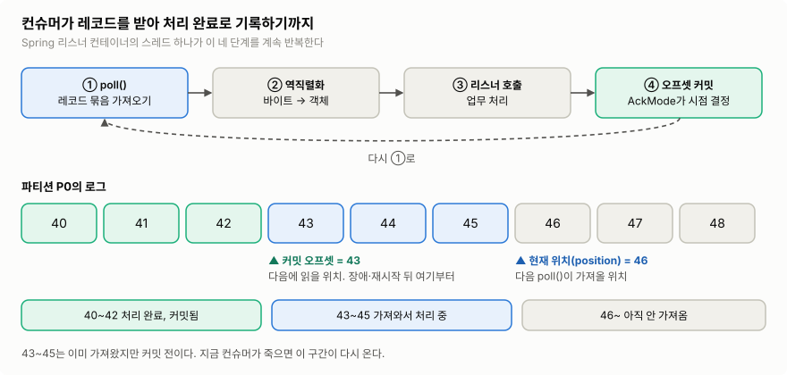

>컨테이너 스레드 하나가 ①~④를 반복한다. 아래 로그에서 커밋 오프셋(43)과 현재 위치(46) 사이가 "가져왔지만 아직 처리 완료로 기록하지 않은" 구간이다.
>이미지 출처: 자체 작성 ([KafkaConsumer API](https://kafka.apache.org/43/javadoc/org/apache/kafka/clients/consumer/KafkaConsumer.html) 기준)

1. **`poll()`**: 브로커에서 맡은 파티션의 레코드를 한 묶음 가져온다. 한 번에 최대 `max.poll.records`(기본 500)개다. 컨슈머가 **가져가는(pull)** 방식이라, 처리 속도보다 빨리 밀려 들어오지 않는다.
2. **역직렬화**: 바이트를 키·값 객체로 바꾼다. 프로듀서의 직렬화 형식과 맞아야 한다.
3. **리스너 호출**: 레코드마다 `@KafkaListener` 메서드를 호출한다. 업무 처리는 여기서 일어난다.
4. **오프셋 커밋**: "어디까지 처리했는지"를 Kafka에 기록한다. 시점은 3절에서 다룬다.

Spring의 리스너 컨테이너 하나는 **스레드 하나에서 이 루프를 돈다**. 그래서 리스너가 한 레코드에 오래 머물면, 그 컨슈머가 맡은 다른 파티션의 레코드도 함께 기다린다. 이 사실은 6절의 재시도에서 다시 중요해진다.

## 3. 어디까지 처리했나: 오프셋 커밋

### 3.1 현재 위치와 커밋 오프셋은 다르다

컨슈머에게는 오프셋이 두 개 있다.

| 이름 | 뜻 | 언제 움직이나 |
|---|---|---|
| **현재 위치**(position) | 다음 `poll()`이 가져올 오프셋 | 레코드를 **가져오면** 바로 앞으로 간다 |
| **커밋 오프셋** | 장애·재시작·리밸런싱 뒤 **다시 읽기 시작할 위치** | 컨슈머가 **커밋해야** 움직인다 |

- 현재 위치는 컨슈머 메모리에만 있다. 컨슈머가 죽으면 사라진다.
- 커밋 오프셋은 Kafka 내부 토픽 `__consumer_offsets`에 그룹·토픽·파티션별로 저장된다. 다른 컨슈머가 파티션을 이어받을 때 이 값을 읽는다.
- ex) 오프셋 `42`까지 처리했다면 ==**`43`을 커밋**==한다. 커밋 값은 "여기까지 처리했다"가 아니라 "다음엔 여기부터 읽어라"라는 뜻이다.


>컨슈머가 처리 위치를 그룹 코디네이터(브로커)에 커밋하고, 코디네이터가 이를 `__consumer_offsets`에 저장한다.
>이미지 출처: [Confluent — Consumer Group Protocol](https://developer.confluent.io/courses/architecture/consumer-group-protocol/)

### 3.2 누가 커밋하나: 자동 커밋은 끈다

순수 `KafkaConsumer`의 `enable.auto.commit` 기본값은 `true`다. 켜져 있으면 클라이언트가 `auto.commit.interval.ms`(기본 5초)마다 ==**처리 여부와 무관하게 마지막 `poll()` 위치를 커밋한다**==.

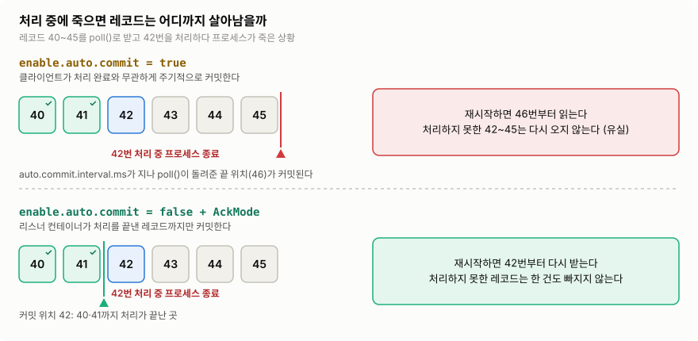

>자동 커밋이면 아직 처리하지 못한 42~45가 커밋되어 다시 오지 않는다. 컨테이너 커밋이면 처리한 곳까지만 커밋하므로 42부터 다시 받는다.
>이미지 출처: 자체 작성 ([Spring Kafka — Message Listener Containers](https://docs.spring.io/spring-kafka/reference/kafka/receiving-messages/message-listener-container.html) 기준)

**Spring Kafka는 이 값을 직접 지정하지 않으면 `false`로 바꾼다**(2.3부터). 대신 리스너 컨테이너가 처리 결과를 보고 커밋한다. 그러니 `enable-auto-commit: true`를 일부러 켜지 않는다.

### 3.3 언제 커밋하나: AckMode

컨테이너가 커밋하는 시점은 `spring.kafka.listener.ack-mode`(AckMode)로 정한다.

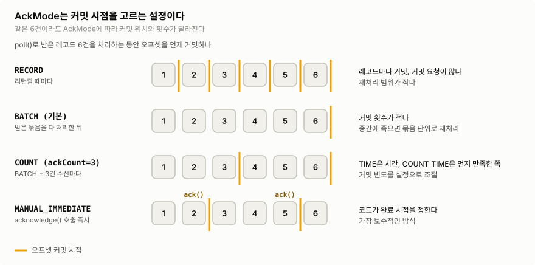

>같은 6건을 처리해도 AckMode에 따라 커밋 위치와 횟수가 달라진다.
>이미지 출처: 자체 작성 ([Spring Kafka — Message Listener Containers](https://docs.spring.io/spring-kafka/reference/kafka/receiving-messages/message-listener-container.html) 기준)

| AckMode | 커밋 시점 | 언제 쓰나 |
|---|---|---|
| `BATCH` (기본값) | `poll()`로 받은 레코드를 모두 처리한 뒤 | 대부분의 경우. 커밋 횟수가 적다 |
| `RECORD` | 레코드 하나를 처리하고 리턴할 때마다 | 재처리 범위를 줄이고 싶을 때. 커밋 요청이 많다 |
| `MANUAL_IMMEDIATE` | 리스너가 `Acknowledgment.acknowledge()`를 호출한 즉시 | 처리 완료 시점을 코드에서 직접 정해야 할 때 |

- `BATCH`·`RECORD`는 ==**리스너가 예외 없이 리턴한 레코드만**== 처리 완료로 본다. 리스너 안에서 DB 트랜잭션이 끝난 뒤 리턴하면 "DB 커밋 → 오프셋 커밋" 선후가 저절로 지켜진다.
- 그래서 대부분은 기본 `BATCH`로 충분하다. `MANUAL_IMMEDIATE`는 커밋을 조건부로 미뤄야 할 때만 쓴다. 이때 ack를 빠뜨리거나, 실패를 "ack 생략"으로 표현하면 사고가 난다. 실패는 예외로 던진다.

**리스너가 예외를 던지면?** `BATCH`에서 6건 중 4번째가 실패했다고 하자.

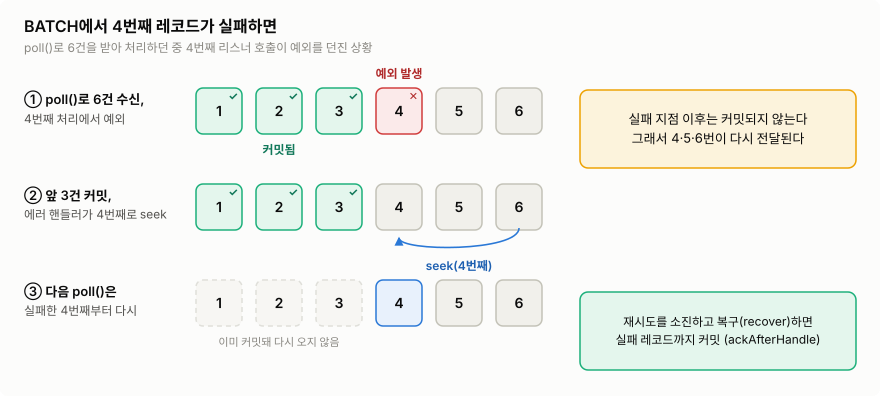

>성공한 앞 3건만 커밋되고, 실패한 4번째부터는 커밋되지 않은 채 다시 전달된다.
>이미지 출처: 자체 작성 ([Spring Kafka — Error Handling](https://docs.spring.io/spring-kafka/reference/kafka/annotation-error-handling.html) 기준)

컨테이너는 앞 3건을 커밋한다. 에러 핸들러(6절)가 실패한 레코드로 위치를 되돌리고(`seek`), 다음 `poll()`이 4번째부터 다시 가져온다. ==**실패한 레코드를 건너뛰고 뒤를 커밋하는 일은 없다.**==

### 3.4 커밋 오프셋이 없을 때: `auto.offset.reset`

새 그룹이라 커밋 오프셋이 없거나, 보존 기간이 지나 커밋 오프셋이 가리키는 레코드가 삭제됐을 때만 적용된다.

- `latest`(기본값): 지금 끝부터 읽는다. 그 전에 쌓인 레코드는 읽지 않는다.
- `earliest`: 남아 있는 가장 처음부터 읽는다.
- ==**유효한 커밋이 있으면 `earliest`여도 처음부터 다시 읽지 않는다.**== 일부러 다시 읽으려면 오프셋을 되감는다(7.4절).

## 4. 같은 레코드가 다시 오는 경우

커밋 오프셋은 "다음에 읽을 위치"일 뿐이다. 처리가 끝났는데 커밋이 안 됐다면, 그 레코드는 다시 온다.

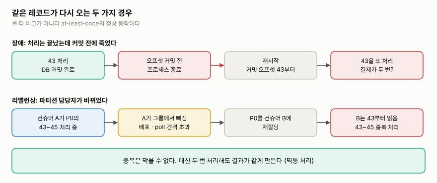

>위: 처리를 마쳤지만 오프셋을 커밋하기 전에 죽었다. 아래: 파티션 담당자가 바뀌어 새 컨슈머가 마지막 커밋부터 읽는다. 두 경우 모두 이미 처리한 레코드가 다시 온다.
>이미지 출처: 자체 작성

### 4.1 장애: 처리와 커밋의 선후가 전달 보장을 정한다

처리와 커밋 중 무엇을 먼저 하느냐에 따라, 장애가 났을 때의 결과가 갈린다.

| 방식 | 선후 | 처리 도중 죽으면 |
|---|---|---|
| At-most-once (최대 한 번) | 커밋 → 처리 | 커밋은 됐으니 다시 안 온다. ==**누락**== |
| At-least-once (최소 한 번) | 처리 → 커밋 | 커밋이 안 됐으니 다시 온다. ==**중복 처리**== |

결제·주문처럼 빠지면 안 되는 이벤트는 **at-least-once**를 쓴다. 3절의 Spring 기본 동작(리스너가 리턴한 뒤 커밋)이 바로 이 방식이다. 대가로 ==**중복은 정상 동작**==이 된다.

### 4.2 리밸런싱: 파티션 담당자가 바뀐다

**리밸런싱**은 그룹 안에서 파티션 담당자를 다시 정하는 과정이다. 컨슈머가 추가·종료되거나, 장애로 빠지거나, 파티션이 늘어날 때 일어난다. 배포할 때마다 일어난다고 보면 된다.


>컨슈머가 추가되면 기존 컨슈머가 파티션을 반납하고 다시 나눠 받는다. 그림은 전체가 잠시 멈추는 전통적 방식이다. 최근 방식은 영향받는 파티션만 단계적으로 옮긴다.
>이미지 출처: [Confluent — Consumer Group Protocol](https://developer.confluent.io/courses/architecture/consumer-group-protocol/)

- 파티션을 넘겨받은 컨슈머는 ==**마지막 커밋 오프셋부터**== 읽는다. 이전 컨슈머가 처리했지만 커밋하지 못한 레코드는 다시 처리된다.
- **처리가 느려도 리밸런싱이 일어난다.** `poll()` 호출 간격이 `max.poll.interval.ms`(기본 5분)를 넘으면, 그룹은 그 컨슈머가 멈췄다고 보고 파티션을 빼앗는다. 그러면 처리 중이던 묶음이 다른 컨슈머에서 또 처리된다.
	- 레코드 하나가 오래 걸리면 `max.poll.records`를 줄여 한 묶음의 처리 시간을 짧게 한다.
	- 6절의 재시도 대기도 이 시간에 포함된다.
- 리밸런싱 범위와 동작은 그룹 프로토콜(`group.protocol`, 기본 `classic`)과 배정 전략에 따라 다르다. 운영 버전의 설정을 확인한다.

**정리하면, at-least-once에서 중복은 피할 수 없다.** 막을 수 없으니 ==**두 번 처리해도 결과가 같게**== 만들어야 한다.

## 5. 다시 와도 안전하게: 멱등 처리

**멱등성**은 같은 이벤트를 여러 번 처리해도 ==**최종 결과가 한 번 처리한 것과 같은**== 성질이다.

- `status = 'PAID'`로 바꾸는 작업은 원래 멱등에 가깝다. 두 번 해도 결과가 같다.
- 잔액 `+100`, 재고 `-1`, 이메일 발송은 멱등하지 않다. 두 번 하면 결과가 달라진다. 이런 작업에는 중복을 거르는 장치가 필요하다.

### 5.1 처리한 이벤트 ID를 같은 트랜잭션에 기록한다

ex) `PaymentCompleted(eventId=E1, orderId=O1)`을 받아 주문을 `PAID`로 바꾼다.

1. 프로듀서는 이벤트마다 ==**재발행해도 바뀌지 않는 `eventId`**==를 넣는다. 재발행할 때마다 새 UUID를 만들면 중복을 알아볼 수 없다([[04 프로듀서 심화]]의 Outbox가 이 ID를 고정한다).
2. 컨슈머 DB에 `processed_events(consumer_name, event_id)` 유니크 제약을 둔다.
3. 한 DB 트랜잭션에서 이벤트 ID를 INSERT하고 주문 상태를 바꾼다. INSERT가 충돌하면 이미 처리한 이벤트이니 업무 변경 없이 넘어간다.
4. 리스너가 리턴하면 컨테이너가 오프셋을 커밋한다. 커밋 전에 죽어도, 다시 온 이벤트는 3단계에서 걸러진다.

**왜 "같은 트랜잭션"이어야 하나.** 처리 기록을 업무 변경보다 먼저, 별도 트랜잭션으로 커밋하면 크래시 한 번에 이벤트가 사라진다.

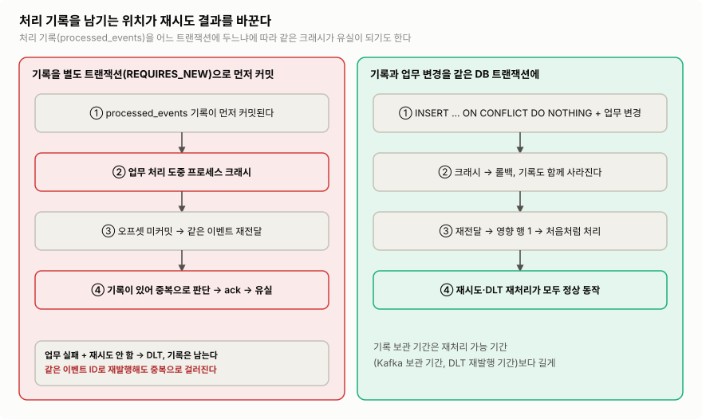

>왼쪽은 기록만 커밋된 채 업무 처리 중 죽어서, 다시 온 이벤트를 "이미 처리함"으로 오판해 버린다. 오른쪽은 기록과 업무가 함께 롤백되어 다시 처리된다.
>이미지 출처: 자체 작성

### 5.2 코드 ex) Kotlin + Spring Boot + PostgreSQL

Spring Boot 3.x, `spring-kafka`, `spring-jdbc`, `jackson-module-kotlin`, `kotlin-spring` 플러그인 기준이다. `orders(id, status)` 테이블은 있다고 가정한다. AckMode는 기본값 `BATCH`를 쓴다.

```sql
CREATE TABLE processed_events (
    consumer_name TEXT NOT NULL,
    event_id      TEXT NOT NULL,
    processed_at  TIMESTAMPTZ NOT NULL DEFAULT now(),
    PRIMARY KEY (consumer_name, event_id)
);
```

```kotlin
data class PaymentCompleted(val eventId: String, val orderId: Long)

@Component
class PaymentListener(
    private val objectMapper: ObjectMapper,
    private val paymentService: PaymentService,
) {
    @KafkaListener(topics = ["payments.completed"])
    fun onMessage(payload: String) {
        val event = objectMapper.readValue(payload, PaymentCompleted::class.java)
        paymentService.apply(event) // 여기서 DB 트랜잭션이 커밋된다
    } // 예외 없이 리턴하면 컨테이너가 이 레코드를 처리 완료로 보고 커밋한다
}

@Service
class PaymentService(private val jdbc: JdbcTemplate) {
    @Transactional
    fun apply(event: PaymentCompleted) {
        require(event.eventId.isNotBlank() && event.orderId > 0) { "잘못된 이벤트: $event" }

        val inserted = jdbc.update(
            """INSERT INTO processed_events (consumer_name, event_id)
               VALUES ('order-service', ?) ON CONFLICT DO NOTHING""",
            event.eventId,
        )
        if (inserted == 0) return // 이미 처리한 이벤트. 실패가 아니므로 예외를 던지지 않는다

        val updated = jdbc.update(
            "UPDATE orders SET status = 'PAID' WHERE id = ? AND status = 'PENDING'",
            event.orderId,
        )
        check(updated == 1) { "주문이 없거나 결제 대기 상태가 아님: ${event.orderId}" }
    }
}
```

**장애 시점별로 확인하면**

- 주문 UPDATE가 실패하면 `processed_events` INSERT도 함께 롤백된다. 다시 처리할 수 있다.
- DB 커밋 뒤 오프셋 커밋 전에 죽으면 같은 이벤트가 다시 온다. `inserted == 0`이라 주문은 바뀌지 않고, 리스너가 정상 리턴해 ==**중복 이벤트도 커밋된다**==.
- 재전달은 순서 역전(2.1절)이기도 하다. ex) 42·43을 처리하고 커밋 전에 죽으면, 42가 43 뒤에 한 번 더 온다. `eventId`로 걸러지므로 뒤 이벤트가 바꾼 상태를 앞 이벤트가 되돌리지 않는다.
- 중복을 예외(`DuplicateKeyException`)로 던지면 실패로 취급돼 재시도·DLT로 간다. `ON CONFLICT DO NOTHING`으로 영향 행 수를 보고 판단한다.
- `@Transactional`은 **다른 빈**의 메서드 호출에만 적용된다. 그래서 리스너와 서비스를 나눴다.

### 5.3 멱등 처리에서 정할 것

- **중복 키는 오프셋이 아니라 이벤트 ID.** 오프셋은 파티션 안의 위치일 뿐이다. 같은 이벤트가 재발행되면 오프셋이 달라진다.
- **처리 기록 보관 기간**은 재처리가 일어날 수 있는 기간(토픽 보존 기간, DLT 재처리 기간)보다 길게 잡는다.
- **외부 API 호출**은 내 DB 트랜잭션으로 되돌릴 수 없다. 대상 API가 지원하는 멱등 키에 `eventId`를 넘긴다. [Stripe의 멱등 키](https://stripe.com/blog/idempotency)가 대표적이다.
- **Kafka 트랜잭션(exactly-once)으로는 안 되나?** Kafka 트랜잭션은 "Kafka에서 읽고 → Kafka에 쓰는" 흐름의 출력과 오프셋을 함께 커밋한다. ==**외부 DB 쓰기는 포함하지 않는다.**== Kafka → 서비스 DB 흐름의 기본은 at-least-once + 멱등 처리다.

## 6. 처리가 실패하면: 블로킹 재시도

멱등 처리로 "다시 와도 안전"해졌다. 이제 반대 상황이다. 리스너가 예외를 던지면 어떻게 될까?

### 6.1 실패부터 나눈다

| 실패 | ex) | 다시 하면 되나 |
|---|---|---|
| 일시적 | DB 연결 오류, 락 대기 초과, 외부 API 타임아웃·5xx | 시간이 지나면 풀릴 수 있다. **재시도** |
| 영구적 | 잘못된 JSON, 필수 값 누락, 지원하지 않는 이벤트 버전 | 몇 번을 해도 같다. **바로 격리**(7절) |
| 업무상 거절 | 이미 취소된 주문에 대한 결제 완료 | 업무 규칙으로 정한다. 정상 결과로 보면 성공 처리, 조사가 필요하면 격리 |

예외 클래스만 보고 정하지 않는다. ex) 위 코드의 "주문이 없음"은 주문 생성 이벤트가 아직 도착하지 않아 생긴 것이라면 일시적 실패다.

### 6.2 Spring의 기본 동작: 조용한 유실

리스너 예외는 컨테이너의 **에러 핸들러**인 `DefaultErrorHandler`가 받는다. 아무 설정도 하지 않으면 기본 BackOff는 `FixedBackOff(0L, 9)`다. ==**간격 없이 10번 연달아 시도한 뒤 ERROR 로그만 남기고, 오프셋을 커밋하고 다음 레코드로 넘어간다.**==

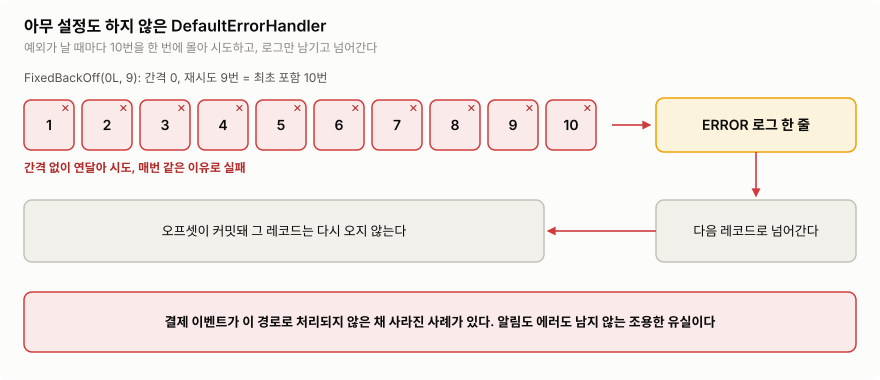

>DB가 1초만 끊겨도 10번이 순식간에 모두 실패하고, 레코드는 로그 한 줄만 남긴 채 다시 오지 않는다.
>이미지 출처: 자체 작성 ([Spring Kafka — Error Handling](https://docs.spring.io/spring-kafka/reference/kafka/annotation-error-handling.html) 기준)

그래서 운영 컨슈머는 ==**재시도 횟수·간격과, 끝내 실패했을 때 보낼 곳(DLT)을 반드시 지정한다**==.

### 6.3 블로킹 재시도의 동작

`DefaultErrorHandler`는 실패한 레코드로 위치를 되돌리고, 대기한 뒤 같은 레코드를 다시 처리한다. 다음 레코드로 넘어가지 않고 그 자리에서 재시도하므로 **블로킹 재시도**라고 부른다.

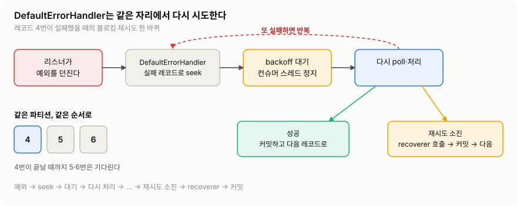

>실패한 4번이 성공하거나 재시도가 끝날 때까지 뒤의 5·6번은 기다린다. 재시도하는 동안에는 순서 역전이 없다.
>이미지 출처: 자체 작성 ([Spring Kafka — Error Handling](https://docs.spring.io/spring-kafka/reference/kafka/annotation-error-handling.html) 기준)

**비용.** 대기하는 동안 컨테이너 스레드가 멈춘다. 2.2절에서 봤듯이 스레드 하나가 여러 파티션을 맡으므로, ==**실패와 무관한 다른 파티션도 함께 멈춘다**==.

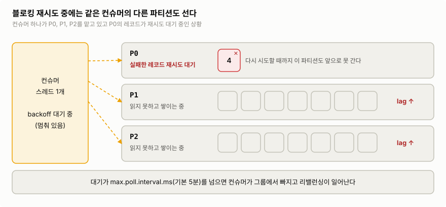

>P0의 레코드 하나가 재시도를 기다리는 동안 P1·P2도 읽지 못해 랙이 쌓인다.
>이미지 출처: 자체 작성

- 대기가 `max.poll.interval.ms`(기본 5분)를 넘으면 리밸런싱이 일어난다(4.2절).
- 역전이 없는 것은 ==**재시도 횟수가 남아 있는 동안**==뿐이다. 재시도가 끝나면 recoverer가 정한 대로 넘어간다(7절).
- 그래서 블로킹 재시도는 ==**짧게, 적게**== 쓴다. 초 단위 간격으로 수 회 정도다. 분·시간 단위로 기다려야 하는 장애라면 8절의 재시도 토픽을 쓴다.

### 6.4 BackOff와 예외 분류

**BackOff**는 재시도 횟수와 간격이다.

| BackOff | ex) | 주의 |
|---|---|---|
| `FixedBackOff(간격, 재시도 횟수)` | `FixedBackOff(1_000L, 2L)` = 1초 간격, 최초 포함 3번 시도 | 두 번째 인자는 최초 시도를 뺀 재시도 횟수 |
| `ExponentialBackOffWithMaxRetries(n)` | `n=3`, 1초부터 2배 = 1s → 2s → 4s | 지수 간격 + 명확한 횟수. 가장 읽기 쉽다 |
| `ExponentialBackOff` | | 횟수나 한도를 안 주면 ==**무한 재시도**==. `maxElapsedTime`은 실제 경과 시간이 아니라 대기 간격의 합이다 |

**예외 분류.** 기본으로 재시도하지 않는 예외는 역직렬화·변환 관련 6개(`DeserializationException`, `MessageConversionException`, `ConversionException`, `MethodArgumentResolutionException`, `NoSuchMethodException`, `ClassCastException`)뿐이다. ==**나머지는 전부 재시도한다.**== 잘못된 JSON(`JsonProcessingException`)이나 검증 실패(`IllegalArgumentException`)도 재시도한다는 뜻이다. 영구적인 실패는 직접 등록한다.

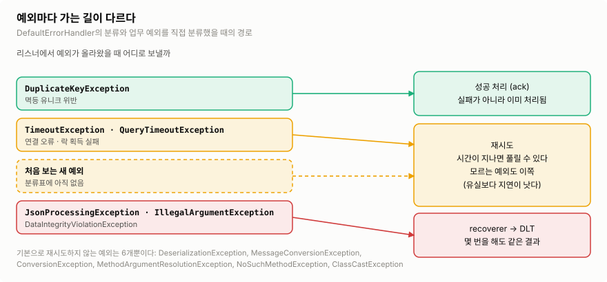

>멱등 처리의 중복은 성공, 일시적 오류와 처음 보는 예외는 재시도, 확실히 영구적인 오류는 바로 DLT로 보낸다.
>이미지 출처: 자체 작성 ([Spring Kafka — Error Handling](https://docs.spring.io/spring-kafka/reference/kafka/annotation-error-handling.html) 기준)

- **확실히 영구적인 것만** `addNotRetryableExceptions(...)`로 등록한다.
- **처음 보는 예외는 재시도 쪽에 둔다.** 바로 격리하면 복구 가능한 레코드를 놓친다. 유실보다 지연이 낫다. 새 예외는 DLT 유입 알림으로 발견해 분류에 추가한다.
- 리스너 예외는 Spring이 감싸서 넘기지만, `DefaultErrorHandler`는 원인(cause)을 따라가며 분류한다. 직접 풀 필요는 없다.
- `JsonDeserializer`처럼 역직렬화를 Kafka 설정으로 하면, 실패가 리스너 호출 전에 난다. 값 deserializer를 `ErrorHandlingDeserializer`로 감싸야 에러 핸들러로 넘어와 DLT로 보낼 수 있다.

## 7. 끝내 실패하면: DLT

### 7.1 DLT란

**DLT**(Dead Letter Topic)는 자동 처리에 실패한 레코드를 ==**조사·수정·재처리하려고 격리해 두는 토픽**==이다.

- DLT로 보냈다고 처리가 끝난 게 아니다. "사람이 봐야 할 실패"로 남겨 둔 것이다.
- 브로커가 알아서 옮겨 주지 않는다. ==**컨슈머(프레임워크)가 DLT에 발행**==한다.
- 격리하면 그 레코드를 건너뛰고 원본 파티션 처리를 이어갈 수 있다. 대신 같은 키의 뒤 레코드를 앞 레코드 없이 처리한다. 2.1절의 **건너뛰기**다(7.4절).

### 7.2 `DeadLetterPublishingRecoverer`

재시도를 다 쓰거나 재시도하지 않을 예외면, `DefaultErrorHandler`가 **recoverer**를 호출한다. 기본 recoverer는 로그만 남기므로, DLT에 발행하는 `DeadLetterPublishingRecoverer`를 지정한다.

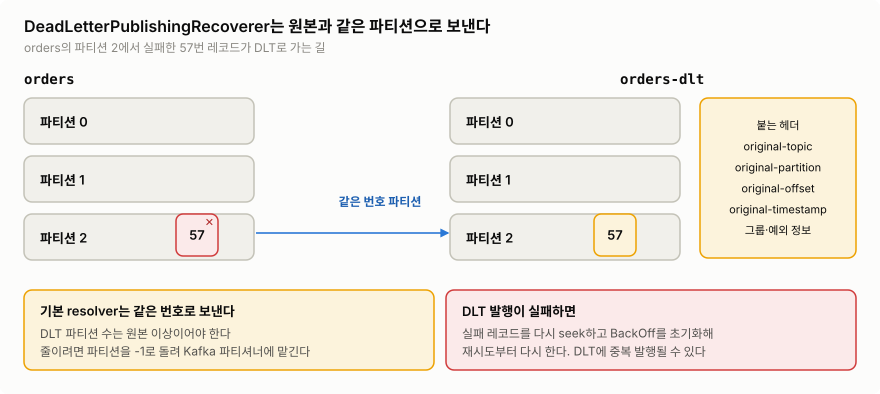

>실패한 레코드는 `<원본 토픽>-dlt`의 같은 번호 파티션으로 가고, 원본 위치와 예외 정보가 헤더로 붙는다.
>이미지 출처: 자체 작성 ([Spring Kafka — Publishing Dead-letter Records](https://docs.spring.io/spring-kafka/reference/kafka/annotation-error-handling.html) 기준)

| 항목 | 기본 동작 |
|---|---|
| 목적지 | `<원본 토픽>-dlt`의 **원본과 같은 번호** 파티션. 그래서 DLT 파티션 수가 원본 이상이어야 한다 |
| 헤더 | 원본 토픽·파티션·오프셋·타임스탬프, 컨슈머 그룹, 예외 클래스·메시지·스택트레이스 |
| 커밋 | DLT 발행이 성공한 뒤 원본 레코드를 커밋한다 |
| 발행 실패 | 원본 레코드를 다시 처리한다. 그래서 DLT에 ==**같은 레코드가 중복으로 들어갈 수 있다**== |

### 7.3 코드 ex) 재시도 + DLT 설정

5.2절의 리스너·서비스에 그대로 붙는다. Spring Boot는 `CommonErrorHandler` 타입 빈을 자동 구성된 리스너 컨테이너에 연결한다.

```kotlin
@Configuration
class KafkaErrorConfig {
    @Bean
    fun errorHandler(template: KafkaTemplate<String, String>): DefaultErrorHandler {
        val recoverer = DeadLetterPublishingRecoverer(template).apply {
            setFailIfSendResultIsError(true) // DLT 발행 실패를 성공으로 넘기지 않는다
        }
        val backOff = ExponentialBackOffWithMaxRetries(3).apply {
            initialInterval = 1_000L // 1s → 2s → 4s 뒤 DLT
            multiplier = 2.0
            maxInterval = 10_000L
        }
        return DefaultErrorHandler(recoverer, backOff).apply {
            addNotRetryableExceptions(
                JsonProcessingException::class.java,  // 잘못된 JSON
                IllegalArgumentException::class.java, // require() 검증 실패
            )
        }
    }
}
```

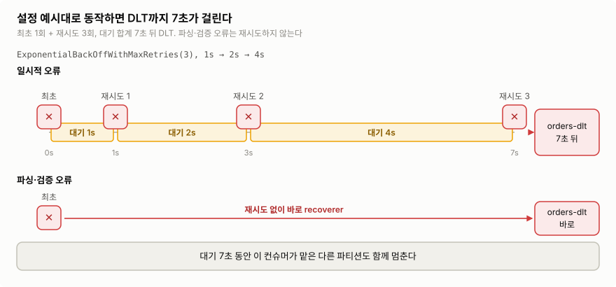

>일시적 오류는 최초 1회와 재시도 3회, 대기 합계 7초 뒤 DLT로 간다. 파싱·검증 오류는 재시도 없이 바로 간다.
>이미지 출처: 자체 작성

- `payments.completed-dlt` 토픽은 원본과 **같은 파티션 수 이상**으로 미리 만든다.
- DLT 발행에는 `KafkaTemplate`이 쓰인다. Spring Boot 기본 프로듀서 직렬화(`StringSerializer`)가 원본 레코드 형식과 맞는지 확인한다.
- 기본 `BATCH`에서는 recoverer가 성공하면 원본 오프셋이 커밋된다. `MANUAL_IMMEDIATE`를 쓴다면 `setCommitRecovered(true)`를 추가해야 바로 커밋된다.
- 대기 7초 동안 이 컨슈머의 다른 파티션도 멈춘다(6.3절). 처리량이 중요하면 횟수·간격을 줄이거나 8절을 검토한다.

### 7.4 DLT 운영

- **알림**: DLT 유입량과 첫 실패 시각에 알림을 건다. 아무도 안 보는 DLT는 6.2절의 "로그만 남는 유실"과 다를 바 없다.
- **재처리**: 원인을 고친 뒤, DLT 레코드를 골라 원본 토픽에 다시 발행한다. ==**같은 `eventId`를 유지**==하면 5절의 멱등 처리 덕분에 이미 처리된 이벤트는 걸러진다. DLT를 소비하는 쪽도 중복을 견뎌야 한다(7.2절 표의 발행 실패).
- **이미 커밋한 레코드를 다시 처리하려면**: 로직 버그로 잘못 처리하고 커밋까지 했다면, 재시도로는 복구할 수 없다. 컨슈머 그룹의 오프셋을 되감는다(`kafka-consumer-groups.sh --reset-offsets` 등). 이미 성공한 레코드도 다시 오므로 역시 멱등 처리가 전제다.
- **건너뛰기를 견디는지 먼저 확인한다.** 견디는지는 컨슈머가 상태 전이를 검증하는지로 판단한다.
	- 5.2절의 결제 완료 처리는 `WHERE status = 'PENDING'`으로 현재 상태를 조건으로 건다. 앞 이벤트가 빠진 채 뒤 이벤트가 오거나, 나중에 앞 이벤트를 역전된 채 재처리해도, 상태가 맞지 않으면 `check`에서 실패해 DLT로 간다. 잘못된 상태로 바뀌지 않으니 DLT로 버틸 수 있다. 재처리할 때는 DLT 레코드를 원래 순서대로 다시 발행한다.
	- 2.1절의 배송 서비스처럼 앞 이벤트 없이도 뒤 이벤트가 "성공"하는 흐름은 견디지 못한다. 재시도가 끝나도 넘어가지 말고, 그 자리에서 소비를 멈춘 뒤 알림을 보낸다(7.5절).

### 7.5 DLT 대신 멈추기: 컨테이너 정지

여기서 멈추는 대상은 1절의 **리스너 컨테이너**, 즉 `KafkaConsumer`를 들고 `poll()` 루프를 돌리는 스레드다. 루프가 멈추면 실패한 레코드 뒤의 레코드도 처리되지 않는다. 그래서 순서 역전도 건너뛰기도 생기지 않는다. 대가로 ==**그 컨테이너가 맡은 모든 파티션의 소비가 멈추고 랙이 쌓인다**==. 사람이 원인을 고친 뒤 재개하면, 커밋되지 않은 실패 레코드부터 다시 처리한다.

멈추는 방법은 두 가지다.

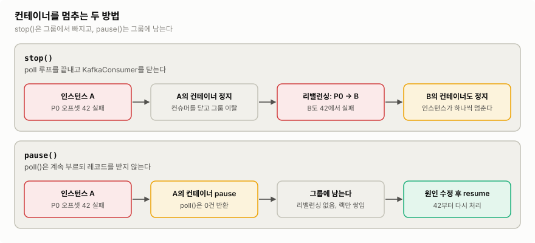

>`stop()`은 그룹을 떠나 리밸런싱을 일으키고, 파티션을 넘겨받은 인스턴스도 같은 레코드에서 실패한다. `pause()`는 파티션을 쥔 채 기다린다.
>이미지 출처: 자체 작성 ([Spring Kafka — Pausing and Resuming Listener Containers](https://docs.spring.io/spring-kafka/reference/kafka/pause-resume.html) 기준)

| 방식 | 동작 | 장점 | 비용·주의 |
|---|---|---|---|
| `stop()` | `poll()` 루프를 끝내고 `KafkaConsumer`를 닫는다. 그룹에서 빠진다 | 그 인스턴스는 확실히 멈춘다 | 리밸런싱(4.2절)으로 같은 그룹의 다른 인스턴스가 파티션을 받아 같은 레코드에서 또 실패한다 |
| `pause()` | `poll()`은 계속 부르되 레코드를 받지 않는다. 그룹에 남는다 | 리밸런싱 없이 파티션을 쥔 채 기다린다 | 멈춘 상태는 메모리에만 있다. 앱이 재시작되면 다시 소비해 재시도부터 한다 |

둘 다 개발자가 직접 부를 수 있다.

- **에러 핸들러에 맡기기**: `CommonContainerStoppingErrorHandler`를 에러 핸들러로 등록하면, 리스너가 예외를 던지는 즉시 컨테이너를 `stop()`한다. ==**재시도는 하지 않는다**==.
- **코드에서 부르기**: `KafkaListenerEndpointRegistry`에서 리스너 `id`로 컨테이너를 꺼내 `stop()`/`start()`, `pause()`/`resume()`을 부른다. 사람이 재개할 때도 이 방법을 쓴다. ex) 운영용 관리 API에서 `resume()`을 부른다.

재시도를 먼저 하고 멈추려면, 7.3절의 `DefaultErrorHandler`에서 recoverer만 바꾼다. recoverer는 재시도가 끝난 레코드를 받는 자리다. 여기서 컨테이너를 `pause()`하고 예외를 다시 던진다. ==**recoverer가 예외를 던지면 그 레코드는 커밋되지 않고**== 다시 읽을 위치로 되돌려진다(`seek`). `pause()`는 다음 `poll()` 직전에 적용되므로 그 레코드를 다시 가져오지 않는다.

가정: Spring Kafka 3.x. 2.1절의 배송 서비스 리스너에 `@KafkaListener(id = "shipping-orders", topics = ["orders.events"])`처럼 `id`를 붙인다.

```kotlin
@Bean
fun errorHandler(registry: KafkaListenerEndpointRegistry): DefaultErrorHandler {
    val pauseAndAlert = ConsumerRecordRecoverer { record, ex ->
        registry.getListenerContainer("shipping-orders")?.pause() // 다음 poll()부터 받지 않는다
        // 운영 알림: record.topic(), record.partition(), record.offset(), ex.message
        throw ex // 던지면 커밋되지 않고 이 레코드 위치로 seek된다
    }
    val backOff = ExponentialBackOffWithMaxRetries(3).apply { initialInterval = 1_000L }
    return DefaultErrorHandler(pauseAndAlert, backOff)
}
```

장애 시점별로 확인하면:

- 재시도 중 앱이 죽으면: 오프셋이 커밋되지 않았으므로 재시작 후 실패한 레코드부터 다시 받는다.
- 멈춘 동안 앱이 재시작되면: 멈춤이 풀려 같은 레코드를 다시 재시도하고, 또 실패하면 다시 멈춘다.
- 원인을 고치고 `resume()`하면: 같은 레코드부터 처리한다. recoverer가 실패하면 BackOff가 초기화되는 것이 기본값이라, 원인이 남아 있으면 재시도를 처음부터 한 뒤 다시 멈춘다.

- `pause()`는 그 컨테이너의 모든 파티션을 멈춘다. 실패한 파티션만 멈추려면 `pausePartition(TopicPartition(record.topic(), record.partition()))`을 쓴다.
- 이 정책을 건너뛰기를 견디지 못하는 리스너에만 쓰려면, 별도 리스너 컨테이너 팩토리에 이 핸들러를 지정하고 `@KafkaListener(containerFactory = ...)`로 고른다. 결제 완료 리스너 같은 나머지는 7.3절의 DLT 핸들러를 쓴다.
- 이 정책을 택한다면 "한 레코드 때문에 파티션 전체가 멈추는 것"을 업무적으로 받아들일 수 있는지 먼저 확인한다.

## 8. 순서 역전을 견딜 때: 재시도 토픽

블로킹 재시도는 재시도하는 동안 순서 역전을 막는 대신 파티션 전체를 멈춘다. 외부 알림 API가 10분 동안 죽었다면, 그동안 모든 알림이 밀린다. ==**뒤 이벤트를 먼저 처리해도 괜찮은 흐름**==이라면 실패한 레코드만 빼내 따로 재시도할 수 있다. 이것이 **논블로킹 재시도**다.


>실패한 메시지를 재시도 토픽으로 넘겨 원본 처리를 계속하고, 재시도 토픽에서도 끝내 실패하면 DLQ에 격리한다.
>이미지 출처: [Uber Engineering — Building Reliable Reprocessing and Dead Letter Queues with Apache Kafka](https://www.uber.com/us/en/blog/reliable-reprocessing/)

Spring Kafka에서는 `@RetryableTopic`으로 구성한다.

1. 처리 실패 → 다음 재시도 시각을 헤더에 담아 **재시도 토픽**으로 발행하고, 원본 오프셋은 커밋한다. 원본은 다음 레코드를 계속 처리한다.
2. 재시도 토픽의 컨슈머는 시각이 될 때까지 그 파티션을 멈췄다가(pause) 다시 처리한다.
3. 또 실패하면 다음 재시도 토픽으로, 마지막 시도도 실패하면 DLT로 간다.

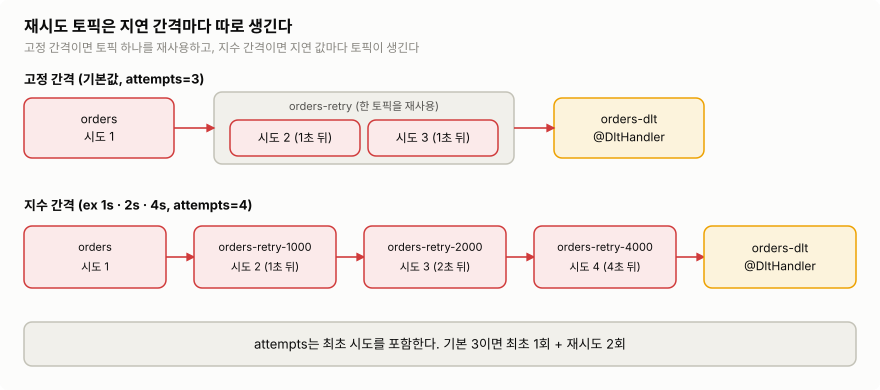

>지수 간격이면 대기 시간마다 재시도 토픽이 따로 생긴다. `attempts`는 최초 시도를 포함한다.
>이미지 출처: 자체 작성 ([Spring Kafka — Non-Blocking Retries](https://docs.spring.io/spring-kafka/reference/retrytopic/how-the-pattern-works.html) 기준)

```kotlin
@RetryableTopic(
    attempts = "4",                                     // 최초 1회 + 재시도 3회
    backoff = Backoff(delay = 2_000, multiplier = 2.0), // 2s → 4s → 8s
    exclude = [JsonProcessingException::class, IllegalArgumentException::class],
    traversingCauses = "true",                          // 기본값 false. 감싼 예외의 원인까지 보고 분류
    numPartitions = "3",                                // 자동 생성 토픽의 파티션 수
)
@KafkaListener(topics = ["coupons.issued"], groupId = "notification-service")
fun onMessage(payload: String) = notifier.send(payload)

@DltHandler
fun onDlt(payload: String) {
    // 실패 기록 저장 + 운영 알림. 여기서 업무 로직을 다시 돌리지 않는다.
}
```

**대가는 순서 역전이다.** 같은 키라도 토픽이 다르면 처리 순서가 보장되지 않는다.

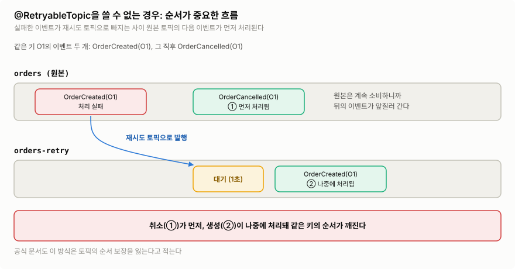

>`OrderCreated(O1)`이 재시도 토픽에서 기다리는 사이 원본의 `OrderCancelled(O1)`이 먼저 처리된다.
>이미지 출처: 자체 작성 ([Spring Kafka — Non-Blocking Retries](https://docs.spring.io/spring-kafka/reference/retrytopic/how-the-pattern-works.html) 기준)

- 쿠폰 알림·검색 인덱싱처럼 레코드끼리 독립적인 흐름에 쓴다. 주문 상태 전이처럼 역전을 견디지 못하는 흐름에는 쓰지 않는다.
- 배치 리스너와 컨테이너 트랜잭션에서는 쓸 수 없다.
- 재시도 토픽 자동 생성은 기본이 파티션 1개다. 운영에서는 파티션 수·복제 계수를 지정하거나 토픽을 직접 만든다.

### 어떤 재시도를 고르나

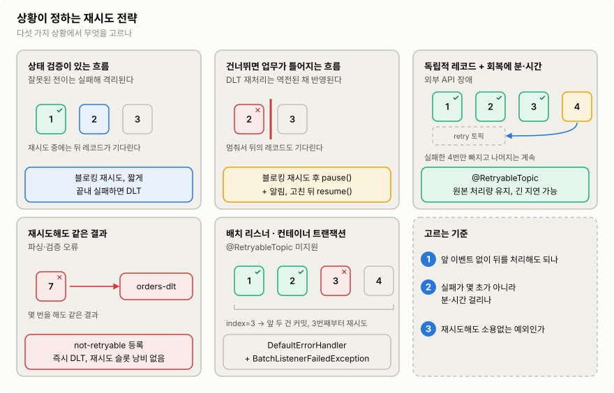

>역전과 건너뛰기를 견디는지, 회복에 얼마나 걸리는지, 재시도로 해결되는 실패인지에 따라 전략이 갈린다.
>이미지 출처: 자체 작성

전략은 실패의 두 단계에서 따로 고른다.

- **재시도하는 동안**: 그 자리에서 기다리면(블로킹) 역전이 없고, 빼내서 기다리면(재시도 토픽) 역전이 생긴다.
- **재시도가 끝난 뒤**: DLT로 보내면 건너뛰고 진행하고, 멈추면(`pause()`) 건너뛰지 않는 대신 소비가 멈춘다.

그래서 기준은 "순서가 필요한가"가 아니라 ==**앞 이벤트 없이 뒤 이벤트를 처리해도 업무가 버티는가**==다.

| 상황 | 재시도하는 동안 | 재시도가 끝난 뒤 | 이유 |
|---|---|---|---|
| 상태 검증이 잘못된 전이를 막는다 (5.2절 결제 완료) | 블로킹, 짧게 | DLT | 상태가 맞지 않는 이벤트는 실패해 격리된다 |
| 건너뛰면 업무가 틀어진다 (2.1절 배송) | 블로킹, 짧게 | 컨테이너 `pause()` + 알림 (7.5절) | DLT 재처리는 역전된 채 반영된다 |
| 레코드끼리 독립적 + 회복에 분·시간 (외부 API 장애) | `@RetryableTopic` | DLT | 원본 처리량을 지키며 길게 기다린다 |
| 재시도해도 같은 결과 (파싱·검증) | 재시도 안 함 (not-retryable) | 즉시 DLT | 재시도 시간을 낭비하지 않는다 |

## 9. 병렬 처리와 랙

### 9.1 처리량 늘리기

- **가장 단순한 방법은 컨슈머를 늘리는 것**이다. Spring에서는 `spring.kafka.listener.concurrency`(ex) `3`)로 앱 하나에 컨슈머 스레드를 여러 개 띄운다. 각 스레드가 자기 `KafkaConsumer`로 파티션을 나눠 맡는다.
- 앱 인스턴스 수 × `concurrency`가 파티션 수를 넘으면 남는 컨슈머는 논다. 더 늘리려면 파티션을 늘린다([[03 토픽·파티션 상세 개념]]).
- `KafkaConsumer` 하나를 여러 스레드에서 동시에 호출하면 안 된다. 리스너 안에서 레코드를 다른 스레드 풀에 넘기면 ==**처리가 끝나기 전에 커밋될 수 있고, 같은 키의 순서 역전도 생긴다**==. 처음에는 파티션별 순차 처리로 시작한다.

### 9.2 랙(lag) 보기

**랙 = 파티션 로그 끝 오프셋 − 그룹의 커밋 오프셋.** 아직 처리 완료로 기록되지 않은 레코드 수다. 그룹·파티션별로 본다.

```bash
kafka-consumer-groups.sh --bootstrap-server broker1:9092 --describe --group order-service
```

- 랙이 **계속 늘면** 유입량이 처리량보다 크거나 소비가 멈춘 것이다. 특정 파티션만 크면 핫 파티션, 블로킹 재시도 중인 레코드, 그 컨슈머의 장애를 의심한다.
- 랙이 **줄면** 밀린 레코드를 따라잡는 중이다.
- DLT 유입량도 함께 본다. 랙이 0이어도 실패한 레코드는 DLT에 쌓이고 있을 수 있다.

## 10. 설정 정리

기본값은 Kafka 4.x 클라이언트, Spring Kafka 3.x 기준이다.

| 설정 | 기본값 | 무엇을 정하나 | 다룬 곳 |
|---|---|---|---|
| `group.id` | 없음 | 함께 파티션을 나눠 맡을 그룹 | 1·2절 |
| `max.poll.records` | 500 | `poll()` 한 번에 가져오는 최대 레코드 수 | 2·4절 |
| `enable.auto.commit` | Kafka `true` / ==**Spring `false`**== | 클라이언트 자동 커밋 여부 | 3.2절 |
| `ack-mode` (Spring) | `BATCH` | 컨테이너가 커밋하는 시점 | 3.3절 |
| `auto.offset.reset` | `latest` | 커밋 오프셋이 없을 때 시작 위치 | 3.4절 |
| `max.poll.interval.ms` | 5분 | `poll()` 간격이 이걸 넘으면 그룹에서 빠짐 | 4.2절 |
| `DefaultErrorHandler` BackOff | `FixedBackOff(0L, 9)` | 재시도 횟수·간격. 기본값은 간격 없이 10번 후 로그만 | 6절 |
| recoverer | 로그만 남김 | 끝내 실패한 레코드를 보낼 곳 | 7절 |
| `concurrency` (Spring) | 1 | 앱 하나의 컨슈머 스레드 수 | 9절 |

```yaml
spring:
  kafka:
    bootstrap-servers: broker1:9092,broker2:9092,broker3:9092
    consumer:
      group-id: order-service
      auto-offset-reset: earliest # 새 그룹이 처음 붙을 때 쌓인 이벤트를 놓치지 않는다
      key-deserializer: org.apache.kafka.common.serialization.StringDeserializer
      value-deserializer: org.apache.kafka.common.serialization.StringDeserializer
    listener:
      concurrency: 3 # 파티션 수 이하로
```

여기에 5.2절의 멱등 처리와 7.3절의 `KafkaErrorConfig`를 더하면, 이 글의 질문에 대한 답이 완성된다.

## 실무 판단

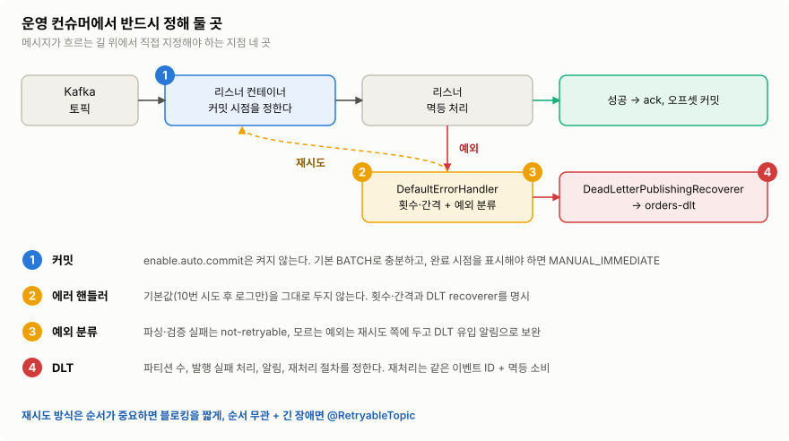

>운영 컨슈머라면 커밋 시점, 멱등 처리, 에러 핸들러, DLT 네 곳을 반드시 직접 정한다.
>이미지 출처: 자체 작성

- **커밋**: `enable.auto.commit`은 켜지 않는다. 리스너가 DB 트랜잭션을 마친 뒤 리턴하게 하면 기본 `BATCH`로 충분하다.
- **중복**: at-least-once에서 중복은 정상이다. ==**처리한 `eventId`를 업무 변경과 같은 트랜잭션에 기록**==하고, 중복은 예외 없이 성공 처리한다.
- **재시도**: 기본값(간격 없이 10번 후 로그만)을 그대로 두지 않는다. 짧은 블로킹 재시도 + 영구 오류 분류를 지정한다.
- **실패 격리**: DLT recoverer를 붙이고, DLT 유입 알림과 재처리 절차를 정한다. 재처리는 같은 `eventId`로 한다.
- **순서**: 앞 이벤트 없이 뒤 이벤트를 처리해도 되는지 먼저 정한다. 상태 검증이 막아 주면 블로킹 재시도 + DLT. 건너뛰면 안 되면 재시도 후 컨테이너를 멈추고 알림(7.5절). 레코드끼리 독립적이고 장애가 길면 재시도 토픽.

참고: [KafkaConsumer API](https://kafka.apache.org/43/javadoc/org/apache/kafka/clients/consumer/KafkaConsumer.html) · [Apache Kafka Consumer 설정](https://kafka.apache.org/43/configuration/consumer-configs/) · [Spring Kafka — Message Listener Containers](https://docs.spring.io/spring-kafka/reference/kafka/receiving-messages/message-listener-container.html) · [Spring Kafka — Error Handling·DLT](https://docs.spring.io/spring-kafka/reference/kafka/annotation-error-handling.html) · [Spring Kafka — Pausing and Resuming Listener Containers](https://docs.spring.io/spring-kafka/reference/kafka/pause-resume.html) · [Spring Kafka — Listener Container Lifecycle](https://docs.spring.io/spring-kafka/reference/kafka/receiving-messages/kafkalistener-lifecycle.html) · [Spring Kafka — Non-Blocking Retries](https://docs.spring.io/spring-kafka/reference/retrytopic/how-the-pattern-works.html) · [Spring Boot — Kafka](https://docs.spring.io/spring-boot/reference/messaging/kafka.html) · [Confluent — Consumer Group Protocol](https://developer.confluent.io/courses/architecture/consumer-group-protocol/) · [Uber Engineering — 재처리와 DLQ](https://www.uber.com/us/en/blog/reliable-reprocessing/) · [Stripe — 멱등 키](https://stripe.com/blog/idempotency) · [컨슈머 상세 개념](https://mxruhxn.tistory.com/entry/Apache-Kafka-%EC%B9%B4%ED%94%84%EC%B9%B4-%EC%BB%A8%EC%8A%88%EB%A8%B8-%EC%83%81%EC%84%B8-%EA%B0%9C%EB%85%90)
