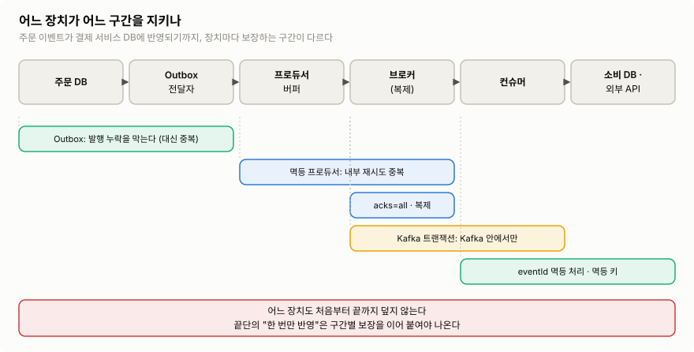

"Kafka는 exactly-once를 지원한다"는 말을 들으면, 이벤트가 어디서든 정확히 한 번 처리된다고 생각하기 쉽다. 실제로는 ==**장치마다 지키는 구간이 다르고, 처음부터 끝까지 덮는 장치는 없다**==. 이 글은 한 가지 질문을 따라간다.

> **주문 서비스에서 발행한 이벤트가 다른 서비스의 DB에 "정확히 한 번" 반영되려면, 어느 구간을 무엇으로 지켜야 하는가?**

[[04 프로듀서 심화]]와 [[05 컨슈머 심화]]에서 구간별 장치를 하나씩 봤다. 이 글은 그 장치들을 파이프라인 하나 위에 올려놓고, 남은 하나인 **Kafka 트랜잭션**이 어디까지 보장하는지 정리한다.

## 1. 세 가지 전달 보장

전달 보장은 장애가 났을 때 이벤트가 **빠지는지, 다시 처리되는지**를 말한다.

| 보장 | 뜻 | 대가 |
|---|---|---|
| At-most-once (최대 한 번) | 다시 처리하지 않는다 | 장애 때 ==**누락**==될 수 있다 |
| At-least-once (최소 한 번) | 빠뜨리지 않는다 | 장애 때 ==**중복**== 처리될 수 있다 |
| Exactly-once (정확히 한 번) | 결과가 한 번만 반영된다 | ==**보장 범위가 좁다.**== 범위 밖에서는 다시 앞의 둘 중 하나가 된다 |

컨슈머에서는 처리와 오프셋 커밋 중 무엇을 먼저 하느냐로 앞의 둘이 갈린다([[05 컨슈머 심화]] 4절). 백엔드 서비스는 보통 ==**at-least-once로 빠뜨리지 않고, 중복은 멱등 처리로 무해하게 만든다**==. 이것이 사실상의 "업무 결과 기준 exactly-once"다.

## 2. 중복과 유실은 어디서 생기나

주문 서비스가 `OrderCreated`를 발행하고, 결제 서비스가 소비해 DB에 반영하는 흐름을 따라가 보자.



>장치마다 막대가 덮는 구간이 다르다. 한 장치를 켰다고 다른 구간의 중복·유실이 해결되지 않는다.
>이미지 출처: 자체 작성

| 구간 | 무엇이 잘못될 수 있나 | 막는 장치 | 남는 것 | 다룬 곳 |
|---|---|---|---|---|
| 주문 DB → 발행 | DB 커밋 후 발행 전에 죽어 이벤트 **누락** | Transactional Outbox | 전달자 재시작 시 **중복 발행** | [[04 프로듀서 심화]] 7절 |
| 프로듀서 → 브로커 | 저장은 됐는데 응답이 유실돼 재시도 → **중복 기록** | 멱등 프로듀서(PID·시퀀스) | 앱이 `send()`를 **새로 호출**한 중복은 못 막음 | [[04 프로듀서 심화]] 6절 |
| 브로커 저장 | 리더 장애로 성공 응답 받은 레코드 **유실** | `acks=all` + `min.insync.replicas` + 복제 | ISR이 모두 사라지는 경우 | [[04 프로듀서 심화]] 4절 |
| 브로커 → 컨슈머 | 처리 후 커밋 전 장애·리밸런싱 → **중복 처리** | 소비 측 멱등 처리(`eventId`) | 멱등 처리가 안 되는 외부 작업 | [[05 컨슈머 심화]] 5절 |
| 컨슈머 → Kafka 출력 | 출력 발행과 오프셋 커밋 사이 장애 → **중복 출력** | Kafka 트랜잭션 | Kafka 밖의 작업 | 이 글 3절 |
| 컨슈머 → 외부 API | 호출 성공 후 커밋 전 장애 → **중복 호출** | 대상 API의 멱등 키 | 멱등 키를 지원하지 않는 API | 이 글 4절 |

> [!important] 두 종류의 중복을 구분한다
> - **로그에 같은 업무 이벤트가 두 번 기록됨**: 프로듀서 쪽 문제다. Outbox 재발행, 앱의 재전송이 원인이다. 레코드가 두 개라서 오프셋도 다르다.
> - **같은 레코드를 두 번 읽음**: 컨슈머 쪽 문제다. 커밋 전 장애, 리밸런싱이 원인이다. 오프셋이 같다.
>
> 둘 다 걸러야 하므로 ==**중복 판단 키는 오프셋이 아니라 이벤트 ID**==다. 이벤트 ID는 처음 만들 때 정하고, 재발행해도 바꾸지 않는다.

## 3. Kafka 트랜잭션: Kafka 안에서의 exactly-once

### 3.1 무엇을 묶나

컨슈머가 Kafka에서 읽고, 가공해서, **다시 Kafka에 쓰는** 흐름(consume-process-produce)을 생각해 보자. ex) `transfers` 토픽에서 이체 요청을 읽어 `balances` 토픽에 출금·입금 레코드를 쓴다.

트랜잭션이 없으면 출금 레코드만 쓰고 죽을 수 있다. 재시작하면 같은 요청을 다시 읽어 출금을 또 쓴다. Kafka 트랜잭션은 다음 세 가지를 ==**전부 반영하거나 전부 버린다**==.

1. 출력 토픽(여러 파티션)에 쓴 레코드
2. 입력 토픽의 소비 오프셋 커밋(`__consumer_offsets`에 쓰는 것도 Kafka 쓰기다)
3. 그래서 "읽은 위치"와 "그 결과로 쓴 레코드"가 함께 확정된다


>이체 앱이 `transfers`를 읽고 `balances`의 두 파티션에 출금·입금을 쓰며, 소비 오프셋까지 한 트랜잭션으로 묶는다. 하나라도 실패하면 전부 취소된다.
>이미지 출처: [Confluent — Kafka Transactions](https://developer.confluent.io/courses/architecture/transactions/)

### 3.2 어떻게 동작하나

- 프로듀서에 `transactional.id`를 준다. 재시작해도 같은 값을 쓰는, 프로듀서의 고정 이름이다. 트랜잭션을 켜면 멱등 프로듀서도 자동으로 켜진다.
- 브로커 하나가 그 프로듀서의 **트랜잭션 코디네이터**가 된다. 프로듀서는 어느 파티션에 쓸지 코디네이터에 등록하고 레코드를 쓴다.
- 커밋하면 코디네이터가 관련된 모든 파티션에 **커밋 마커**를 남긴다. 중단하면 **중단 마커**를 남긴다. 레코드는 이미 로그에 써져 있고, 마커가 그 레코드를 유효하게 할지 정한다.
- **좀비 차단(fencing)**: 앱이 멈춘 줄 알았는데 다시 살아나 쓰는 경우를 막는다. 같은 `transactional.id`로 새 인스턴스가 시작하면 코디네이터가 세대 번호(epoch)를 올리고, 이전 인스턴스의 미완료 트랜잭션을 중단시킨다. 옛 인스턴스의 쓰기는 이후 거부된다.


>출금만 쓰고 오프셋을 커밋하기 전에 죽은 인스턴스를, 새 인스턴스가 시작하며 차단하고 미완료 트랜잭션을 중단시킨다. 하위 컨슈머는 중단된 레코드를 버린다.
>이미지 출처: [Confluent — Kafka Transactions](https://developer.confluent.io/courses/architecture/transactions/)

### 3.3 읽는 쪽: `isolation.level=read_committed`

트랜잭션으로 쓴 레코드는 커밋 전에도 로그에 있다. 그래서 ==**읽는 쪽도 설정해야 보장이 완성된다**==.

- `read_uncommitted`(기본값): 중단된 트랜잭션의 레코드까지 읽는다.
- `read_committed`: 커밋된 트랜잭션의 레코드만 읽는다. 아직 열린 트랜잭션이 있으면 그 지점(LSO, last stable offset)에서 멈췄다가, 커밋이나 중단이 확정되면 이어서 읽는다. 트랜잭션 없이 쓴 일반 레코드는 그대로 읽는다.


>컨슈머는 열린 트랜잭션이 시작된 LSO 앞까지만 받고, 중단된 트랜잭션의 레코드(57)는 버린다.
>이미지 출처: [Confluent — Kafka Transactions](https://developer.confluent.io/courses/architecture/transactions/)

- 대가는 지연이다. 트랜잭션이 오래 열려 있으면 그 뒤의 레코드도 읽지 못한다.

### 3.4 어떻게 쓰나

| 방식 | 설정 |
|---|---|
| Kafka Streams | `processing.guarantee=exactly_once_v2` 한 줄 |
| Spring Kafka | `spring.kafka.producer.transaction-id-prefix`를 설정하면 Spring Boot가 `KafkaTransactionManager`를 만들어 리스너 컨테이너에 연결한다. 리스너 안의 `KafkaTemplate.send()`가 컨테이너가 시작한 트랜잭션에 참여한다 |
| 순수 클라이언트 | `initTransactions()` → `beginTransaction()` → `send()` → `sendOffsetsToTransaction()` → `commitTransaction()`을 직접 호출 |

```yaml
spring:
  kafka:
    producer:
      transaction-id-prefix: transfer-tx- # 인스턴스마다 겹치지 않게
    consumer:
      isolation-level: read_committed     # 이 서비스가 트랜잭션 출력을 읽는다면
```

- 여러 인스턴스를 띄우면 `transaction-id-prefix`가 **인스턴스마다 달라야** 한다.
- 리스너가 예외를 던지면 트랜잭션이 롤백되고, 실패한 레코드가 다시 전달된다. 컨테이너 트랜잭션에서는 [[05 컨슈머 심화]] 8절의 `@RetryableTopic`을 쓸 수 없다.

## 4. Kafka 밖이 끼면: 다시 at-least-once


>Kafka와 외부 시스템을 한 트랜잭션으로 묶는 기능은 없다. 결과를 먼저 Kafka 토픽에 쓰고, 외부 시스템으로는 멱등하게 전달하라고 권한다.
>이미지 출처: [Confluent — Kafka Transactions](https://developer.confluent.io/courses/architecture/transactions/)

==**Kafka 트랜잭션은 DB 커밋, 외부 API 호출, 이메일 발송을 포함하지 않는다.**== 리스너 안에서 `@Transactional`로 DB 트랜잭션도 함께 열 수는 있지만, 두 트랜잭션은 차례로 커밋될 뿐이다. 한쪽이 커밋되고 다른 쪽이 실패하는 틈은 남는다. 그래서 대상마다 따로 지킨다.

| 대상 | 방법 | 남는 위험 |
|---|---|---|
| 내 서비스 DB | at-least-once + 처리한 `eventId`를 업무 변경과 같은 DB 트랜잭션에 기록([[05 컨슈머 심화]] 5절) | 처리 기록 보관 기간이 재처리 기간보다 짧으면 중복 |
| 외부 결제 API | 같은 결제 요청에 ==**같은 멱등 키**==를 넘긴다. ex) [Stripe의 멱등 키](https://stripe.com/blog/idempotency) | 대상 API의 멱등 보장 범위·보관 기간 |
| 이메일·푸시 | 멱등 API가 없으면 중복 가능성을 업무 규칙으로 받아들이거나, 발송 기록으로 줄인다 | 발송 기록과 실제 발송 사이의 틈. 완전히 없앨 수는 없다 |
| 다른 서비스로 이벤트 발행 + 내 DB 변경 | Transactional Outbox([[04 프로듀서 심화]] 7절) | 중복 발행 → 받는 쪽 멱등 처리 |

> [!note] 빅테크 운영 사례
> [Uber의 광고 이벤트 처리](https://www.uber.com/us/en/blog/real-time-exactly-once-ad-event-processing/)는 Kafka·Flink 트랜잭션에 더해 **이벤트 ID와 하위 시스템의 중복 제거**를 함께 쓴다. [LinkedIn의 클러스터 복제](https://www.linkedin.com/blog/engineering/data-streaming-processing/load-balanced-brooklin-mirror-maker-replicating-large-scale-kaf)는 무손실 복제의 보장 범위를 **at-least-once**로 명시한다. 두 곳 모두 "exactly-once를 켰다"가 아니라 ==**보장을 어느 경계까지 적용할지**==를 정해 두었다.

## 실무 판단

| 흐름 | 조합 |
|---|---|
| Kafka → 내 DB (가장 흔함) | at-least-once + `eventId` 멱등 처리. Kafka 트랜잭션은 필요 없다 |
| Kafka → 가공 → Kafka | Kafka 트랜잭션(또는 Kafka Streams `exactly_once_v2`) + 하위 컨슈머 `read_committed` |
| 내 DB 변경 + 이벤트 발행 | Transactional Outbox + 받는 쪽 멱등 처리 |
| Kafka → 외부 API | at-least-once + 대상 API의 멱등 키. 멱등 키가 없으면 중복 허용 범위를 업무적으로 정한다 |

- 어떤 조합이든 ==**이벤트 ID는 처음 만들 때 정하고 끝까지 바꾸지 않는다**==. 모든 구간의 중복 제거가 이 값에 기댄다.
- "exactly-once를 쓰나요?"라는 질문에는 **어느 구간에서**를 함께 답한다.

참고: [Apache Kafka 설계 — Message Delivery Semantics](https://kafka.apache.org/43/design/design/) · [Consumer 설정: `isolation.level`](https://kafka.apache.org/43/configuration/consumer-configs/) · [Kafka Streams 설정](https://kafka.apache.org/43/configuration/kafka-streams-configs/) · [Spring Kafka — Transactions](https://docs.spring.io/spring-kafka/reference/kafka/transactions.html) · [Confluent — Kafka Transactions](https://developer.confluent.io/courses/architecture/transactions/) · [Uber Engineering](https://www.uber.com/us/en/blog/real-time-exactly-once-ad-event-processing/) · [LinkedIn Engineering](https://www.linkedin.com/blog/engineering/data-streaming-processing/load-balanced-brooklin-mirror-maker-replicating-large-scale-kaf) · [Stripe Engineering](https://stripe.com/blog/idempotency)
