비동기 처리는 작업을 HTTP 응답 경로 밖으로 빼서, 요청이 그 작업의 완료를 기다리지 않게 하는 설계다. 주문 API에서 알림 발송을 응답 뒤로 빼면 응답은 빨라진다. 대신 세 가지를 떠안는다. 주문을 저장한 직후 서버가 죽으면 그 알림은 누가 다시 보내는가? 같은 알림이 두 번 가면? "주문 취소"가 "주문 생성"보다 먼저 처리되면? 이 글은 한 가지 질문을 따라간다.

> **작업을 응답 뒤로 빼면 무엇을 얻고 무엇을 떠안으며, 떠안은 것을 어떤 방식으로 감당하는가?**

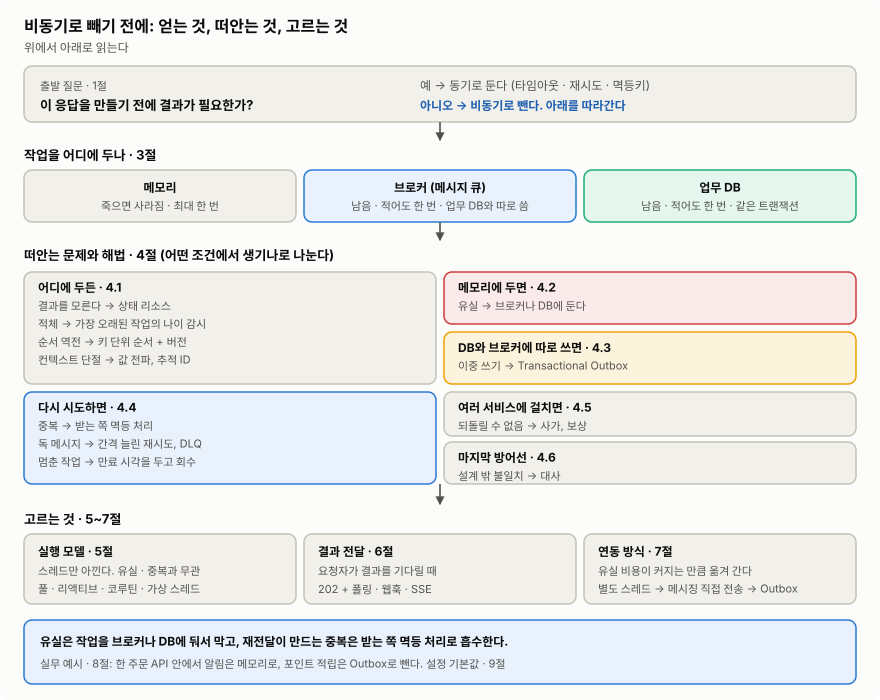

>왼쪽에서 오른쪽으로 읽는다. 얻는 것(1절)의 대가로 떠안는 문제 열 가지와 그 해법(3절)이 생긴다. 실행 모델(4절)은 스레드를, 연동 방식(5절)과 결과 전달(6절)은 신뢰성을 정한다.
>이미지 출처: 자체 작성 (이 글의 1~9절 기준)

순서는 이렇다.

1. 응답 경로에서 무엇을 뺄 수 있는지
2. "비동기"라는 말이 가리키는 두 층
3. 작업이 손을 떠나면 생기는 문제 열 가지
4. 프로세스 안에서 기다리는 법: 실행 모델
5. 작업을 어디에 두고 넘기나: 연동 방식
6. 요청자에게 결과를 돌려주는 법
7. 무엇을 고를지
8. 실무 예시: 알림은 메모리로, 포인트는 Outbox로
9. 설정 기본값 모음

이 글은 큰 그림과 고르는 기준을 다룬다. 각 장치의 구현 세부보다 "무엇이 어디서 깨지고, 무엇으로 막는가"에 집중한다. 기준 버전은 JDK 21, Spring Boot 3.5(Spring Framework 6.2)이고, Kafka 동작은 Kafka 4.x 문서로 확인했다.

## 1. 응답 경로에서 무엇을 뺄 수 있나

응답 경로에는 응답을 만드는 데 꼭 필요하지 않은 일이 섞여 있기 쉽다. 그런 일을 응답 뒤로 빼면 아래를 얻는다.

| 상황 | 비동기로 얻는 것 | ex) |
|---|---|---|
| 응답에 꼭 필요 없는 부수 작업이 응답 경로에 있다 | 응답 시간 단축 | 주문 후 알림, 포인트 적립, 검색 색인 |
| 연동 대상이 자주 느리거나 실패한다 | 장애 격리: 연동 실패가 기능 실패로 번지지 않는다 | 푸시 서버 장애에도 주문은 성공 |
| 유입이 순간적으로 처리량을 넘는다 | 부하 평탄화: 버퍼가 피크를 흡수한다 | 이벤트 오픈 때 포인트 지급 폭주 |
| 같은 사건에 반응할 곳이 계속 늘어난다 | 확장: 생산자 코드를 안 고치고 구독자만 추가한다 | "주문함" 이벤트를 정산·추천·통계가 구독 |
| 작업이 HTTP 타임아웃보다 오래 걸린다 | 긴 작업 처리: 접수만 하고 응답, 결과는 나중에 | 리포트 생성, 동영상 인코딩 |
| 스레드 대부분이 IO 대기로 놀고 있다 | 자원 효율: 대기 중에 스레드를 반납한다 | 외부 API를 많이 부르는 게이트웨이 |

뺄지 말지는 질문 하나로 가른다. ==**지금 이 응답을 만들기 전에 그 결과가 필요한가?**==

- **필요하면 동기로 둔다.** 대신 타임아웃·재시도·멱등키로 그 호출을 안전하게 만든다. ex) 승인 성공·실패를 바로 보여줘야 하는 결제 API.
- **결과가 필요하긴 한데 응답 뒤에 필요하면 뺄 수 있다.** 그동안의 상태를 사용자에게 보여준다. ex) 결제 승인 이벤트를 받아 주문을 확정하고, 그 사이 화면에는 "결제 확인 중"을 띄운다.
- **결과가 필요 없으면 뺀다.** ex) 주문 완료 알림.

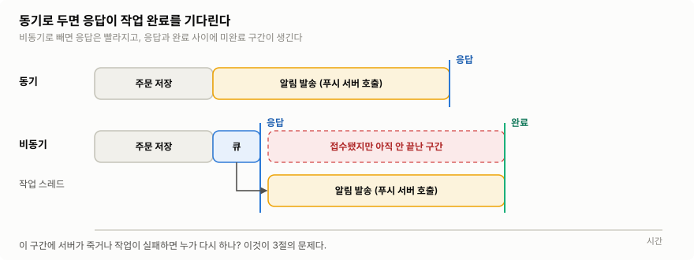

>비동기로 빼면 응답은 접수 직후에 나간다. 그 대가로 응답과 작업 완료 사이에 "접수됐지만 아직 안 끝난" 구간이 생긴다.
>이미지 출처: 자체 작성

빼는 순간 **"요청은 성공했는데 작업은 아직(또는 끝내) 안 된" 상태**가 생긴다. 그래서 두 가지를 더 묻는다. 그 시차를 업무가 허용하는가? 작업이 실패하면 재시도하거나, 나중에 사람이 처리하거나, 무시할 수 있는가? 둘 중 하나라도 "아니오"면 동기로 둔다.

## 2. "비동기"라는 말이 가리키는 두 층

1절 표의 마지막 줄만 성격이 다르다. 나머지는 작업을 **응답 경로 밖으로** 넘겨서 얻고, 마지막 줄은 **프로세스 안에서** 스레드를 아껴서 얻는다. "비동기"라는 말이 이 두 층에서 다른 뜻으로 쓰여서 대화가 자주 엇갈린다.

| 층 | 여기서 "비동기"의 뜻 | ex) | 주로 다루는 문제 |
|---|---|---|---|
| 코드 실행 (프로세스 안) | 호출이 결과를 바로 돌려주지 않고, Future·콜백·`suspend`로 나중에 받는다 | `CompletableFuture`, 코루틴, Reactor | 스레드·컨텍스트·디버깅 |
| 시스템 연동 (응답 경로 밖) | API 서버가 작업 완료를 기다리지 않고 접수만 한 뒤 클라이언트에 응답한다 | 메시지 큐, Outbox, 배치, `202 Accepted` | 유실·중복·순서·일관성 |

같은 프로세스의 별도 스레드(`@Async`)로 넘기는 것도 응답 경로 밖으로 빼는 일이라 시스템 연동 층에서 함께 다룬다. 다만 작업이 메모리에 있어서 유실에 가장 약하다(3.1).

코드 실행 층에는 축이 하나 더 있다. **동기·비동기**는 결과를 언제, 어떻게 받느냐의 문제다. **블로킹·논블로킹**은 기다리는 동안 OS 스레드를 붙잡아 두느냐의 문제다. 두 축은 따로 움직인다. ex) `Future.get()`은 비동기로 시작해 놓고 블로킹으로 기다린다. 가상 스레드(JVM이 관리하는 가벼운 스레드, 4절) 위의 JDBC 호출은 결과를 그 자리에서 받는 동기 호출이다. 하지만 기다리는 동안 OS 스레드를 반납하므로, 이 정의로는 논블로킹이다(반납하지 못하는 예외는 4절). 반대로 플랫폼 스레드(OS 스레드와 1:1로 묶인 기존 스레드)에서는 같은 호출이 동기·블로킹이다.

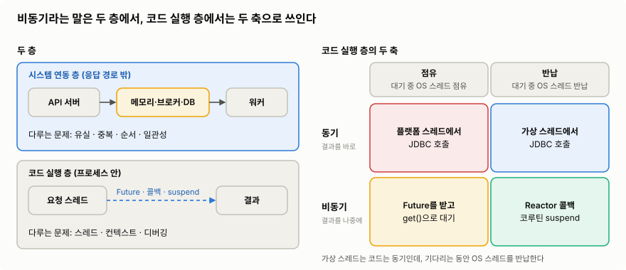

>왼쪽은 "비동기"가 쓰이는 두 층이고, 오른쪽은 코드 실행 층 안에서 동기·비동기와 블로킹·논블로킹이 서로 독립인 두 축이라는 점을 보여 준다.
>이미지 출처: 자체 작성 ([JEP 444: Virtual Threads](https://openjdk.org/jeps/444) 기준)

코드 실행 층에서 얻는 건 자원 효율이다. ==**유실·중복 같은 신뢰성 문제는 대부분 시스템 연동 층에서 생긴다.**== 코루틴으로 바꿨다고 메시지가 덜 사라지지는 않는다. 3절은 시스템 연동 층의 문제를, 4절은 코드 실행 층의 선택지를 다룬다.

## 3. 작업이 손을 떠나면 생기는 문제

동기 호출에도 결과를 모르는 순간은 있다. 상대가 처리한 뒤 응답만 유실되면 호출자는 타임아웃을 받고도 성공했는지 알 수 없다. 그래도 동기에서는 호출자가 그 자리에서 판단하고 재시도할 수 있다. 비동기에서는 작업이 호출자 손을 떠난다. 그래서 **작업이 지금 어디 있고, 몇 번, 어떤 순서로 처리됐는지를 따로 설계해야 한다.** 반복해서 나오는 문제는 열 가지다.

| # | 문제 | 왜 생기나 | 보통의 해법 | 다룬 곳 |
|---|---|---|---|---|
| ① | 유실 | 작업이 메모리에만 있다가 프로세스가 죽는다 | 영속 저장소(브로커·DB)에 보관 | 3.1 |
| ② | 이중 쓰기 | DB 커밋과 메시지 발행이 원자적이지 않다 | Transactional Outbox, CDC | 3.1, 5 |
| ③ | 중복 | 재시도·재전달 때문에 같은 메시지가 또 온다 | 소비자 멱등 처리 | 3.2 |
| ④ | 순서 역전 | 여러 소비자가 병렬로 처리하고, 재시도가 앞지른다 | 키 단위 순서 + 버전 | 3.3 |
| ⑤ | 실패와 독 메시지 | 계속 실패하는 메시지가 뒤를 막는다 | 백오프·지터 재시도, DLQ | 3.4 |
| ⑥ | 적체 | 유입이 처리량을 넘고, 큐가 그 사실을 늦게 드러낸다 | 가장 오래된 메시지의 나이 감시 | 3.4 |
| ⑦ | 결과 전달·멈춘 작업 | 요청자는 결과를 모르고, 처리 중 죽은 작업은 방치된다 | 상태 리소스, 임대(lease)와 회수 | 3.5 |
| ⑧ | 되돌릴 수 없음 | 여러 단계가 하나의 트랜잭션이 아니다 | 사가, 보상 트랜잭션 | 3.6 |
| ⑨ | 컨텍스트·추적 단절 | 스레드·프로세스가 바뀌면 `ThreadLocal`이 안 넘어간다 | 컨텍스트 전파, `traceparent` | 3.7 |
| ⑩ | 설계 밖 불일치 | 버그·수동 작업·재시도 한도 초과 | 대사(reconciliation) | 3.8 |

### 3.1 유실과 이중 쓰기

`@Async`나 스레드 풀은 작업을 **프로세스 메모리의 큐**에 둔다. Spring Boot가 `@Async`용으로 자동 구성하는 실행기는 스레드 8개에 **상한 없는 큐**를 쓴다(9절 표). 처리가 밀리면 큐가 메모리를 계속 먹는다. 종료할 때는 기본값이면 큐에 남은 작업을 실행하지 않고 버리며, 실행 중인 작업은 인터럽트한다. 종료 때 기다리게 하려면 `await-termination`과 `await-termination-period`를 함께 설정해야 한다. 그래도 `kill -9`, OOM, 장비 장애에는 기다릴 기회조차 없다. 그 순간 대기 중이던 작업은 **기록도 없이 사라진다.** 유실을 허용할 수 없다면 작업을 브로커나 DB 같은 **영속 저장소**에 기록해야 한다.

브로커를 쓰더라도 끝이 아니다. "DB 커밋 → 브로커 전송" 순서면 그 사이에 죽었을 때 주문은 있는데 이벤트가 없다. 순서를 뒤집어 "전송 → DB 커밋"으로 하면, 커밋이 실패했을 때 없는 주문의 이벤트가 나간다. 두 저장소에 따로 쓰는 이 문제를 **이중 쓰기**(dual write)라고 한다.

흔히 쓰는 해법은 **Transactional Outbox**다. 보낼 메시지를 업무 데이터와 **같은 DB 트랜잭션**으로 `outbox` 테이블에 넣고, 별도의 릴레이(relay)가 그 테이블을 읽어 브로커로 발행한다.

>Order Service는 브로커에 직접 쓰지 않는다. ① 업무 테이블과 OUTBOX 테이블이 한 트랜잭션에 묶이고, ② Message Relay가 OUTBOX를 읽어 ③ 브로커로 발행한다.
>이미지 출처: [microservices.io: Pattern: Transactional outbox](https://microservices.io/patterns/data/transactional-outbox.html)

이렇게 하면 ==**커밋되면 보낼 근거가 반드시 남고, 롤백되면 메시지도 같이 사라진다.**== 보장 범위는 "DB 트랜잭션 안에서 업무 데이터와 보낼 메시지가 함께 남는다"까지다. 세 방식을 같은 크래시 시점에 놓고 보면 차이가 분명하다.

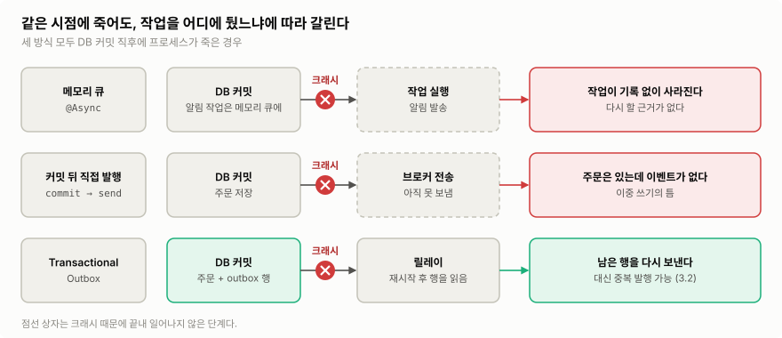

>같은 시점에 죽어도 작업을 어디에 두었느냐에 따라 결과가 갈린다. 메모리 큐와 커밋 뒤 직접 발행은 작업을 잃고, Outbox는 DB에 남은 행으로 다시 보낸다.
>이미지 출처: 자체 작성 ([microservices.io: Transactional outbox](https://microservices.io/patterns/data/transactional-outbox.html) 기준)

대가도 있다. 릴레이가 보낸 뒤 "보냄" 표시 전에 죽으면 다시 보내므로 **중복 발행**은 여전히 생긴다(3.2). 그리고 **모든 쓰기 경로**가 `outbox` INSERT를 빠짐없이 해야 한다. 릴레이가 outbox를 읽는 방식(폴링, CDC)에 따른 차이는 5절에서 본다.

우아한형제들 회원시스템은 이 패턴의 변형을 쓴다. 도메인 데이터와 같은 DB에 이벤트 저장소를 두고 발행 여부 플래그를 함께 저장한다. 첫 발행은 커밋 뒤 리스너가 SNS로 바로 하고, 저장 후 5분이 지나도 발행되지 않은 이벤트는 배치가 찾아 다시 발행한다([우아한형제들 기술블로그](https://techblog.woowahan.com/7835/)).

### 3.2 중복: 정확히 한 번은 범위가 좁다

3.1에서 본 대로 보내는 쪽에서도 중복이 생긴다. 받는 쪽도 같다. Kafka 같은 브로커는 컨슈머가 어디까지 처리했는지를 **오프셋**(읽은 위치)으로 기록한다. 컨슈머가 메시지를 처리한 뒤 오프셋을 커밋하기 전에 죽으면, 재시작한 컨슈머는 마지막 커밋 위치부터 다시 읽는다. 그래서 비동기 연동의 기본값은 **at-least-once**(적어도 한 번)다.

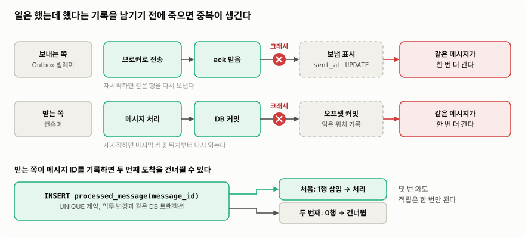

>두 경우 모두 "일은 했는데 했다는 기록을 남기기 전에" 죽어서 중복이 생긴다. 받는 쪽이 메시지 ID를 기록해 두면 두 번째 도착은 건너뛸 수 있다.
>이미지 출처: 자체 작성 ([Apache Kafka 설계 문서](https://kafka.apache.org/43/design/design/) 기준)

**받는 쪽이 멱등해야 한다.** 같은 메시지를 두 번 처리해도 결과가 한 번 처리한 것과 같아야 한다는 뜻이다. 방법은 셋이다.

| 방식 | 동작 | 장점 | 비용·주의 |
|---|---|---|---|
| 처리 이력 테이블 | 메시지 ID를 UNIQUE 컬럼에 INSERT하고, 충돌하면 건너뛴다 | 어떤 업무 로직에도 쓸 수 있다 | 이력 INSERT와 업무 변경이 **같은 DB 트랜잭션**이어야 한다. 이력 테이블 정리가 필요하다 |
| 조건부 UPDATE | `WHERE status = 'PENDING'`처럼 현재 상태를 조건으로 건다 | 테이블을 더 만들지 않는다 | 상태 전이로 표현되는 작업에만 맞다 |
| 덮어쓰기 | 누적(`+ n`) 대신 원본에서 다시 계산해 덮어쓴다 | 몇 번 와도 결과가 같다 | 원본을 다시 읽는 비용이 든다 |

조건부 UPDATE는 영향받은 행 수로 판단한다. 0행이면 이미 다른 쪽이 처리했다는 뜻이라 그대로 끝낸다. 웹훅도 다르지 않다. Stripe는 같은 이벤트가 두 번 이상 올 수 있으니 처리한 이벤트 ID를 기록해 두고 걸러 내라고 안내한다.

"exactly-once를 지원한다"는 말도 범위를 같이 봐야 한다. Kafka 트랜잭션의 exactly-once는 Kafka 토픽을 읽고, 처리하고, 다시 Kafka 토픽에 쓰는 경로에서만 성립한다. DB나 외부 API가 끼면 끝단 결과는 다시 at-least-once가 되고, 위의 멱등 처리로 마무리한다.

### 3.3 순서 역전

여러 소비자가 병렬로 처리하거나, 실패한 메시지가 재시도되는 사이 뒤의 메시지가 먼저 처리되면 순서가 뒤집힌다. 전체 순서를 지키려 들면 병렬 처리를 포기해야 해서 비싸다. 그리고 대부분은 그럴 필요도 없다. 순서가 필요한 범위는 보통 **"같은 주문 안"처럼 업무 단위 하나**다.

Kafka에서는 이 범위를 메시지 키로 정한다. 토픽은 여러 **파티션**으로 나뉘고, 순서는 한 파티션 안에서만 지켜진다. 같은 키는 같은 파티션으로 가므로, 주문 ID를 키로 쓰면 같은 주문의 이벤트는 순서대로, 다른 주문끼리는 병렬로 처리된다. 단, 파티션 수를 바꾸면 같은 키가 다른 파티션으로 갈 수 있어 순서가 깨질 수 있다.

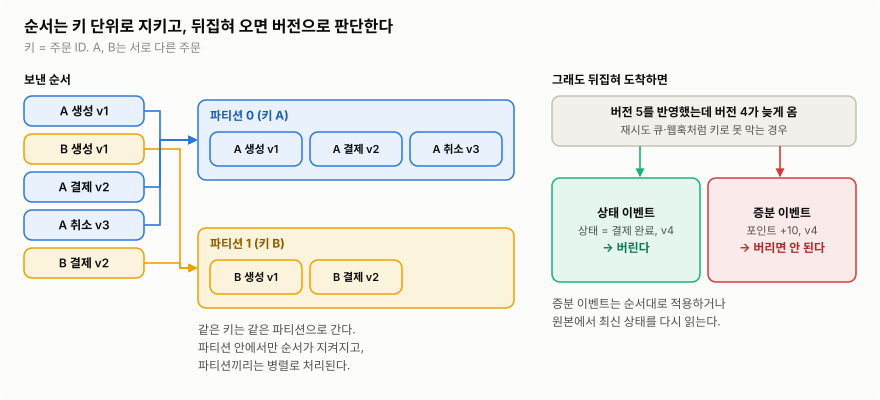

>같은 주문의 이벤트는 같은 파티션에 들어가 순서가 지켜진다. 그래도 순서가 뒤집혀 도착할 수 있다면, 상태 이벤트는 낮은 버전을 버리고 증분 이벤트는 버리면 안 된다.
>이미지 출처: 자체 작성 ([Apache Kafka 소개](https://kafka.apache.org/43/getting-started/introduction/) 기준)

키만으로 막을 수 없는 역전도 있다. 웹훅처럼 보내는 쪽이 순서를 보장하지 않거나(Stripe는 이벤트를 생성 순서대로 보낸다고 보장하지 않는다), 재시도용 큐(3.4)로 옮긴 메시지가 뒤처지는 경우다. 이때는 **버전**으로 판단한다. 버전은 생산자가 같은 주문이 바뀔 때마다 1씩 올려 메시지에 싣는 값이다. ex) 주문 행의 `version` 컬럼. 메시지가 무엇을 담느냐에 따라 대응이 갈린다.

- 이벤트가 그 시점의 **전체 상태**를 담는다면, 이미 가진 것보다 낮은 버전은 버려도 된다. ex) 버전 5(취소)를 반영했는데 버전 4(결제 완료)가 늦게 오면 버린다.
- "포인트 +10" 같은 **증분 이벤트**에서 낮은 버전을 버리면 변경이 빠진다. 순서대로 적용하거나, 원본에서 최신 상태를 다시 읽어야 한다.

### 3.4 실패와 적체

처리가 실패하면 다시 시도한다. 다만 **재시도는 멱등할 때만 한다.** 멱등하지 않은 작업을 재시도하면 3.2의 중복을 스스로 만든다. 간격은 **지수 백오프**(1초, 2초, 4초…처럼 늘린다)에 상한을 두고, **지터**(무작위 흔들림)를 섞는다. 바로 다시 하면 또 실패하고, 모두가 같은 간격으로 다시 하면 재시도가 한꺼번에 몰린다.

몇 번을 해도 실패하는 메시지(독 메시지)는 정해진 횟수 뒤 **DLQ**(dead-letter queue, 처리 못 한 메시지를 따로 모으는 큐)로 옮겨 뒤의 메시지를 막지 않게 한다. AWS는 DLQ에 메시지가 하나라도 들어오면 알람을 건다. 고쳐야 할 버그가 있다는 뜻이기 때문이다.

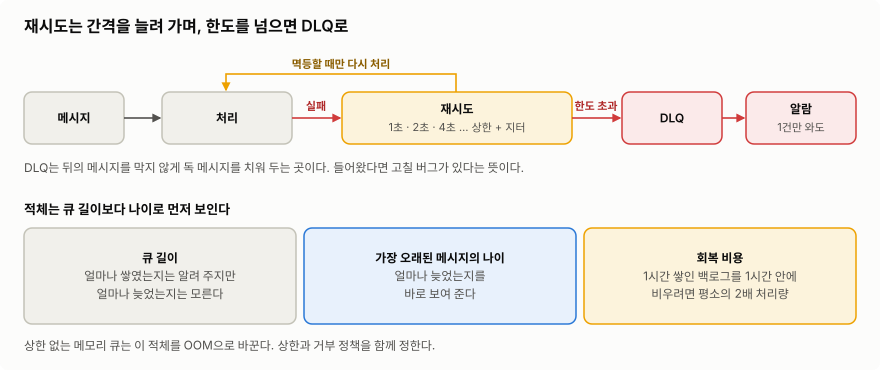

>실패한 메시지는 간격을 늘려 가며 재시도하고, 한도를 넘으면 DLQ로 빠진다. 적체는 큐 길이보다 가장 오래된 메시지의 나이로 먼저 드러난다.
>이미지 출처: 자체 작성 ([AWS Builders' Library: Avoiding insurmountable queue backlogs](https://builder.aws.com/content/3EuRcgkTP1MI0c7zM8W6HL3WIqA/avoiding-insurmountable-queue-backlogs) 기준)

큐는 내구성을 주지만 **문제를 늦게 드러낸다.** 유입이 처리량을 넘어도 큐가 받아 주니 생산자 쪽 지연·에러율은 멀쩡하다. 그래서 AWS는 큐에 있는 **메시지의 나이**를 재서 뒤처짐을 잡는다. Amazon SQS라면 가장 오래된 메시지의 나이를 보여 주는 `ApproximateAgeOfOldestMessage` 지표가 이 역할을 한다. 쌓인 뒤의 회복도 비싸다. 한 시간 장애로 쌓인 백로그를 복구 후 한 시간 안에 비우려면, 그동안 새로 들어오는 양까지 처리해야 하니 **평소의 두 배 처리량**이 필요하다. 상한 없는 메모리 큐는 이 적체를 OOM으로 바꿔 놓는다. 메모리 큐라면 상한과, 가득 찼을 때 어떻게 거부할지(거부 정책)를 함께 정한다.

### 3.5 결과 전달과 멈춘 작업

요청자는 작업이 끝났는지 모른다. 그래서 작업 상태를 **리소스로 드러낸다.** 요청자가 그 리소스를 어떻게 찾아 조회하는지는 6절에서 다룬다. Azure의 비동기 요청-응답 패턴은 상태 응답에 아래 필드를 담으라고 권한다.

- `status`: `Pending`, `Running`, `Succeeded`, `Failed`, `Canceled` 같은 값
- `createdAt`: 접수 시각. 버려진 작업을 찾는 데 쓴다.
- `lastUpdatedAt`: 마지막 갱신 시각. 멈춘 작업과 진행 중인 작업을 구분하는 데 쓴다.

"아직 반영 안 됨"을 `null`로 뭉개면 호출자는 "없음"과 "아직"을 구분하지 못한다.

처리 중에 워커가 죽으면 작업이 `RUNNING`에 멈춘다. 워커는 `WHERE status = 'PENDING'`으로 작업을 잡으므로, 재전달된 메시지가 와도 이미 `RUNNING`인 작업은 건너뛴다. 결국 아무도 다시 하지 않는다.

그래서 작업을 잡을 때 **임대(lease) 만료 시각**을 함께 기록한다. "이 시각까지는 내가 맡는다"는 표시다. 그리고 임대가 지난 `RUNNING` 작업을 `PENDING`으로 되돌려 다시 처리하게 하는 회수 스케줄러를 둔다.

회수만 하면 새 문제가 생긴다. 죽은 줄 알았던 워커가 느렸을 뿐이라면, 뒤늦게 돌아와 새로 잡은 실행의 결과를 덮어쓴다. 그래서 작업을 잡을 때마다 새로 만드는 고유값인 **실행 토큰**을 함께 기록하고, 완료 처리에 `WHERE token = 내 토큰`을 조건으로 건다. 회수 뒤 새 워커가 잡으면 토큰이 바뀌므로, 늦게 돌아온 워커의 완료는 0행으로 끝난다.

Amazon SQS의 가시성 타임아웃도 같은 원리다. 받아 간 메시지를 정해진 시간 동안 숨겨 두고, 그 안에 삭제되지 않으면 다시 보이게 한다.

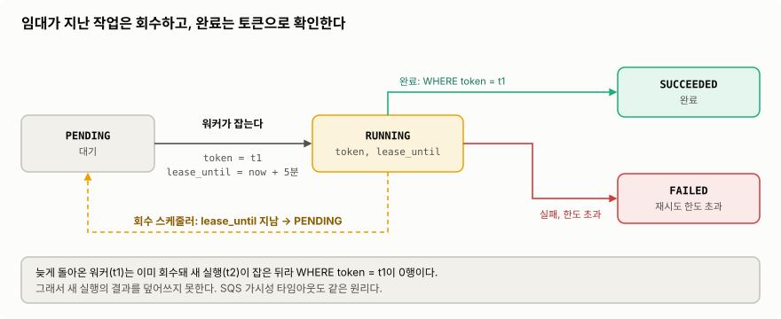

>임대가 지난 RUNNING 작업은 회수 스케줄러가 PENDING으로 되돌린다. 완료는 자기 토큰이 아직 유효할 때만 성공하므로, 늦게 돌아온 워커는 결과를 덮어쓰지 못한다.
>이미지 출처: 자체 작성 ([Amazon SQS 가시성 타임아웃](https://docs.aws.amazon.com/AWSSimpleQueueService/latest/SQSDeveloperGuide/sqs-visibility-timeout.html) 기준)

회수 스케줄러는 주기 스캔이라 주의할 점이 셋이다. `(status, lease_until)` 인덱스가 없으면 매번 풀스캔이 된다. 한 번에 되돌릴 건수에 상한을 둔다. 여러 서버에서 동시에 돌지 않게 `SKIP LOCKED`나 ShedLock 같은 락을 건다.

### 3.6 되돌릴 수 없음: 사가와 보상

여러 서비스에 걸친 작업은 한 DB 트랜잭션으로 묶을 수 없다. 그래서 각 서비스의 로컬 트랜잭션을 차례로 이어 붙이고, 중간에 실패하면 이미 끝난 단계를 **보상 트랜잭션**으로 상쇄한다. 이 묶음을 **사가**(saga)라고 한다.

보상을 롤백으로 생각하기 쉽지만 다르다. 각 단계는 이미 커밋됐으니 되돌릴 수 없고, 보상은 완료된 단계의 **업무 효과를 업무 규칙에 맞게 상쇄하는 새 작업**이다. ex) 잡아 둔 재고 예약을 해제하고, 발급한 쿠폰을 회수한다. 보상도 실패하고 재시도되니 멱등하게 만들어야 한다.

Azure의 사가 패턴 문서는 단계를 셋으로 나눈다.

| 단계 | 뜻 | ex) |
|---|---|---|
| 보상 가능 단계 | 반대 효과를 내는 작업으로 상쇄할 수 있다 | 재고 예약 → 예약 해제 |
| 피벗 단계 | 되돌릴 수 없는 지점. 성공하면 그 뒤는 끝까지 가야 한다 | 외부 결제 승인 |
| 재시도 가능 단계 | 피벗 뒤에 오며, 멱등해서 성공할 때까지 재시도한다 | 배송 요청, 알림 |

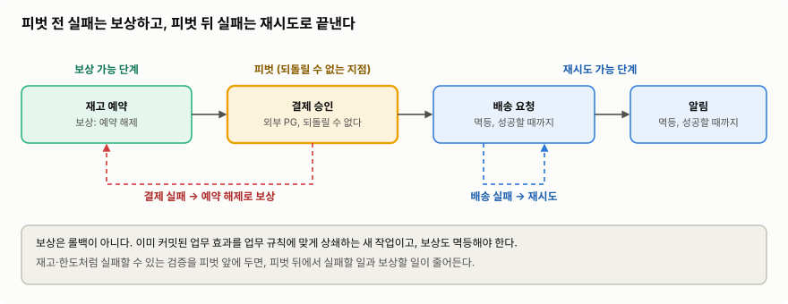

>피벗 전에 실패하면 이미 끝난 단계를 보상하고, 피벗 뒤에 실패하면 되돌리지 않고 재시도로 끝낸다. 실패할 수 있는 검증을 피벗 앞에 두면 보상할 일이 줄어든다.
>이미지 출처: 자체 작성 ([Azure Architecture Center: Saga design pattern](https://learn.microsoft.com/en-us/azure/architecture/patterns/saga) 기준)

이 예에서 결제 승인은 피벗이라 보상하지 않는다. 결제 뒤 단계가 실패하면 결제를 되돌리지 않고, 뒤 단계를 재시도해서 끝낸다.

### 3.7 컨텍스트와 추적의 단절

Spring은 현재 트랜잭션, 로그의 MDC(traceId 같은 값), 인증 정보(`SecurityContext`)를 `ThreadLocal`에 둔다. `ThreadLocal`은 스레드마다 따로 있는 저장소라서, 작업이 다른 스레드로 넘어가면 **이 값들이 따라가지 않는다.**

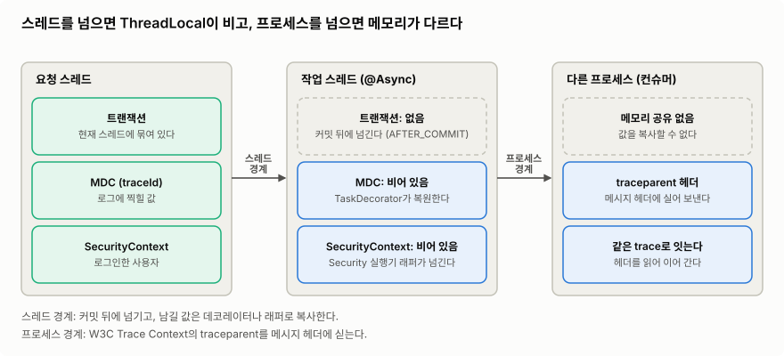

>스레드를 넘으면 ThreadLocal 값이 비고, 프로세스를 넘으면 메모리 자체가 다르다. 스레드 경계는 데코레이터나 실행기 래퍼로 값을 복사하고, 프로세스 경계는 메시지 헤더에 traceparent를 실어 잇는다.
>이미지 출처: 자체 작성 ([W3C Trace Context](https://www.w3.org/TR/trace-context/) 기준)

경계마다 대응이 다르다.

- **트랜잭션**: 트랜잭션은 요청 스레드에 묶여 있어 작업 스레드로 넘어가지 않는다. 커밋 전에 넘기면 작업이 아직 커밋되지 않은 주문을 못 보거나, 롤백된 주문의 알림을 보낼 수 있다. 그래서 커밋이 끝난 뒤에 넘긴다. `@TransactionalEventListener`는 트랜잭션 안에서 발행한 이벤트를 커밋 뒤(기본 `phase = AFTER_COMMIT`)에 받는 리스너다. 트랜잭션 없이 발행하면 기본적으로 아예 호출되지 않는다.
- **리스너 안의 트랜잭션**: 이 리스너 안에서 DB에 다시 쓰려면 새 트랜잭션이 필요하다. Spring Framework 6.1부터는 이 리스너에 `@Transactional`을 붙일 때 `REQUIRES_NEW`나 `NOT_SUPPORTED`만 허용하고, 아니면 시작할 때 예외가 난다(`BEFORE_COMMIT` phase는 6.2.10부터 예외).
- **로그·관측 컨텍스트**: Spring Framework 6.1의 `ContextPropagatingTaskDecorator`는 작업을 감싸서, 원래 스레드의 로그·관측 컨텍스트를 작업 스레드에서 복원한다. Micrometer의 `context-propagation` 라이브러리가 필요하다. 이 데코레이터를 빈으로 등록하면, Spring Boot가 `TaskDecorator` 빈이 하나뿐일 때 그것을 자동 구성 실행기에 건다.
- **인증 정보**: Spring Security의 `DelegatingSecurityContextAsyncTaskExecutor`로 실행기를 감싸 `SecurityContext`를 넘긴다.
- **프로세스 경계**: 메모리가 다르니 값을 복사할 수 없다. 메시지 헤더에 W3C Trace Context의 `traceparent`를 실어 받는 쪽이 같은 trace를 잇게 한다.

### 3.8 설계 밖 불일치: 대사

①~⑨를 다 막아도 버그, 수동 데이터 수정, 재시도 한도 초과는 설계 밖에서 생긴다. 마지막 방어선으로 **원본과 대상을 주기적으로 비교하는 대사**를 둔다. ex) 매일 새벽 주문 테이블과 포인트 적립 내역을 주문 ID로 맞춰 보고, 빠진 적립을 찾는다. 규칙으로 판단할 수 있는 차이만 자동 보정하고, 나머지는 알람으로 사람에게 넘긴다.

## 4. 프로세스 안에서 기다리는 법: 실행 모델

여기부터는 방식을 고른다. 실행 모델은 1절의 자원 효율을, 연동 방식과 결과 전달은 3절의 문제를 다룬다. 질문은 셋이다. 프로세스 안에서 기다리는 동안 스레드를 어떻게 쓸지(**실행 모델**, 4절), 시스템 사이에서 작업을 어디에 보관하고 넘길지(**연동 방식**, 5절), 요청자에게 결과를 어떻게 돌려줄지(**결과 전달**, 6절)다. 이 셋은 같이 쓴다. ex) 코루틴으로 짠 API가 Outbox로 작업을 넘기고, `202` + 폴링으로 결과를 돌려준다.

실행 모델은 IO를 기다리는 동안 스레드를 어떻게 다루느냐로 갈린다.

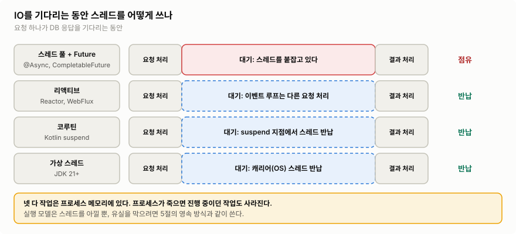

>스레드 풀은 대기 내내 스레드를 붙잡고, 나머지 셋은 대기 중에 스레드를 반납한다. 어느 쪽이든 작업은 프로세스 메모리에 있으니, 프로세스가 죽으면 진행 중이던 작업도 사라진다.
>이미지 출처: 자체 작성 ([JEP 444: Virtual Threads](https://openjdk.org/jeps/444), [Kotlin Coroutines basics](https://kotlinlang.org/docs/coroutines-basics.html) 기준)

| 방식 | 동작 | 장점 | 비용·주의 |
|---|---|---|---|
| 스레드 풀 + Future (`@Async`, `CompletableFuture`) | 작업을 풀의 스레드에 넘기고 Future로 결과를 받는다 | 익숙하고 추가 인프라가 없다 | 블로킹하는 동안 스레드를 점유한다. 큐 상한과 거부 정책이 필요하다 |
| 리액티브 (Reactor, WebFlux) | 적은 수의 이벤트 루프 스레드가 콜백으로 결과를 받는다 | 적은 스레드로 많은 연결을 처리한다. 소비자가 `request(n)`으로 받을 양을 정하는 배압이 내장돼 있다 | 이벤트 루프에서 블로킹하면 전체가 멈춘다. 블로킹 호출은 `Schedulers.boundedElastic()`으로 격리한다. 학습 곡선이 높고 스택 트레이스가 끊긴다 |
| 코루틴 (Kotlin) | `suspend` 지점에서 스레드를 반납하고, 결과가 오면 이어서 실행한다 | 순차 코드처럼 읽힌다. 구조화된 동시성으로 실패·취소가 부모-자식 트리를 따라 전파된다 | `suspend`가 호출 체인 전체로 번진다. 블로킹 라이브러리는 `Dispatchers.IO`로 격리한다 |
| 가상 스레드 (JDK 21+) | JVM이 관리하는 가벼운 스레드가 블로킹되면, 밑의 OS 스레드(캐리어)를 반납한다 | 기존 동기 코드를 거의 그대로 두고 IO 대기로 인한 스레드 한계를 푼다 | 빨라지는 게 아니라 처리량이 늘어난다. 풀링하지 않는다. 기준인 JDK 21에서는 `synchronized` 안에서 블로킹하면 캐리어를 붙잡는다(pinning). JDBC 드라이버가 그렇게 짜여 있으면 반납하지 못한다. JDK 24(JEP 491)에서 대부분 해소됐지만, native 코드나 클래스 초기화 중 블로킹은 여전히 붙잡는다 |

먼저 병목이 정말 **IO 대기 때문에 생긴 스레드 부족인지** 확인한다. DB 쿼리 자체가 느린 거라면 실행 모델을 바꿔도 소용없다. 블로킹 코드베이스라면 코드를 거의 안 고쳐도 되는 가상 스레드부터 검토한다. Spring Boot에서는 `spring.threads.virtual.enabled=true`로 켜며, 그러면 `@Async` 기본 실행기도 가상 스레드를 쓴다. 연결 수가 수만 단위이거나 스트림 배압이 필요할 때 리액티브를 고려한다.

넷 다 작업을 프로세스 메모리에 둔다. ==**실행 모델은 유실을 막지 않는다.**== 유실이 문제라면 5절의 영속 방식과 같이 써야 한다.

## 5. 작업을 어디에 두고 넘기나: 연동 방식

다섯 방식을 가르는 건 **보낼 작업을 어디에 보관하느냐**다. 거기서 유실 범위와 운영 부담이 정해진다.

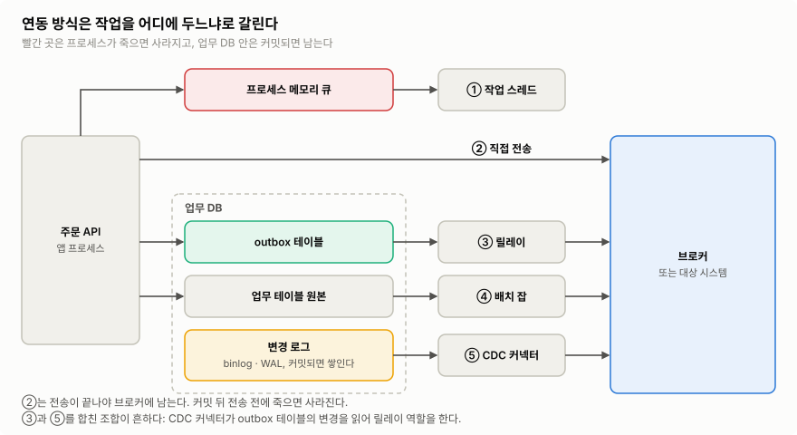

>다섯 방식은 작업을 메모리, 브로커, outbox 테이블, 업무 테이블 원본, DB 변경 로그 중 어디에 두느냐가 다르다. DB에 근거가 남는 아래쪽 셋은 커밋 뒤 크래시에도 작업이 남는다.
>이미지 출처: 자체 작성 ([Debezium: Outbox Event Router](https://debezium.io/documentation/reference/stable/transformations/outbox-event-router.html) 기준)

| | 별도 스레드 | 메시징 직접 전송 | Outbox | 배치 | CDC |
|---|---|---|---|---|---|
| 작업 보관 위치 | 프로세스 메모리 | 브로커 (전송 성공 후) | 업무 DB의 outbox 테이블 | 업무 DB (원본 그대로) | DB 변경 로그 |
| 커밋 후 크래시 시 | 유실 | 전송 전이면 유실 | 보존 | 보존 | 보존 |
| 지연 | 매우 짧다 | 짧다 | 폴링 주기 | 배치 주기 | 짧다 |
| 앱 코드 변경 | 호출부 | 호출부 | 모든 쓰기 경로 | 거의 없다 | 거의 없다 |
| 운영 부담 | 낮다 | 중간 | 중간 | 낮다~중간 | 높다 |
| 맞는 곳 | 유실돼도 되는 부가 기능 | 소비자가 여럿인 느슨한 결합 | 유실되면 안 되는 업무 이벤트 | 시차가 원래 허용된 대량 데이터 | 쓰기 경로가 많은 레거시, 데이터 복제 |

**별도 스레드**는 추가 인프라 없이 코드 몇 줄로 끝나지만, 큐가 메모리에 있어서 프로세스가 죽으면 작업이 사라진다(3.1). `@Async`는 프록시 방식이라 **같은 클래스 안에서 호출하면 비동기로 돌지 않는다.** Spring 문서도 프록시 모드에서는 같은 클래스 안의 호출을 가로챌 수 없다고 적어 두었다.

**메시징 직접 전송**은 브로커가 두 시스템 사이의 버퍼가 된다. 소비자가 느려지거나 죽어도 생산자는 영향을 덜 받고, 새 소비자는 토픽을 구독하기만 하면 된다. 이 확장성은 메시지가 **"주문함" 같은 이벤트일 때** 커진다. "포인트 지급해" 같은 커맨드는 생산자가 여전히 수신자를 안다는 뜻이라 결합이 남는다. 대가는 이중 쓰기(3.1), 중복(3.2), 그리고 브로커 운영이다.

**Outbox**는 3.1에서 본 대로 커밋과 발행 근거를 원자적으로 묶는다. 릴레이는 outbox 테이블을 폴링하거나, 아래의 CDC로 읽는다.

**배치**는 정해진 주기마다 쌓인 데이터를 한꺼번에 보낸다. 원본이 업무 DB에 그대로 있어서 실패하면 같은 범위를 다시 돌리면 된다. 하지만 지연이 곧 주기이고 부하가 한 시점에 몰린다. `updated_at` 기준으로 조회하면 두 가지를 놓친다. 하나는 늦게 커밋된 트랜잭션이다. ex) 10:00:59에 `updated_at`을 쓰고 10:01:05에 커밋된 행은, 10:01:00에 "10:00~10:01" 범위를 조회한 배치가 보지 못하고 다음 배치의 범위에서도 빠진다. 다른 하나는 물리 삭제다. 조회할 행 자체가 없다.

**CDC**(change data capture)는 DB 변경 로그(MySQL binlog, PostgreSQL WAL)를 읽어 전파한다. 어느 경로로 썼든 커밋된 변경은 모두 잡는다. 하지만 **행 변경과 업무 이벤트는 다르다.** `orders.status`가 바뀐 것과 "주문 취소됨"은 같은 말이 아니다. 업무 테이블을 직접 CDC하면 내부 스키마가 외부 계약이 되어 버린다. 운영 부담도 가장 크다. 그래서 **Outbox 테이블을 CDC로 읽어 릴레이로 삼는 조합**이 흔하다. ex) Debezium의 Outbox Event Router.

## 6. 요청자에게 결과를 돌려주는 법

이 절의 방식은 작업이 오래 걸리는데 요청자가 결과를 받아야 할 때 쓴다. 가장 단순한 방식은 **`202 Accepted` + 폴링**이다. `202`는 RFC 9110에서 "요청은 받았지만 처리는 끝나지 않았다"는 뜻의 상태 코드다.

>POST는 202만 받고 끝난다. 클라이언트는 상태 엔드포인트를 GET으로 확인하고, 진행 중이면 200을, 끝나면 303 See Other를 받아 결과 리소스로 간다.
>이미지 출처: [Azure Architecture Center: Asynchronous Request-Reply pattern](https://learn.microsoft.com/en-us/azure/architecture/patterns/asynchronous-request-reply)

`202` 응답에는 폴링할 주소(`Location`)와 다음 확인까지 기다릴 시간(`Retry-After`)을 담는다. 완료 후 리다이렉트는 `303`을 쓴다. `303`은 원래 메서드와 관계없이 결과 리소스를 GET으로 가져오라는 뜻이라 이 패턴과 맞는다. `302`는 메서드를 GET으로 바꾼다고 보장하지 않아서, 원래 요청이 POST인 곳에 쓰면 클라이언트에 따라 POST가 다시 나갈 수 있다.

| 방식 | 동작 | 장점 | 비용·주의 |
|---|---|---|---|
| 202 + 폴링 | 클라이언트가 상태 엔드포인트를 주기적으로 조회한다 | 가장 단순하다. 클라이언트 제약이 없다 | 결과 지연이 폴링 간격만큼 생기고, 불필요한 요청이 많다 |
| 웹훅 (서버 → 서버) | 끝나면 서버가 상대 서버의 엔드포인트를 호출한다 | 즉시 통지되고 폴링 부하가 없다 | 공개 엔드포인트와 서명 검증이 필요하다. 중복·순서 역전을 전제해야 한다 |
| WebSocket / SSE (서버 → 클라이언트) | 연결을 열어 두고 서버가 결과를 밀어 준다 | 실시간이고 진행률을 보여 줄 수 있다 | 연결 유지 비용이 든다. 서버를 늘리면 연결이 어느 서버에 있는지 찾아야 한다 |

트래픽이 적다면 폴링으로 충분하고, 푸시는 폴링 부하가 실제로 문제가 될 때 고른다.

어느 방식이든 지킬 것이 둘 있다.

- **`202`를 돌려주기 전에 요청 검증은 끝낸다.** 잘못된 요청은 바로 `400`으로 돌려보낸다.
- **POST에는 멱등키를 받는다.** 클라이언트는 응답이 유실된 건지 요청이 안 간 건지 구분할 수 없어서 같은 POST를 다시 보낸다. 같은 키가 오면 새 작업을 만들지 말고 기존 상태 리소스를 돌려준다.

웹훅을 받는 쪽은 **서명 검증 → 저장 → 2xx 응답 → 업무 처리** 순서로 간다. Stripe도 복잡한 로직 전에 빨리 2xx를 돌려주고, 업무 처리는 비동기 큐로 하라고 안내한다. ==**2xx를 저장보다 먼저 보내면, 그 사이에 죽었을 때 이벤트가 그대로 사라진다.**== 보내는 쪽은 2xx를 받았으니 다시 보내지 않는다.

## 7. 무엇을 고를까

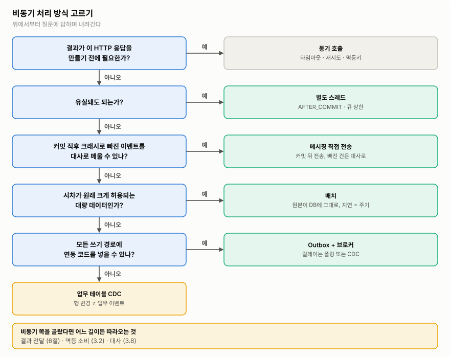

>위에서부터 질문에 답하며 내려간다. 결과가 응답 전에 필요하면 동기로 두고, 아니면 유실을 얼마나 견딜 수 있는지로 방식을 고른다. 어느 비동기 길을 고르든 결과 전달·멱등 소비·대사는 따라온다.
>이미지 출처: 자체 작성

처음부터 다 갖출 필요는 없다. **유실 비용이 커지는 만큼** 별도 스레드 → 메시징 직접 전송 → Outbox 순으로 옮겨 가면 된다. 실행 모델(4절)은 이 흐름과 따로, 스레드가 부족한지를 보고 고른다. 결과 전달(6절)은 요청자가 결과를 기다리는지로 고른다.

## 8. 실무 예시: 알림은 메모리로, 포인트는 Outbox로

주문 API 하나 안에서 두 부수 작업을 다르게 뺀다. 알림은 유실돼도 되니 커밋 뒤 메모리 큐(`@Async`)로, 포인트 적립은 유실되면 안 되니 Outbox로 넘긴다. 포인트 서비스는 같은 메시지를 두 번 받아도 한 번만 적립한다.

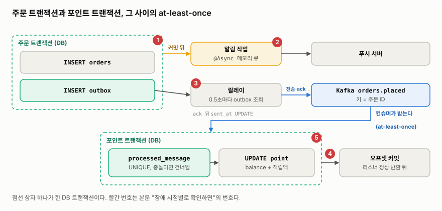

>주문 트랜잭션은 주문과 outbox 행을 함께 커밋하고, 포인트 트랜잭션은 처리 이력과 적립을 함께 커밋한다. 번호는 아래 "장애 시점별로 확인하면"의 번호와 같다.
>이미지 출처: 자체 작성

흐름은 이렇다.

- **주문 서비스**: 한 DB 트랜잭션에서 `orders` 행과 `outbox` 행(보낼 포인트 이벤트)을 함께 INSERT한다.
- **알림**: 커밋 뒤 `@TransactionalEventListener`가 이벤트를 받고, `@Async`로 메모리 큐에 넘겨 푸시를 보낸다.
- **릴레이**: outbox에서 아직 안 보낸 행을 주기적으로 읽어 Kafka로 보내고, 브로커 ack를 받은 뒤에만 `sent_at`을 채운다. 메시지 키는 주문 ID(3.3), 메시지 ID는 outbox 행의 ID다. 다시 보내도 ID는 바뀌지 않는다. 앱을 여러 대 띄우면 릴레이도 여러 대에서 돌아 순서가 섞이니, ShedLock 같은 분산 락으로 한 대만 돌게 한다(3.5의 회수 스케줄러와 같은 문제다).
- **포인트 서비스**: 한 DB 트랜잭션에서 `processed_message`에 메시지 ID를 INSERT하고(충돌하면 건너뜀) 포인트를 적립한다. DB 커밋이 끝난 뒤 오프셋을 커밋한다.

**장애 시점별로 확인하면**

1. 주문 트랜잭션 커밋 전에 죽는다 → 주문과 outbox 행이 함께 롤백된다. 알림 리스너도 호출되지 않는다. 아무것도 나가지 않는다.
2. 커밋 직후, 알림 작업이 메모리 큐에 있을 때 죽는다 → 주문과 outbox 행은 남아 포인트 이벤트는 릴레이가 보낸다. 알림은 사라진다. 이 손실은 처음부터 허용한 것이다.
3. 릴레이가 브로커 ack를 받은 뒤 `sent_at` UPDATE 전에 죽는다 → 다음 주기에 같은 행을 다시 보낸다. 메시지 ID가 같으니 포인트 서비스가 걸러 낸다.
4. 포인트 트랜잭션 커밋 뒤, 오프셋 커밋 전에 죽는다 → 같은 메시지가 다시 온다. `processed_message`에 걸려 건너뛴다.
5. 포인트 트랜잭션 도중에 죽는다 → 처리 이력과 적립이 함께 롤백된다. 다시 받은 메시지로 처음부터 처리한다.

보장 범위를 정리하면, 주문과 outbox는 **DB 트랜잭션**으로 함께 남는다. 릴레이에서 Kafka까지는 **at-least-once**다. 포인트는 처리 이력과 적립이 한 DB 트랜잭션이라 **끝단 결과가 한 번만 반영**된다. 알림은 **최대 한 번**(at-most-once)이다. 한 번 가거나 사라질 뿐, 두 번 가지는 않는다.

포인트 처리가 계속 실패하는 경우도 정해 둬야 한다. 재시도 한도를 넘긴 메시지는 DLQ로 보낸다(3.4). 라이브러리 기본값이 DLQ가 아닐 수 있으니 확인한다. ex) Spring Kafka의 기본 에러 핸들러는 10번 실패하면 로그만 남기고 그 레코드를 건너뛴다. 그대로 두면 포인트가 조용히 빠진다.

## 9. 설정 기본값 모음

| 설정 | 기본값 | 무엇을 정하나 | 다룬 곳 |
|---|---|---|---|
| `spring.task.execution.pool.core-size` | 8 | `@Async` 기본 실행기의 코어 스레드 수 | 3.1 |
| `spring.task.execution.pool.queue-capacity` | 상한 없음 (`Integer.MAX_VALUE`) | 코어 스레드가 모두 바쁠 때 작업을 쌓는 큐의 크기 | 3.1, 3.4 |
| `spring.task.execution.pool.max-size` | 상한 없음 (`Integer.MAX_VALUE`) | 큐가 가득 찼을 때 늘릴 수 있는 최대 스레드 수. 큐에 상한이 없으면 큐가 차지 않으니 코어 수 이상으로 늘지 않는다 | 3.1 |
| `spring.task.execution.shutdown.await-termination` | `false` | 종료할 때 큐에 남은 작업까지 실행할지. `false`면 남은 작업을 버리고 실행 중 작업을 인터럽트한다. `true`여도 컨테이너 종료는 기다리지 않고 나란히 진행된다 | 3.1 |
| `spring.task.execution.shutdown.await-termination-period` | 없음 (기다리지 않음) | 종료할 때 남은 작업을 최대 얼마나 막고 기다릴지 | 3.1 |
| `spring.threads.virtual.enabled` | `false` | 가상 스레드 사용 여부. 켜면 `@Async` 기본 실행기가 가상 스레드를 쓰는 `SimpleAsyncTaskExecutor`가 된다 | 4 |
| `@TransactionalEventListener(phase)` | `AFTER_COMMIT` | 리스너를 트랜잭션의 어느 시점에 호출할지 | 3.7, 8 |
| `@TransactionalEventListener(fallbackExecution)` | `false` | 트랜잭션 없이 발행된 이벤트도 받을지 | 3.7 |

## 실무 판단

- 뺄지 말지는 "이 응답을 만들기 전에 결과가 필요한가?"로 가른다. 필요하면 동기로 두고 타임아웃·재시도·멱등키로 안전하게 만든다.
- 빼는 순간 기본값은 at-least-once다. ==**유실은 영속 저장소로 막고, 중복은 받는 쪽 멱등 처리로 흡수한다.**== exactly-once는 Kafka 안이나 한 DB 트랜잭션 안처럼 범위를 좁혀야만 성립한다.
- 코루틴·리액티브·가상 스레드는 스레드를 아껴 줄 뿐, 유실·중복과는 상관없다.
- 유실 비용이 커지는 만큼 별도 스레드 → 메시징 → Outbox 순으로 옮겨 간다. 한 API 안에서도 작업마다 다르게 고를 수 있다(8절).
- 도입 전에 아래를 확인한다.
	- 작업이 어디에 보관되는가? 프로세스가 죽으면 어떻게 되는가?
	- DB 커밋과 발행 사이에 크래시 구간이 있는가?
	- 소비자가 같은 메시지를 두 번 받아도 안전한가?
	- 순서가 필요한 범위는 어디까지인가? 그 범위의 키를 메시지 키로 쓰는가?
	- 재시도 간격·지터, DLQ, DLQ 알람이 있는가?
	- 가장 오래된 메시지의 나이를 보고 있는가?
	- 요청자가 "아직"과 "실패"를 구분할 수 있는가?
	- 처리 중에 죽은 작업을 누가 되찾는가?
	- 원본과 대상을 대조하는 대사가 있는가?

참고: [Azure Architecture Center — Asynchronous Request-Reply pattern](https://learn.microsoft.com/en-us/azure/architecture/patterns/asynchronous-request-reply) · [Azure Architecture Center — Saga design pattern](https://learn.microsoft.com/en-us/azure/architecture/patterns/saga) · [AWS Builders' Library — Avoiding insurmountable queue backlogs](https://builder.aws.com/content/3EuRcgkTP1MI0c7zM8W6HL3WIqA/avoiding-insurmountable-queue-backlogs) · [AWS Builders' Library — Timeouts, retries, and backoff with jitter](https://builder.aws.com/content/3EumjoZascWd1oZiEgL8ORlv3qE/timeouts-retries-and-backoff-with-jitter) · [Amazon SQS — Visibility timeout](https://docs.aws.amazon.com/AWSSimpleQueueService/latest/SQSDeveloperGuide/sqs-visibility-timeout.html) · [Stripe — Receive Stripe events in your webhook endpoint](https://docs.stripe.com/webhooks) · [microservices.io — Pattern: Transactional outbox](https://microservices.io/patterns/data/transactional-outbox.html) · [우아한형제들 기술블로그 — 회원시스템 이벤트기반 아키텍처 구축하기](https://techblog.woowahan.com/7835/) · [Debezium — Outbox Event Router](https://debezium.io/documentation/reference/stable/transformations/outbox-event-router.html) · [Apache Kafka — Design: Message Delivery Semantics](https://kafka.apache.org/43/design/design/) · [Spring Boot — Task Execution and Scheduling](https://docs.spring.io/spring-boot/3.5/reference/features/task-execution-and-scheduling.html) · [Spring Framework — EnableAsync](https://docs.spring.io/spring-framework/docs/6.2.x/javadoc-api/org/springframework/scheduling/annotation/EnableAsync.html) · [Spring Framework — Transaction-bound Events](https://docs.spring.io/spring-framework/reference/6.2/data-access/transaction/event.html) · [Spring Framework — ContextPropagatingTaskDecorator](https://docs.spring.io/spring-framework/docs/6.2.x/javadoc-api/org/springframework/core/task/support/ContextPropagatingTaskDecorator.html) · [Spring Boot 3.5 — TaskExecutorConfigurations 소스](https://github.com/spring-projects/spring-boot/blob/3.5.x/spring-boot-project/spring-boot-autoconfigure/src/main/java/org/springframework/boot/autoconfigure/task/TaskExecutorConfigurations.java) · [Spring for Apache Kafka 3.3 — Handling Exceptions](https://docs.spring.io/spring-kafka/reference/3.3/kafka/annotation-error-handling.html) · [Spring Security — Concurrency Support](https://docs.spring.io/spring-security/reference/features/integrations/concurrency.html) · [Project Reactor — How do I wrap a synchronous, blocking call?](https://projectreactor.io/docs/core/release/reference/faq.html#faq.wrap-blocking) · [Reactive Streams — README](https://github.com/reactive-streams/reactive-streams-jvm/blob/master/README.md) · [Kotlin — Coroutines basics](https://kotlinlang.org/docs/coroutines-basics.html) · [JEP 444: Virtual Threads](https://openjdk.org/jeps/444) · [JEP 491: Synchronize Virtual Threads without Pinning](https://openjdk.org/jeps/491) · [W3C — Trace Context](https://www.w3.org/TR/trace-context/) · [RFC 9110 — HTTP Semantics](https://www.rfc-editor.org/rfc/rfc9110)
