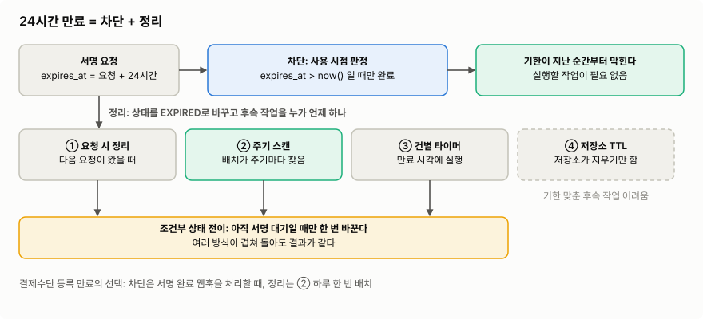
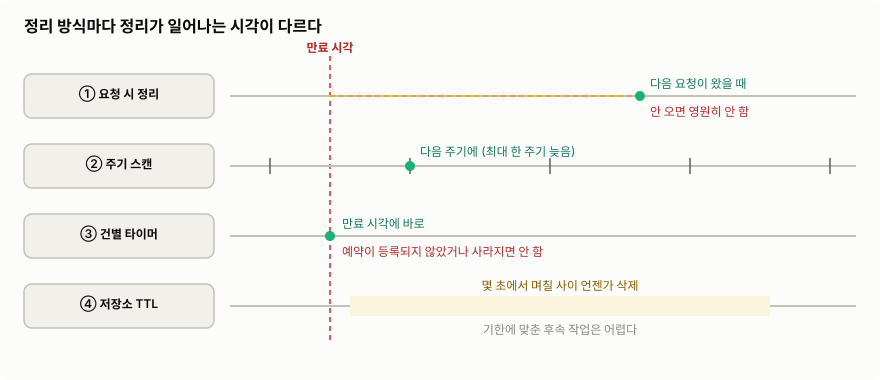
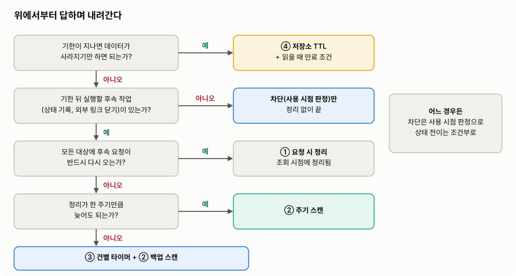
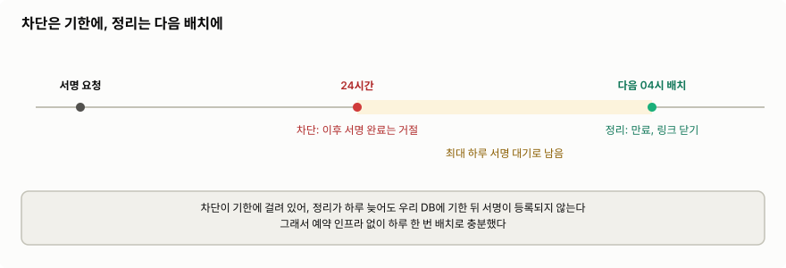

**만료 처리**는 기한이 지난 데이터를 더는 쓰지 못하게 막고, 상태를 바꾸고, 필요한 후속 작업을 실행하는 일이다. 이 노트는 "결제수단 등록 서명 요청은 24시간이 지나면 만료된다"는 요구사항 하나를 예시로 쓴다.

> **기한이 지난 데이터를 언제, 무엇이 알아채서 정리하게 해야 하는가?**



>차단은 데이터를 쓰려는 순간 만료 시각을 비교하면 끝난다. ==**설계할 것은 정리를 맡을 방식**==이고, 어느 방식이든 상태 전이는 "아직 서명 대기일 때만 한 번" 일어나게 만든다. ④ 저장소 TTL은 Redis처럼 저장소가 기한 지난 데이터를 스스로 지우는 기능이다.
>
>이미지 출처: 자체 작성

## 1. 만료는 차단과 정리, 두 가지 일이다

예시 요구사항은 이렇다. 사용자가 결제수단 등록을 요청하면 서버는 등록을 서명 대기(`REQUESTED`)로 저장하고, 외부 출금 대행사의 서명 링크를 보낸다. 서명이 끝나면 대행사가 서명 완료 웹훅을 보낸다. 요청 후 24시간 안에 서명하지 않으면 만료다.

이 요구사항은 두 가지 일로 나뉜다.

- **차단**: 24시간이 지난 뒤 온 서명 완료는 등록하지 않는다. 웹훅을 처리할 때 `expires_at > now()`를 조건에 넣으면, 따로 실행되는 작업 없이 기한이 지난 순간부터 막힌다. 이처럼 데이터를 쓰려는 순간 만료 시각과 비교하는 것을 이 노트에서는 **사용 시점 판정**이라 부른다.
- **정리**: 등록을 만료(`EXPIRED`)로 바꾸고 서명 링크를 닫는다. 데이터를 바꿔야 하므로 ==**기한 이후에 누군가 실행해야**== 한다.

차단은 사용 시점 판정 하나로 끝나므로, 만료 처리 방식을 고른다는 것은 "==**정리를 누가, 언제 실행하나**=="를 정하는 일이다.

정리는 서명 완료 웹훅과 같은 행을 두고 경합할 수 있다. 그래서 판정과 전이를 **조건부 UPDATE** 한 문장에 넣는다. `WHERE`에 현재 상태와 만료 시각을 넣고, 영향받은 행이 1이면 이쪽이 전이를 한 것이고, 0이면 다른 쪽이 먼저 바꾼 것이다([[02 비동기로 빼기 전에 알아야 할 것, 유실·중복·순서와 처리 방식 총정리#중복과 멱등 처리|02의 조건부 UPDATE]]). PostgreSQL 기본 격리 수준(READ COMMITTED)에서는 늦은 UPDATE가 먼저 쓴 트랜잭션을 기다린 뒤 바뀐 행에 `WHERE`를 다시 평가하므로, 둘 중 한쪽만 성공한다([PostgreSQL — Read Committed](https://www.postgresql.org/docs/16/transaction-iso.html#XACT-READ-COMMITTED)). 

## 2. 정리를 맡기는 네 가지 방식



>①은 다음 요청에, ②는 다음 주기에, ③은 만료 시각에 정리한다. ④는 저장소가 언젠가 지우기만 한다. 빨간 글씨는 정리가 아예 일어나지 않는 경우다.
>
>이미지 출처: 자체 작성 ([Redis — EXPIRE](https://redis.io/docs/latest/commands/expire/), [DynamoDB — Time to Live](https://docs.aws.amazon.com/amazondynamodb/latest/developerguide/howitworks-ttl.html) 기준)

### ① 요청 시 정리

해당 데이터로 요청이 왔을 때 만료면 그 자리에서 정리한다. **lazy expiration**이라고도 한다.

①~③은 정리를 "언제" 부르는지만 다르고, 정리 한 건이 하는 일은 같다. 그래서 정리 한 건을 하나로 두고 모든 방식이 이것을 부르게 한다.

```kotlin
// 정리 한 건. ①~③이 모두 이것을 부른다.
interface RegistrationExpirer {
    // 1. 상태가 REQUESTED이고 expires_at <= now()인지 확인한다. 아니면 아무것도 하지 않는다.
    // 2. 대행사 API로 서명 링크를 닫는다. 이미 닫혀 있어도 성공하는 멱등 호출이다.
    // 3. UPDATE payment_method_registration SET status = 'EXPIRED'
    //    WHERE id = :id AND status = 'REQUESTED' AND expires_at <= now()
    // 링크를 먼저 닫으므로 3 전에 실패해도 다음 호출이 이어서 끝낸다. 몇 번 불려도 결과가 같다.
    fun expire(id: Long)
}

enum class RegistrationStatus { REQUESTED, COMPLETED, EXPIRED }

interface RegistrationRepository {
    fun getStatus(id: Long): RegistrationStatus
}
```

```kotlin
@Service
class RegistrationQueryService(
    private val registrations: RegistrationRepository,
    private val expirer: RegistrationExpirer,
) {
    fun getStatus(id: Long): RegistrationStatus {
        runCatching { expirer.expire(id) }   // 기한이 지났으면 조회 직전에 정리한다. 실패해도 조회는 계속한다
        return registrations.getStatus(id)
    }
}
```

- 장점:
	- 스케줄러가 필요 없다
- 단점:
	- 요청이 오지 않는 데이터는 영원히 정리되지 않는다
	- => 그래서 단독으로는 거의 쓰지 않고, 다른 방식에 덧붙여 "==**조회하는 순간에는 정리돼있게**==" 만드는 데 사용
- 적합한 상황:
	- **다른 방식이 정리하기 전이라도 조회 결과에 만료가 바로 보여야 할 때**
	- 모든 대상에 요청이 반드시 다시 오는 경우. ex) 캐시 항목은 읽을 때 만료면 지우고 다시 채운다

### ② 주기 스캔

스케줄러가 주기마다 기한 지난 데이터를 조회해 정리한다. 내가 사내 CMS 프로젝트에서 서명을 만료시킬 때 썼던 일일 만료 배치가 여기에 해당한다.

```kotlin
// ①의 RegistrationRepository에 대상 조회를 더한다
interface RegistrationRepository {
    // 기한이 지난 서명 대기 id를 afterId 다음부터 id 순으로 limit개 읽는다(keyset 페이지네이션):
    //   SELECT id FROM payment_method_registration
    //   WHERE status = 'REQUESTED' AND expires_at <= now() AND id > :afterId
    //   ORDER BY id LIMIT :limit
    // 정리한 건은 조건에서 빠지므로 OFFSET으로 넘기면 안 읽은 건을 건너뛴다.
    // 마지막 id 다음부터 읽으면 건너뛰지 않고, 실패해 남은 건을 되풀이해 읽지도 않는다.
    fun findExpiredIds(afterId: Long, limit: Int): List<Long>
}
```

```kotlin
@Component
class RegistrationExpiryJob(
    private val registrations: RegistrationRepository,
    private val expirer: RegistrationExpirer,
) {
    @Scheduled(cron = "0 0 4 * * *", zone = "Asia/Seoul")   // 매일 04:00
    fun run() = expireFrom(afterId = 0)

    private tailrec fun expireFrom(afterId: Long) {
        val ids = registrations.findExpiredIds(afterId, PAGE_SIZE)
        ids.forEach(::expireSafely)
        if (ids.size == PAGE_SIZE) expireFrom(afterId = ids.last())
    }

    private fun expireSafely(id: Long) {
        runCatching { expirer.expire(id) }
            .onFailure { log.warn("등록 {} 만료 실패, 다음 실행에서 다시 시도", id, it) }
    }

    companion object {
        private const val PAGE_SIZE = 100
        private val log = LoggerFactory.getLogger(RegistrationExpiryJob::class.java)
    }
}
```

건마다 `expire`를 부르는 이유는 서명 링크를 닫는 외부 호출이 건마다 있고, 그게 성공한 뒤에 상태를 바꿔야 해서다. ==**후속 작업이 상태 변경뿐이면 벌크 UPDATE 한 문장이면 된다**==.

```sql
-- 외부 후속 작업이 없을 때. 대상이 많으면 LIMIT을 건 서브쿼리로 나눠 실행해 잠금 시간을 줄인다.
UPDATE payment_method_registration SET status = 'EXPIRED'
WHERE status = 'REQUESTED' AND expires_at <= now();
```

- 장점:
	- 스케줄러와 조회 쿼리 하나면 되는 단순한 구조다
	- 매 실행이 대상을 다시 조회하므로 ==**실패하거나 서버가 죽어도 다음 실행이 처리한다**==. 미리 등록해 두는 것이 없어 유실도 없다
- 단점:
	- 정리가 최대 한 주기 늦는다
	- 대상이 없어도 실행되고, 대상을 찾는 인덱스(`(status, expires_at)`)가 필요하다
	- 서버가 여러 대면 같은 배치가 동시에 돈다. 결과는 조건부 전이라 틀어지지 않지만 외부 호출과 DB 부하가 최대 서버 수만큼 늘어난다
- 적합한 상황:
	- 차단이 사용 시점 판정으로 이미 되고 있어 정리가 늦어도 되는 경우. 대부분의 만료 요구사항이 여기에 해당한다
	- ③의 예약이 사라졌을 때 놓친 건을 줍는 백업 스캔

중복 실행이 문제라면 두 방법 중 하나를 쓴다.

- **ShedLock**: 배치 실행에 락을 걸어 여러 서버 중 한 대만 돌게 한다.
	- 장점:
		- `@SchedulerLock` 애너테이션 하나로 붙고, 배치 코드는 그대로 둔다
	- 단점:
		- 한 대만 일하므로 대상이 많아도 처리 속도는 서버 한 대 그대로다
		- 락을 저장할 테이블이 따로 필요하다
	- 적합한 상황:
		- 대상이 적어 한 대로 충분한 배치. 이 예시의 일일 배치가 여기에 해당한다
- **`FOR UPDATE SKIP LOCKED`**: 대상을 잠그며 읽고, 다른 서버가 잠근 행은 건너뛰어 여러 대가 일을 나눈다.
	- 장점:
		- 서버를 늘리면 처리 속도도 늘어난다
		- 별도 락 라이브러리가 필요 없다
	- 단점:
		- 잠금은 트랜잭션이 끝나면 풀리므로 읽기부터 정리까지 한 트랜잭션이어야 한다. 위 코드처럼 ==**읽기와 `expire`를 나누면 효과가 없다**==
		- ==**외부 API를 호출하는 동안 트랜잭션과 행 잠금이 유지**==된다
	- 적합한 상황:
		- 대상이 많아 한 대로는 주기 안에 끝나지 않고, 정리가 DB 안에서 끝나 트랜잭션이 짧은 경우

서버가 한 대거나 대상이 적어 중복 호출이 문제 되지 않으면 둘 다 없어도 된다.

### ③ 건별 타이머

데이터를 만들 때 ==**"만료 시각에 실행될 작업"을 한 건씩 예약**==한다.

가장 흔한 구현은 **지연 큐**다. 메시지를 넣을 때 지연 시간을 정하면, 그 시간이 지나야 컨슈머가 받는다. 만료 시각까지 남은 시간을 지연으로 넣으면 ==**만료 시각에 정리 핸들러가 실행**==된다.

도구를 고를 때 먼저 볼 것은 ==**메시지마다 다른 지연을 줄 수 있는가**==다. 일반 큐와 Kafka 토픽은 들어온 순서대로 내보내는 FIFO라서 만료 시각 순으로 정렬하지 않는다. 지연이 다른 메시지를 한 큐에 섞으면, 앞에 있는 긴 지연 메시지가 나갈 때까지 뒤의 짧은 지연 메시지도 나가지 못한다.

**고정 지연**: 큐·토픽마다 지연을 하나로 고정한다(ex) `delay-1m`, `delay-1h`, `delay-24h`). 
- 한 큐 안에서는 들어온 순서가 곧 만료 순서라 막히지 않는다. 
- 재시도 백오프처럼 지연이 몇 단계로 정해진 일이나, 이 예시처럼 모두 24시간인 만료에 맞는다.

| 방식                               | 동작                                            | 장점                                                           | 비용·주의                                      |
| -------------------------------- | --------------------------------------------- | ------------------------------------------------------------ | ------------------------------------------ |
| RabbitMQ 큐 TTL + DLX(데드레터 익스체인지) | 큐 단위 TTL(`x-message-ttl`)이 지난 메시지를 다른 큐로 보냄   | 기존 RabbitMQ로 구현                                              | 큐 맨 앞 메시지만 만료를 확인한다. 메시지마다 TTL을 다르게 주면 막힌다 |
| Kafka 지연 단계별 토픽                  | 컨슈머가 "메시지 시각 + 지연" 전이면 파티션을 멈췄다가 시각이 되면 다시 읽음 | 기존 Kafka로 구현. Spring Kafka `@RetryableTopic`의 재시도 토픽이 이 방식이다 | Kafka 4.x에는 메시지 단위 지연 기능이 없다               |

**임의 지연**: 메시지마다 실행 시각을 정한다. 브로커나 저장소가 시각 순 인덱스를 따로 들고 있어 FIFO 문제가 없다. 기한이 건마다 제각각이면 이쪽을 쓴다.

| 방식 | 동작 | 장점 | 비용·주의 |
|---|---|---|---|
| SQS `DelaySeconds` | 메시지마다 지연을 정함 | 관리형 | 최대 15분. 24시간은 넣을 수 없다 |
| RabbitMQ 4.4 쿼럼 큐 지연 메시지 | `x-opt-delivery-time`(ms 단위 시각)이 지나야 컨슈머에게 보임 | 플러그인 없이 동작하고 복제된다 | 4.4 이상. 지연 중인 메시지도 큐 길이 제한에 포함된다 |
| Apache Pulsar `deliverAt` | 브로커가 시각→메시지 인덱스를 메모리에 두고, 시각이 된 것을 내보냄 | 메시지마다 시각 지정 | Shared·Key_Shared 구독에서만 동작한다 |
| RocketMQ 5.x 지연 메시지 | 시각 기반 저장소에 두었다가 전달 | 메시지마다 시각 지정 | 기본 최대 24시간이고 바꿀 수 없다 |
| EventBridge Scheduler 일회성 스케줄 | `at(...)` 시각에 SQS·Lambda 같은 대상을 호출 | 관리형, 긴 기한 가능 | 1분 단위 정밀도. 끝난 스케줄도 할당량을 차지해 지워야 한다 |
| Redis Sorted Set | 점수를 실행 시각으로 두고 폴링 | 단순, 기한 제한 없음 | 폴링 워커 필요. 디스크 저장(RDB·AOF)을 꺼 두면 재시작 때 예약이 사라진다 |
| Temporal(영속 워크플로 엔진) 타이머 | 워크플로 안에서 `sleep` | 워커가 죽어도 복구 후 실행 | 엔진 운영 비용 |

아래 코드는 표의 Redis Sorted Set 방식이다. Sorted Set은 점수(score)로 정렬되는 집합이다. 실행 시각(만료 시각 + 몇 초 여유)을 점수로 넣고, 1초마다 점수가 지금보다 작은 것을 꺼낸다. 등록을 저장하는 트랜잭션에서 `RegistrationRequested(id, expiresAt)` 이벤트를 발행하고, `@TransactionalEventListener(AFTER_COMMIT)`로 커밋된 뒤에만 예약한다.

```kotlin
// 구현: Redis Sorted Set. 키 하나에 (member = 등록 id, score = 실행 시각 epoch ms)
interface ExpirySchedule {
    // ZADD registration:expiry <at> <id>
    fun schedule(id: Long, at: Instant)

    // 실행 시각이 지난 것을 최대 limit개 꺼낸다:
    //   ZRANGE registration:expiry -inf <now> BYSCORE LIMIT 0 <limit> 로 후보를 읽고,
    //   ZREM 이 1을 돌려준 것만 반환한다. 여러 서버가 폴링해도 한 건은 한 서버만 받는다.
    fun takeDue(now: Instant, limit: Int): List<Long>
}
```

```kotlin
@Component
class RegistrationExpiryTimer(
    private val schedule: ExpirySchedule,
    private val expirer: RegistrationExpirer,
) {
    @TransactionalEventListener(phase = TransactionPhase.AFTER_COMMIT)   // 커밋된 등록에만 예약한다
    fun on(event: RegistrationRequested) {
        // 앱 시계가 DB보다 빠르면 DB 기준으로는 아직 기한 전이라 expire가 아무것도 하지 않고,
        // 예약은 이미 꺼내져 다시 오지 않는다. 그래서 여유를 두고 늦게 예약한다.
        schedule.schedule(event.id, event.expiresAt + CLOCK_SKEW_MARGIN)
    }

    @Scheduled(fixedDelay = 1_000)
    fun poll() {
        schedule.takeDue(Instant.now(), limit = 100).forEach { id ->
            runCatching { expirer.expire(id) }   // 실패하면 이 예약은 사라진다. ② 주기 스캔이 나중에 처리한다
                .onFailure { log.warn("등록 {} 만료 실패, 주기 스캔이 처리", id, it) }
        }
    }

    companion object {
        private val CLOCK_SKEW_MARGIN = Duration.ofSeconds(5)
        private val log = LoggerFactory.getLogger(RegistrationExpiryTimer::class.java)
    }
}
```

- 장점:
	- 만료 시각에 바로 정리된다
	- 테이블을 스캔하지 않는다
- 단점:
	- 지연 큐, Redis, 워크플로 엔진 같은 예약 인프라가 필요하다
	- ==**예약이 사라질 수 있다**==. DB 커밋과 예약 등록이 원자적으로 묶이지 않아 그 사이 서버가 죽으면 예약이 없다([[02 비동기로 빼기 전에 알아야 할 것, 유실·중복·순서와 처리 방식 총정리#4.3 DB와 브로커에 따로 쓰면: 이중 쓰기|02의 이중 쓰기]]). `takeDue`로 꺼낸 뒤 `expire`가 실패해도 그 건은 다시 실행되지 않는다
	- 그래서 ② 백업 스캔을 거의 항상 함께 둬야 한다
- 적합한 상황:
	- 만료 알림처럼 정리 자체가 기한에 맞아야 하는 경우
	- 지연 큐나 워크플로 엔진을 이미 운영하고 있는 경우

서명이 먼저 끝나도 예약은 지우지 않는다. 실행돼도 `expire`가 서명 대기가 아닌 것을 보고 아무것도 하지 않는다.

큰 규모의 지연 작업 시스템도 구조는 같다. Meta의 분산 우선순위 큐 FOQS는 MySQL에 항목마다 `deliver_after`(이 시각 이후 꺼낼 수 있음)를 저장해 두고, 그 시각이 지난 항목을 꺼낸다([Meta — FOQS](https://engineering.fb.com/2021/02/22/production-engineering/foqs-scaling-a-distributed-priority-queue/)).

### ④ 저장소 TTL

저장소에 만료 시간을 주면 저장소가 알아서 지운다.

```kotlin
// redis: StringRedisTemplate
redis.opsForValue().set("auth-code:$id", code, Duration.ofHours(24))   // 24시간 뒤 키가 만료돼 더는 읽히지 않는다
```

- 장점:
	- 코드가 거의 없고 스케줄러도 필요 없다
- 단점:
	- 삭제 시각이 정확하지 않다. DynamoDB는 보통 만료 후 며칠 안에 지우고, 그 전까지 읽기에 나오므로 읽을 때 만료 조건으로 걸러야 한다([DynamoDB — Time to Live](https://docs.aws.amazon.com/amazondynamodb/latest/developerguide/howitworks-ttl.html)).
	- 상태를 `EXPIRED`로 남기거나 외부 링크를 닫는 후속 작업을 기한에 맞춰 붙이기 어렵다. Redis keyspace notification의 `expired` 이벤트(키가 만료돼 지워질 때 구독자에게 보내는 알림)를 쓰려 해도, 이 이벤트는 TTL 시각이 아니라 Redis가 키를 실제로 지울 때(키에 접근하거나 백그라운드 점검에 걸릴 때) 나온다. 구독자가 끊겨 있던 동안의 이벤트는 다시 받을 수 없다([Redis — Keyspace notifications](https://redis.io/docs/latest/develop/pubsub/keyspace-notifications/))
- 적합한 상황:
	- 세션, 인증 코드, 멱등키처럼 ==**데이터가 사라지기만 하면 되는 경우**==

## 3. 고르는 기준

각 방식을 표로 정리해보면 다음과 같다.

| 방식        | 동작               | 장점                 | 비용·주의                            |
| --------- | ---------------- | ------------------ | -------------------------------- |
| ① 요청 시 정리 | 요청이 왔을 때 정리      | 스케줄러 없음            | 요청이 안 오면 영원히 정리 안 됨              |
| ② 주기 스캔   | 주기마다 조회해 정리      | 단순, 실패해도 다음 실행이 처리 | 최대 한 주기 지연, 스캔 비용, 중복 실행 관리      |
| ③ 건별 타이머  | 만료 시각에 실행될 작업 예약 | 만료 시각에 바로 정리       | 예약 인프라 필요, 유실 대비 ② 백업 필요         |
| ④ 저장소 TTL | 저장소가 언젠가 삭제      | 코드 거의 없음           | 삭제 시각 불확실, 후속 작업을 기한에 맞춰 붙이기 어려움 |



>위에서부터 답하며 내려간다. 어느 방식이든 차단은 사용 시점 판정, 상태 전이는 조건부로 한다.
>
>이미지 출처: 자체 작성

기한 뒤에 상태를 기록하거나 외부를 닫을 일이 없으면 정리 자체가 필요 없다. 차단만 걸어 두고 행은 그대로 둔다.

마지막 질문 "정리가 한 주기만큼 늦어도 되는가?"의 답은 ==**차단이 이미 사용 시점 판정으로 되고 있는지**==에 달려 있다. 차단이 기한에 걸려 있으면 정리가 늦어도 우리 DB에서 만료된 데이터가 쓰이는 일은 없다. 그러면 주기는 "상태와 외부 시스템이 얼마나 빨리 맞춰져야 하나"로만 정한다. 반대로 사용자에게 만료 알림을 정시에 보내야 하는 것처럼 정리 자체가 기한에 맞아야 하면 ③을 쓴다.

## 4. 예시: 24시간 만료에 일일 배치를 고른 이유



>차단은 24시간 시점에 정확히 걸린다. 정리는 다음 04시 배치가 하므로, 그 사이 최대 하루는 서명 대기로 남는다.
>
>이미지 출처: 자체 작성

3절의 질문 순서대로 답하면 이렇다.

- **사라지기만 하면 되나?**: 아니다. 등록을 `EXPIRED`로 남기고 서명 링크를 닫는 후속 작업이 있어 ④는 맞지 않다.
- **모든 대상에 요청이 다시 오나?**: 아니다. 서명을 포기하고 떠난 사용자는 다시 요청하지 않아, ①만으로는 서명 대기가 계속 쌓인다.
- **한 주기 늦어도 되나?**: 된다. 차단은 웹훅을 처리할 때 `expires_at > now()`로 이미 걸려 있어, 정리가 늦어도 우리 DB에 기한 뒤 서명이 등록되는 일은 없다. 그래서 ②다.
- **③은 왜 아닌가?** 이 서비스는 지연 큐나 예약 인프라를 운영하지 않았다. SQS 지연 큐는 최대 15분이라 24시간을 넣을 수 없고, RabbitMQ·워크플로 엔진은 새로 도입해야 한다. 유실 대비로 ② 백업 스캔도 어차피 필요하다.

그래서 ==**하루 한 번, 트래픽이 적은 04시에 도는 ② 일일 배치**==를 골랐다. 하루에 생기는 등록 요청이 많지 않아 한 번에 처리해도 실행 시간이 짧다.

받아들인 대가는 만료된 등록이 최대 하루 서명 대기로 남고, 서명 링크도 그만큼 열려 있다는 것이다. 그 사이 사용자가 서명하면 우리 DB는 차단으로 등록하지 않지만 대행사에는 서명이 남아, 다음 배치가 정리할 때까지 두 쪽 상태가 어긋난다. 그래서 배치의 후속 작업은 링크를 닫은 뒤 대행사 쪽에 남은 서명도 지운다. 등록 상태 화면에 바로 "만료"를 보여 줘야 한다면 ①을 덧붙이고, 만료 알림을 정시에 보내야 하는 요구가 생기면 ③을 덧붙인다.

## 실무 판단

- 만료를 **차단과 정리로 나눈다**. 차단은 사용 시점 판정(`expires_at > now()`)으로 즉시 하고, 설계할 것은 정리를 맡을 방식이다.
- 상태 전이는 **조건부 UPDATE**로 해서 어느 방식이 몇 번 실행돼도 한 번만 바뀌게 한다. 후속 작업은 멱등하게 만든다.
- 기본값은 **사용 시점 판정 + ② 주기 스캔**이다. 주기는 상태와 외부 시스템을 얼마나 빨리 맞춰야 하는지로 정한다.
- 정리가 기한에 정확히 맞아야 할 때만 **③ 건별 타이머**를 쓰고, ② 백업 스캔을 함께 둔다.
- 데이터가 사라지기만 하면 되면 **④ 저장소 TTL**로 끝내고, 읽을 때 만료 조건으로 한 번 더 거른다.

참고: [PostgreSQL 16 — Transaction Isolation](https://www.postgresql.org/docs/16/transaction-iso.html) · [Redis — EXPIRE](https://redis.io/docs/latest/commands/expire/) · [Redis — Keyspace notifications](https://redis.io/docs/latest/develop/pubsub/keyspace-notifications/) · [DynamoDB — Time to Live](https://docs.aws.amazon.com/amazondynamodb/latest/developerguide/howitworks-ttl.html) · [Amazon SQS — Delay queues](https://docs.aws.amazon.com/AWSSimpleQueueService/latest/SQSDeveloperGuide/sqs-delay-queues.html) · [RabbitMQ — TTL](https://www.rabbitmq.com/docs/ttl) · [RabbitMQ 4.4 release](https://www.rabbitmq.com/blog/2026/10/20/rabbitmq-4.4-release) · [Spring Kafka — Non-Blocking Retries](https://docs.spring.io/spring-kafka/reference/retrytopic/how-the-pattern-works.html) · [KIP-1277](https://cwiki.apache.org/confluence/display/KAFKA/KIP-1277:+Support+Delayed+Message+in+Kafka) · [Pulsar — Delayed message delivery](https://pulsar.apache.org/docs/next/concepts-messaging/#delayed-message-delivery) · [RocketMQ — Delay Message](https://rocketmq.apache.org/docs/featureBehavior/02delaymessage/) · [EventBridge Scheduler — Schedule types](https://docs.aws.amazon.com/scheduler/latest/UserGuide/schedule-types.html) · [Temporal — Timers](https://docs.temporal.io/workflow-execution/timers-delays) · [Meta — FOQS](https://engineering.fb.com/2021/02/22/production-engineering/foqs-scaling-a-distributed-priority-queue/) · [ShedLock](https://github.com/lukas-krecan/ShedLock)
