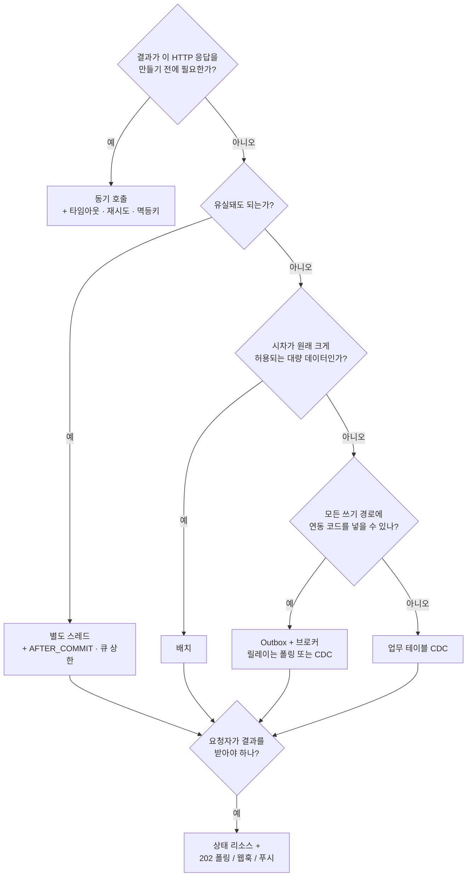

주문 API에서 알림 발송을 응답 뒤로 빼면 응답이 빨라진다. 그런데 주문을 저장한 직후 서버가 죽으면, 아직 보내지 못한 알림은 누가 다시 보낼까? 같은 메시지가 두 번 가면? "주문 취소"가 "주문 생성"보다 먼저 처리되면?

응답 시간을 줄인 대가로 이런 질문을 떠안는다. 공부하면서 정리한 내용을 왜 하는지부터 방식별 트레이드오프까지 한 번에 묶어 봤다.

> [!summary] 결론부터
> **"지금 이 HTTP 응답을 만들기 전에 결과가 필요한가?"** 필요 없으면 비동기로 뺄 수 있다. 빼는 순간 기본값은 at-least-once가 되니, **유실은 Outbox 같은 영속 저장소로 막고 중복은 받는 쪽 멱등 처리로 흡수한다**. 코루틴·리액티브·가상 스레드는 스레드를 아껴 줄 뿐 유실·중복과는 상관없다.

## 0. 용어부터: 비동기는 두 층, 두 축에서 쓰인다

"비동기"라는 말이 서로 다른 두 층에서 쓰여서 대화가 자주 엇갈린다.

| 층 | 여기서 "비동기"의 뜻 | ex) | 주로 다루는 문제 |
|---|---|---|---|
| 코드 실행 (프로세스 안) | 호출이 결과 대신 Future·콜백·중단 지점(suspend)을 돌려주고, 결과는 나중에 받는다 | `CompletableFuture`, 코루틴, Reactor | 스레드·컨텍스트·디버깅 |
| 시스템 연동 (프로세스 밖) | API 서버가 작업 완료를 기다리지 않고, 접수만 한 뒤 클라이언트에 응답한다 | 메시지 큐, Outbox, 배치, 202 Accepted | 유실·중복·순서·일관성 |

코드 실행 층에는 축이 하나 더 있다. 동기/비동기는 결과를 언제, 어떻게 받느냐의 문제이고, 블로킹/논블로킹은 기다리는 동안 스레드를 붙잡아 두느냐의 문제다. **두 축은 따로 움직인다.** ex) `Future.get()`은 비동기로 시작해 놓고 블로킹으로 기다린다. 가상 스레드 위의 JDBC 호출은 코드만 보면 동기·블로킹인데, 기다리는 동안 OS 스레드를 반납한다.

코드 실행 층에서 얻는 건 자원 효율이고, **유실·중복 같은 신뢰성 문제는 대부분 시스템 연동 층에서 생긴다**. ==코루틴으로 바꿨다고 메시지가 덜 사라지지는 않는다.==

## 1. 왜 비동기로 하는가

| 상황                           | 비동기로 얻는 것                   | ex)                     |
| ---------------------------- | --------------------------- | ----------------------- |
| 응답에 꼭 필요 없는 부수 작업이 응답 경로에 있음 | 응답 시간 단축                    | 주문 후 알림, 포인트 적립, 검색 색인  |
| 연동 대상이 자주 느리거나 실패함           | 장애 격리: 연동 실패가 기능 실패로 번지지 않음 | 푸시 서버 장애에도 주문은 성공       |
| 유입이 순간적으로 처리량을 넘음            | 부하 평탄화: 버퍼가 피크를 흡수          | 이벤트 오픈 때 포인트 지급 폭주      |
| 같은 사건에 반응할 곳이 계속 늘어남         | 확장: 생산자 코드를 안 고치고 구독자만 추가   | "주문함" 이벤트를 정산·추천·통계가 구독 |
| 작업이 HTTP 타임아웃보다 오래 걸림        | 긴 작업 처리: 접수만 하고 응답, 결과는 나중에 | 리포트 생성, 동영상 인코딩         |
| 스레드 대부분이 IO 대기로 놀고 있음        | 자원 효율: 대기 중에 스레드를 반납        | 외부 API를 많이 부르는 게이트웨이    |

비동기로 빼면 **"요청은 성공했는데 작업은 아직(또는 끝내) 안 된" 상태**가 생긴다. 약간의 시차가 생겨도 되는지, 실패하면 재시도하거나 나중에 수동으로 처리하거나 무시할 수 있는지 물어서 "예"가 하나도 없으면 동기로 둔다.

앞에서 말한 기준이 여기서 쓰인다. **응답을 만들기 전에 결과가 필요하면 동기로 두고**, 타임아웃·재시도·멱등키로 그 호출을 안전하게 만든다. ex) 결제 화면에서 승인 성공/실패를 바로 보여줘야 하는 결제 API. **결과가 필요하긴 한데 응답 뒤에 필요하다면 비동기로 뺄 수 있다**. ex) 결제 승인 이벤트를 받아 주문을 확정하고, 그동안 사용자에게는 "결제 확인 중" 상태를 보여준다.

## 2. 비동기에서 반복되는 문제와 해법

동기 호출에도 결과를 모르는 순간은 있다. 상대가 처리한 뒤 응답만 유실되면 호출자는 타임아웃을 받고도 성공했는지 알 수 없다. 그래도 동기에서는 호출자가 그 자리에서 판단하고 재시도할 수 있다. 비동기에서는 작업이 호출자 손을 떠나기 때문에, **작업이 지금 어디 있고 몇 번, 어떤 순서로 처리됐는지를 따로 설계해야 한다**.

| # | 문제 | 왜 생기나 | 보통의 해법 |
|---|---|---|---|
| ① | 유실 | 작업이 메모리에만 있다가 프로세스가 죽음 | 영속 저장소(브로커·DB)에 보관 |
| ② | 이중 쓰기 | DB 커밋과 메시지 발행이 원자적이지 않음 | Transactional Outbox, CDC |
| ③ | 중복 | 재시도·재전달 때문에 같은 메시지가 또 옴 | 소비자 멱등 처리 |
| ④ | 순서 역전 | 여러 소비자가 병렬 처리, 재시도로 앞지름 | 키 단위 순서(파티션 키) + 버전 |
| ⑤ | 실패와 독 메시지 | 계속 실패하는 메시지가 뒤를 막음 | 백오프+지터 재시도, DLQ |
| ⑥ | 적체 | 유입 > 처리량, 큐가 문제를 숨김 | 가장 오래된 메시지 나이 모니터링 |
| ⑦ | 결과 전달·멈춘 작업 | 요청자는 결과를 모르고, 처리 중 죽은 작업은 방치됨 | 상태 리소스, 임대(lease)와 회수 |
| ⑧ | 되돌릴 수 없음 | 여러 단계가 하나의 트랜잭션이 아님 | 사가, 보상 트랜잭션 |
| ⑨ | 컨텍스트·추적 단절 | 스레드·프로세스가 바뀌면 ThreadLocal이 안 넘어감 | 컨텍스트 전파, traceparent |
| ⑩ | 설계 밖 불일치 | 버그·수동 작업·재시도 한도 초과 | 대사(reconciliation) |

### ① 유실과 ② 이중 쓰기

`@Async`나 스레드 풀은 작업을 프로세스 메모리 큐에 둔다. 배포, OOM, kill 시점에 대기 중이던 작업은 **기록도 없이 사라진다**. 유실을 허용할 수 없다면 브로커나 DB 같은 영속 저장소에 작업을 기록해야 한다.

브로커를 쓰더라도 "DB 커밋 → 브로커 전송" 사이에 죽으면 이벤트가 빠진다. 순서를 뒤집으면 없는 주문의 이벤트가 나간다. 흔히 쓰는 해법은 **보낼 메시지를 업무 데이터와 같은 트랜잭션으로 Outbox 테이블에 넣고**, 릴레이가 따로 발행하게 하는 것이다.

### ③ 중복: 정확히 한 번은 범위가 좁다

릴레이가 전송한 뒤 완료 표시를 하기 전에 죽으면 다시 보낸다. 소비자가 처리한 뒤 offset을 커밋하기 전에 죽어도 다시 받는다. 비동기 연동의 기본값이 at-least-once인 이유다. ==받는 쪽이 멱등해야 한다.== 메시지 ID를 처리 이력 테이블에 UNIQUE로 남기거나, `WHERE status = 'PENDING'` 같은 조건부 UPDATE를 쓰거나, 누적(`+ n`) 대신 다시 계산해서 덮어쓴다.

Kafka 트랜잭션의 exactly-once도 **Kafka 안(읽기 → 처리 → 쓰기)에서만 성립한다**. DB나 외부 API까지 걸치면 다시 at-least-once로 돌아온다. 웹훅도 다르지 않아서, Stripe는 같은 이벤트가 두 번 이상 올 수 있으니 이벤트 ID로 중복을 거르라고 안내한다.

### ④ 순서 역전

전체 순서를 지키려 들면 비싸다. 그리고 대부분은 그럴 필요도 없다. 순서가 필요한 범위는 보통 **"같은 주문 안"처럼 업무 단위 하나**다. 주문 ID를 메시지 키로 쓰면 같은 파티션에 들어가서, 같은 주문의 이벤트는 순서대로, 다른 주문끼리는 병렬로 처리된다.

이벤트가 그 시점의 **전체 상태**(ex. "주문 상태 = 취소, 버전 5")를 담고 있다면 가진 것보다 낮은 버전은 버려도 된다. 다만 "포인트 +10" 같은 **증분 이벤트에서 낮은 버전을 버리면 변경이 빠지니**, 순서대로 적용하거나 원본에서 다시 읽어야 한다.

### ⑤ 실패와 ⑥ 적체

**재시도는 멱등할 때만** 하고, 간격은 지수 백오프에 상한과 지터를 둔다. 바로 다시 하면 또 실패하고, 다 같이 다시 하면 재시도 폭풍이 된다. N번 실패한 메시지는 DLQ로 옮겨 메인 큐를 막지 않게 한다. AWS는 DLQ에 메시지가 하나라도 들어오면 알람을 건다. DLQ에 들어왔다면 어딘가 버그가 있다고 보는 것이다.

큐는 내구성을 주는 대신 문제를 늦게 드러낸다. 장애로 한 시간 쌓인 백로그를 한 시간 안에 비우려면 **평소의 두 배 용량**이 필요하다. 생산자 지연이나 에러율보다 **큐에 있는 가장 오래된 메시지의 나이**를 봐야 뒤처지는 걸 일찍 안다. 상한 없는 메모리 큐는 적체를 OOM으로 바꿔 놓으니 큐 상한과 거부 정책도 정해 둔다.

### ⑦ 결과 전달과 멈춘 작업

요청자는 작업이 끝났는지 모른다. `PENDING`, `RUNNING`, `SUCCEEDED`, `FAILED` 같은 **상태를 리소스로 드러내고**, `createdAt`, `lastUpdatedAt`를 같이 줘서 멈춘 작업과 진행 중인 작업을 구분하게 한다. "아직 반영 안 됨"을 `null`로 뭉개면 호출자는 "없음"과 "아직"을 구분하지 못한다.

처리 중에 워커가 죽으면 작업이 `RUNNING`에 멈춘다. 재전달된 메시지는 "이미 RUNNING"이라 무시되니 아무도 다시 하지 않는다. 작업을 잡을 때 **실행 토큰과 임대 시간(lease)**을 걸고, 임대가 지난 작업을 `PENDING`으로 되돌려 다시 발행하는 스케줄러를 둔다. 완료 처리에도 토큰을 확인해야, 임대를 넘긴 느린 워커가 새로 잡은 실행을 덮어쓰지 않는다.

### ⑧ 되돌릴 수 없음: 사가와 보상

여러 서비스에 걸친 작업은 한 트랜잭션으로 묶을 수 없으니 로컬 트랜잭션을 이어 붙인 사가로 짜고, 중간에 실패하면 이미 끝난 단계를 보상한다. 보상을 롤백으로 생각하기 쉬운데, 실제로는 완료된 단계의 **업무 효과를 업무 규칙에 맞게 상쇄하는 작업**에 가깝다. ex) 결제를 취소하고 환불을 실행한다. 보상도 실패하고 재시도되니 멱등하게 만들어야 하고, 실패할 수 있는 검증(재고, 한도)을 **되돌릴 수 없는 단계(외부 결제)보다 먼저** 끝내 두면 보상할 일 자체가 줄어든다.

### ⑨ 컨텍스트와 추적의 단절

작업이 다른 스레드로 넘어가면 ThreadLocal에 있던 트랜잭션, MDC(로그 traceId), **SecurityContext가 따라가지 않는다**. 비동기 작업은 원래 트랜잭션 밖에서 돌기 때문에 `@TransactionalEventListener(AFTER_COMMIT)`로 커밋이 끝난 뒤에 넘기고, 로그·인증 컨텍스트는 Spring의 `ContextPropagatingTaskDecorator` 같은 장치로 복원한다. 프로세스를 넘어가면 메시지 헤더에 W3C Trace Context의 `traceparent`를 실어 같은 trace로 잇는다.

### ⑩ 설계 밖 불일치: 대사

유실과 중복을 아무리 막아도 버그, 수동 데이터 수정, 재시도 한도 초과는 설계 밖에서 생긴다. 마지막 방어선으로 **원본과 대상을 주기적으로 비교하는 대사**를 둔다. 규칙으로 판단할 수 있는 것만 자동 보정하고 나머지는 알람으로 넘긴다.

## 3. 비동기 처리 방식과 트레이드오프

방식을 고를 때 질문은 셋이다. 프로세스 안에서 기다리는 동안 스레드를 어떻게 쓸지(**실행 모델**), 시스템 사이에서 작업을 어디에 보관하고 넘길지(**연동 방식**), 요청자에게 결과를 어떻게 돌려줄지(**결과 전달**)다. 이 셋은 같이 쓴다. ex) 코루틴으로 짠 API가 Outbox로 작업을 넘기고 202+폴링으로 결과를 돌려줄 수 있다.

### 3-1. 프로세스 안: 실행 모델

| 방식 | 장점 | 비용·함정 | 맞는 곳 |
|---|---|---|---|
| 스레드 풀 + Future (`@Async`, `CompletableFuture`) | 익숙함, 추가 인프라 없음 | 블로킹하는 동안 스레드 점유, 큐 상한·거부 정책 필요 | 부수 작업 몇 개를 응답 경로에서 빼기 |
| 리액티브 (Reactor, WebFlux) | 적은 스레드로 많은 연결, `request(n)`으로 배압 내장 | 이벤트 루프에서 블로킹하면 전체가 멈춤(별도 스케줄러로 격리 필요), 학습 곡선, 끊긴 스택 트레이스 | 연결 수가 매우 많은 IO 중심 서버, 스트리밍 |
| 코루틴 (Kotlin) | 순차 코드처럼 읽힘, 구조화된 동시성으로 실패·취소가 트리로 전파 | `suspend`가 호출 체인 전체로 번짐, 블로킹 라이브러리는 `Dispatchers.IO`로 격리 | Kotlin 서버에서 여러 IO를 병렬로 묶을 때 |
| 가상 스레드 (JDK 21+) | 기존 동기 코드 그대로 IO 대기 스레드 한계 해소 | 빨라지지는 않음(처리량만 증가), 풀링하지 말 것, JDK 21은 `synchronized` pinning 주의 | 블로킹 코드베이스에서 스레드 부족이 병목일 때 |

먼저 병목이 정말 **IO 대기 때문에 생긴 스레드 부족인지** 확인한다. DB 쿼리가 느린 거라면 실행 모델을 바꿔도 소용없다. 블로킹 코드베이스라면 코드를 거의 안 고쳐도 되는 가상 스레드부터 검토하고, 연결 수가 수만 단위이거나 스트림 배압이 필요할 때 리액티브를 고려한다.

> [!warning] 실행 모델은 유실을 막지 않는다
> 넷 다 작업을 프로세스 메모리에 두기 때문에, 프로세스가 죽으면 진행 중이던 작업도 같이 사라진다. 유실이 문제라면 3-2의 영속 방식과 같이 써야 한다.

### 3-2. 시스템 사이: 연동 방식

다섯 방식을 가르는 건 **보낼 작업을 어디에 보관하느냐**다. 거기서 유실 범위와 운영 부담이 정해진다.

| | 별도 스레드 | 메시징 직접 전송 | Outbox | 배치 | CDC |
|---|---|---|---|---|---|
| 작업 보관 위치 | 프로세스 메모리 | 브로커 (전송 성공 후) | 업무 DB | 업무 DB (원본 그대로) | DB 변경 로그 |
| 커밋 후 크래시 시 | 유실 | 유실 가능 (전송 전이면) | 보존 | 보존 | 보존 |
| 지연 | 매우 짧음 | 짧음 | 폴링 주기 | 배치 주기 | 짧음 |
| 앱 코드 변경 | 호출부 | 호출부 | 모든 쓰기 경로 | 거의 없음 | 거의 없음 |
| 운영 부담 | 낮음 | 중간 | 중간 | 낮음~중간 | 높음 |
| 맞는 곳 | 유실돼도 되는 부가 기능 | 소비자가 여럿, 느슨한 결합 | 유실되면 안 되는 업무 이벤트 | 시차가 원래 허용된 대량 데이터 | 쓰기 경로가 많은 레거시, 데이터 복제 |

별도 스레드는 추가 인프라 없이 코드 몇 줄로 끝나지만, 큐가 메모리에 있어서 프로세스가 죽으면 작업이 사라진다. `@Async`는 프록시 방식이라 **같은 클래스 안에서 호출하면 비동기로 돌지 않는데**, 이건 생각보다 자주 놓친다.

메시징은 브로커가 두 시스템 사이의 버퍼가 되어서 소비자가 느려지거나 죽어도 생산자는 영향을 덜 받는다. 새 소비자는 토픽을 구독하기만 하면 된다. 이 확장성은 메시지가 **"주문함" 같은 이벤트일 때 커진다**. "포인트 지급해" 같은 커맨드는 생산자가 여전히 수신자를 안다는 뜻이라 결합이 남는다. 대가는 이중 쓰기, 중복, 그리고 브로커 운영이다.

Outbox는 메시지를 업무 데이터와 같은 트랜잭션으로 저장하고 릴레이가 따로 보낸다.

이미지 출처: [microservices.io: Pattern: Transactional outbox](https://microservices.io/patterns/data/transactional-outbox.html)
볼 것: 서비스는 브로커에 직접 쓰지 않는다. DB 트랜잭션 하나에 업무 테이블과 outbox가 같이 묶이고, 브로커 전송은 Message Relay가 맡는다.

**커밋되면 보낼 근거가 반드시 남고, 롤백되면 메시지도 같이 사라진다**. 대신 중복 발행은 여전히 가능하고, 폴링 주기만큼 지연되며, 모든 쓰기 경로가 outbox INSERT를 빠짐없이 해야 한다. 쓰기 경로가 많은 레거시라면 이게 제일 어렵다.

배치는 정해진 주기마다 쌓인 데이터를 한꺼번에 보낸다. 원본이 업무 DB에 그대로 있어서 실패하면 같은 범위를 다시 돌리면 되지만, 지연이 곧 주기이고 부하가 한 시점에 몰린다. `updated_at` 기준으로 조회하면 **늦게 커밋된 트랜잭션과 물리 삭제**도 놓친다.

CDC는 DB 변경 로그(MySQL binlog, PostgreSQL WAL)를 읽어 전파한다. 어느 경로로 썼든 커밋된 변경은 모두 잡는다. 하지만 **행 변경과 업무 이벤트는 다르다**. `orders.status`가 바뀐 것과 "주문 취소됨"은 같은 말이 아니고, 업무 테이블을 직접 CDC하면 내부 스키마가 외부 계약이 되어 버린다. 운영 부담도 가장 크다. 그래서 Outbox 테이블을 CDC로 읽어 릴레이로 삼는 조합이 흔하다. ex) Debezium의 Outbox Event Router.

### 3-3. 요청자에게 결과 돌려주기

작업은 오래 걸리는데 요청자가 결과를 받아야 할 때 쓴다.

이미지 출처: [Azure Architecture Center: Asynchronous Request-Reply pattern](https://learn.microsoft.com/en-us/azure/architecture/patterns/async-request-reply)
볼 것: POST는 202만 받고 끝난다. 그 뒤로는 상태 엔드포인트를 GET으로 확인하다가, 완료되면 303 See Other를 따라 결과 리소스로 간다.

| 방식 | 장점 | 비용·함정 | 맞는 곳 |
|---|---|---|---|
| 202 + 폴링 | 가장 단순, 클라이언트 제약 없음 | 결과 지연 = 폴링 간격, 불필요한 요청 | 브라우저·모바일, 트래픽이 크지 않을 때 |
| 웹훅 (서버 → 서버) | 즉시 통지, 폴링 부하 없음 | 공개 엔드포인트·서명 검증 필요, 중복·순서 역전 전제 | PG·외부 서비스 연동 |
| WebSocket / SSE (서버 → 클라이언트) | 실시간, 진행률 표시 | 연결 유지 비용, 서버를 늘리면 연결 위치 문제 | 진행률 표시, 폴링 부하가 큰 대규모 |

202를 돌려주기 전에 요청 검증은 끝내고, **POST에는 멱등키**를 받는다. 클라이언트 입장에선 응답이 유실된 건지 요청이 안 간 건지 알 길이 없다. 웹훅을 받는 쪽은 서명 검증, 저장, 2xx 응답, 업무 처리 순서로 간다. ==2xx를 저장보다 먼저 보내면 그 사이에 죽었을 때 이벤트가 그대로 사라진다.== 트래픽이 적다면 폴링으로 충분하고, 푸시는 폴링 부하가 실제로 문제가 될 때 고른다.

## 4. 언제 무엇을 고를까

볼 것: 아래로 갈수록 유실에 강해지는 대신 운영 부담이 커진다. 어느 길로 가든 결과 전달 질문은 거치고, 멱등 소비자와 대사도 따라온다.

처음부터 다 갖출 필요는 없다. **유실 비용이 커지는 만큼** 별도 스레드 → 메시징 → Outbox 순으로 옮겨 가면 된다. 실행 모델(3-1)은 이 흐름과 따로, 스레드가 부족한지를 보고 고른다.

## 5. 비동기를 도입하기 전 점검표

- [ ] 작업이 어디에 보관되는가? 프로세스가 죽으면 어떻게 되는가?
- [ ] DB 커밋과 발행 사이에 크래시 구간이 있는가?
- [ ] 소비자가 같은 메시지를 두 번 받아도 안전한가?
- [ ] 순서가 필요한 범위는? 그 범위의 키를 메시지 키로 쓰는가?
- [ ] 재시도 간격·지터, DLQ, DLQ 알람이 있는가?
- [ ] 가장 오래된 메시지 나이를 보고 있는가?
- [ ] 요청자가 "아직"과 "실패"를 구분할 수 있는가?
- [ ] 처리 중에 죽은 작업을 누가 되찾는가?
- [ ] 원본과 대상을 대조하는 대사가 있는가?

## 마치며

==비동기로 빼도 기다림은 응답 경로 밖으로 옮겨 갈 뿐 사라지지 않는다.== 응답 시간과 장애 격리를 얻은 만큼 "아직 안 끝난 상태"와 거기서 생기는 재시도·중복·순서·복구는 직접 챙겨야 한다. 한 번에 다 바꾸기보다, 그 비용을 감당할 수 있는 작업부터 하나씩 떼어 내 보면 어떨까?

## 참고 자료
- [Azure Architecture Center: Asynchronous Request-Reply pattern](https://learn.microsoft.com/en-us/azure/architecture/patterns/async-request-reply)
- [Azure Architecture Center: Compensating Transaction pattern](https://learn.microsoft.com/en-us/azure/architecture/patterns/compensating-transaction)
- [AWS Builders' Library: Avoiding insurmountable queue backlogs](https://builder.aws.com/content/3EuRcgkTP1MI0c7zM8W6HL3WIqA/avoiding-insurmountable-queue-backlogs)
- [Stripe: Receive Stripe events in your webhook endpoint](https://docs.stripe.com/webhooks)
- [microservices.io: Pattern: Transactional outbox](https://microservices.io/patterns/data/transactional-outbox.html)
- [우아한형제들 기술블로그: 회원시스템 이벤트기반 아키텍처 구축하기](https://techblog.woowahan.com/7835/)
- [Debezium: Outbox Event Router](https://debezium.io/documentation/reference/stable/transformations/outbox-event-router.html)
- [Spring Framework: @Async](https://docs.spring.io/spring-framework/reference/integration/scheduling.html#scheduling-annotation-support-async)
- [Spring Framework: ContextPropagatingTaskDecorator](https://docs.spring.io/spring-framework/docs/current/javadoc-api/org/springframework/core/task/support/ContextPropagatingTaskDecorator.html)
- [Spring for Apache Kafka: Tips](https://docs.spring.io/spring-kafka/reference/tips.html)
- [Project Reactor: How do I wrap a synchronous, blocking call?](https://projectreactor.io/docs/core/release/reference/faq.html#faq.wrap-blocking)
- [W3C: Trace Context](https://www.w3.org/TR/trace-context/)
- [Reactive Streams: README](https://github.com/reactive-streams/reactive-streams-jvm/blob/master/README.md)
- [Kotlin: Coroutines basics](https://kotlinlang.org/docs/coroutines-basics.html)
- [JEP 444: Virtual Threads](https://openjdk.org/jeps/444)
- [RFC 9110: HTTP Semantics](https://www.rfc-editor.org/rfc/rfc9110)
